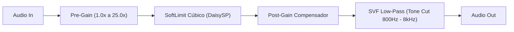

# DSP Algorithm Design: Pedaleira Digital (STM32H723 + DaisySP)

Este guia estabelece os padroes obrigatorios de engenharia para concepcao, implementacao e otimizacao de algoritmos de processamento digital de sinal (DSP) em C++17 para a **Pedaleira Digital**, baseada no microcontrolador STM32H723VGT6 (ARM Cortex-M7 @ 550 MHz) e codec Cirrus Logic CS4272.

---

## 1. Visao Geral da Arquitetura de Audio

O pipeline de processamento opera com fluxo estéreo de 24 bits / 48 kHz via barramento SAI4 acoplado a DMA circular em modo ping-pong (Half-Transfer / Transfer-Complete Interrupts):

- **Frequencia de Amostragem ($f_s$)**: 48.000 Hz.
- **Periodo de Amostragem ($T_s$)**: 20,833 µs.
- **Tamanho do Bloco DMA**: Tipicamente 32 a 64 amostras por canal por interrupcao.
- **Orcamento de CPU por Amostra**: A 550 MHz, cada amostra dispoe de **11.458 ciclos de clock**. O conjunto total da cadeia DSP (Overdrive + EQ + Delay + Crossfade) deve consumir estritamente **menos de 25% da CPU** (< 2.864 ciclos por amostra).

---

## 2. Invariante 1: Normalizacao de Ponto Flutuante `[-1.0f, +1.0f]`

Todo processamento interno dos efeitos opera estritamente com numeros de ponto flutuante de precisao simples (`float`) normalizados na faixa fechada `[-1.0f, +1.0f]`:

1. **Entrada do Codec (ADC -> Float)**:
   - Amostras brutas de 24 bits alinhadas em inteiros de 32 bits com sinal (`int32_t`) sao convertidas para `float` pela divisao pela constante de escala $2^{23}$ ($8.388.608,0\text{f}$ ou $2^{31}-1$ dependendo do alinhamento SAI):
   ```cpp
   float sampleIn = static_cast<float>(rawSample) / 8388608.0f;
   ```
2. **Processamento DSP**:
   - Cada efeito assume entradas no intervalo nominal $[-1.0\text{f}, +1.0\text{f}]$.
   - Valores intermediarios podem exceder temporariamente o limite (headroom interno de ponto flutuante IEEE 754), mas devem ser atenuados ou limitados suavemente antes da saida.
3. **Saida para o Codec (Float -> DAC)**:
   - O sinal final deve passar por `fclamp(outVal, -1.0f, 1.0f)` antes de ser multiplicado por $8388607.0\text{f}$ e convertido para `int32_t`, eliminando estalos por wrap-around aritmetico:
   ```cpp
   float clamped = fclamp(processedSample, -1.0f, 1.0f);
   int32_t rawOut = static_cast<int32_t>(clamped * 8388607.0f);
   ```

---

## 3. Invariante 2: Zero Alocacao Dinamica (`zero-dynamic-allocation`)

E terminantemente proibido qualquer uso de alocacao dinamica de memoria no caminho critico de audio:
- **Proibido**: `malloc()`, `free()`, `new`, `delete`, `std::vector`, `std::string`, `std::function`, ou smart pointers que realizem alocacoes de heap.
- **Obrigatorio**: Toda memoria de buffers de retardo, estados de filtros e coeficientes deve ser pre-alocada como membros de classe alocados estaticamente na secao BSS da AXI SRAM ou DTCM.
- **Buffers Estaticos**:
  - Buffer de Delay (`DspDelay.hpp`):
    ```cpp
    #define dDSP_DELAY_MAX_SAMPLES 48000U // 1.0 segundo a 48 kHz
    float delayBuffer_[dDSP_DELAY_MAX_SAMPLES]; // 192 KB estatico
    ```

---

## 4. Biblioteca Matematica de Audio (`DspMath.hpp`)

O arquivo [`DspMath.hpp`](file:///home/rodrigues/Pedaleira-digital/firmware/stm32/Core/Inc/DspMath.hpp) centraliza operacoes matematicas sem dependencia de bibliotecas pesadas de terceiros:

### 4.1. Limitador de Faixa (`fclamp`)
```cpp
inline float fclamp(float inVal, float minVal, float maxVal)
{
    if(inVal < minVal)
    {
        return minVal;
    }
    else if(inVal > maxVal)
    {
        return maxVal;
    }
    else
    {
        return inVal;
    }
}
```

### 4.2. Saturador Suave Polinomial DaisySP (`SoftLimit`)
Substitui aproximacoes pesadas com $\tanh(x)$ por um polinomio racional estavel de 3a ordem com saturacao perfeita em $\pm 1.0\text{f}$:
$$y(x) = \begin{cases} -1.0, & x \le -3.0 \\ 1.0, & x \ge +3.0 \\ \frac{x \cdot (27 + x^2)}{27 + 9x^2}, & -3.0 < x < +3.0 \end{cases}$$

```cpp
inline float SoftLimit(float inVal)
{
    if(inVal <= -3.0f)
    {
        return -1.0f;
    }
    else if(inVal >= 3.0f)
    {
        return 1.0f;
    }
    else
    {
        return (inVal * (27.0f + (inVal * inVal))) / (27.0f + (9.0f * inVal * inVal));
    }
}
```

### 4.3. Ceifamento Cubico (`SoftClip`)
Equacao tradicional de overdrive simetrico: $y(x) = x - \frac{x^3}{3}$ para $|x| < 1$:
```cpp
inline float SoftClip(float inVal)
{
    if(inVal <= -1.0f)
    {
        return -0.66666667f;
    }
    else if(inVal >= 1.0f)
    {
        return 0.66666667f;
    }
    else
    {
        return inVal - ((inVal * inVal * inVal) * 0.33333333f);
    }
}
```

---

## 5. Filtros de Variavel de Estado - SVF (`DspSvf`)

O modulo [`DspSvf`](file:///home/rodrigues/Pedaleira-digital/firmware/stm32/Core/Inc/DspSvf.hpp) implementa a topologia State Variable Filter da biblioteca DaisySP.

### Vantagens Arquiteturais
- **Multi-saida simultanea**: Calcula em uma unica passada as respostas Passa-Baixas (`Low`), Passa-Altas (`High`), Passa-Faixa (`Band`), Rejeita-Faixa (`Notch`) e Pico (`Peak`).
- **Estabilidade numerica superior**: Nao apresenta estouro por denormais ou polos instaveis comuns em topologias Direct-Form biquad quando a frequencia varia em tempo real.

### Equacoes de Estado (Bilinear / Euler Integrado)
```cpp
// Calculo de coeficientes na configuracao
float g = std::tan(dDSP_PI * (freq_ / sampleRate_));
float damping = 1.0f / res_; // res = Q do filtro
float h = 1.0f / (1.0f + 2.0f * damping * g + g * g);

// Na funcao Process(float inVal):
float hp = (inVal - (2.0f * damping + g) * stateBand_ - stateLow_) * h;
float bp = g * hp + stateBand_;
stateBand_ = g * hp + bp;
float lp = g * bp + stateLow_;
stateLow_ = g * bp + lp;

outLow_   = lp;
outHigh_  = hp;
outBand_  = bp;
outNotch_ = hp + lp;
outPeak_  = lp - hp;
```

### Regras de Validacao
- A frequencia de corte deve ser limitada entre `20.0f` Hz e `0.49f * sampleRate` (Nyquist safety).
- O amortecimento (`damping`) nunca deve ser nulo para evitar oscilacao infinita descontrolada (`min_damping = 0.001f`).

---

## 6. Equalizador de 3 Bandas (`DspEqualizer`)

O equalizador [`DspEqualizer`](file:///home/rodrigues/Pedaleira-digital/firmware/stm32/Core/Inc/DspEqualizer.hpp) divide o espectro tonal da guitarra eletrica em tres bandas padronizadas:

1. **Bass (Grave)**: $100\text{ Hz}$ (Filtro Shelving Passa-Baixas SVF).
2. **Mid (Medio)**: $1.000\text{ Hz}$ com $Q = 1,4$ (Filtro Peaking SVF).
3. **Treble (Agudo)**: $4.000\text{ Hz}$ (Filtro Shelving Passa-Altas SVF).

### Conversao Decibel para Linear
Os parametros recebidos via protocolo serial ou MQTT variam de $-12\text{ dB}$ a $+12\text{ dB}$:
$$\text{gain}_{\text{linear}} = 10^{\frac{\text{gain}_{\text{dB}}}{20.0}}$$

---

## 7. Overdrive Valvulado (`DspOverdrive`)

O bloco [`DspOverdrive`](file:///home/rodrigues/Pedaleira-digital/firmware/stm32/Core/Inc/DspOverdrive.hpp) emula a resposta de amplificadores valvulados e pedais de ganho classico (TS-9 / Klon):



1. **Pre-Gain**: Multiplicador linear proporcional ao knob de Drive ($0$ a $100\% \rightarrow 1{,}0\times$ a $25{,}0\times$).
2. **Nao-Linearidade**: A funcao `SoftLimit()` comprime a amplitude e insere harmônicos impares de 3a e 5a ordem de forma simetrica.
3. **Filtro de Tom**: O estagio de tone utiliza um `DspSvf` em modo passa-baixas para eliminar a aspereza digital (*fizz*) acima de $4\text{ kHz}$.

---

## 8. Linha de Retardo Digital (`DspDelay`)

O efeito de retardo [`DspDelay`](file:///home/rodrigues/Pedaleira-digital/firmware/stm32/Core/Inc/DspDelay.hpp) utiliza um buffer circular com interpolacao linear:

- **Faixa de Tempo**: $20\text{ ms}$ a $1.000\text{ ms}$ ($960$ a $48.000$ amostras a $48\text{ kHz}$).
- **Feedback Maximo**: Limitado rigidamente a $0{,}95$ ($95\%$) no header para impedir auto-oscilacao destrutiva:
  ```cpp
  #define dDSP_DELAY_MAX_FEEDBACK 0.95f
  ```
- **Interpolacao Fracionaria**: Permite modular o tempo de atraso sem artefatos sonoros (*zipper noise*):
  ```cpp
  float frac = readPos - static_cast<float>(idxA);
  float sampleOut = (1.0f - frac) * buffer[idxA] + frac * buffer[idxB];
  ```

---

## 9. Prevencao de Estalos: Crossfade Anti-Pop (`DspCrossfade`)

A comutacao de efeitos (ligar/desligar bypass) no meio de uma forma de onda senoidal causa um degrau abrupto de tensao DC, gerando estalos audiveis (*pops* ou *clicks*).

O modulo [`DspCrossfade`](file:///home/rodrigues/Pedaleira-digital/firmware/stm32/Core/Inc/DspCrossfade.hpp) implementa a transicao gradual entre o sinal seco (`inA` - Dry) e o sinal processado (`inB` - Wet):

- **Taxa de Incremento**: `dDSP_CROSSFADE_DEFAULT_STEP = 0.002f`. A 48 kHz, a transicao completa ($0{,}0 \rightarrow 1{,}0$) leva exatamente **500 amostras ($\approx 10{,}4\text{ ms}$)**, perfeitamente inaudivel ao ouvido humano e imperceptivel em termos de latência.
- **Curva Potencia Constante (Constant Power)**:
  Para evitar a queda de $3\text{ dB}$ no meio da transicao linear:
  $$\text{gain}_A = \cos\left(\text{pos} \cdot \frac{\pi}{2}\right), \quad \text{gain}_B = \sin\left(\text{pos} \cdot \frac{\pi}{2}\right)$$

---

## 10. Padrao de Formatacao e Estilo ASSERT Capacita v1.0

Todo novo algoritmo C++ ou efeito deve atender estritamente aos padroes auditados pelo Quality Gate:

1. **7-bit ASCII Puro**: Zero acentos, cedilhas ou caracteres especiais em comentarios e codigo.
2. **Formatacao Allman**: Abertura de chaves `{` obrigatoriamente em sua propria linha separada.
3. **Proibicao de Single-Line Blocks**: Proibido `if(x) return y;` ou `else return;`. Sempre utilizar bloco delimitado por chaves completas.
4. **Banners Obrigatorios**: O cabecalho `.hpp` deve conter exatamente as cinco secoes padrao:
   - `INCLUDES NECESSARIOS`
   - `CONFIGURACOES`
   - `DEFINES PUBLICOS`
   - `TIPOS DE DADOS PUBLICOS`
   - `PROTOTIPOS PUBLICOS`
5. **Autoria Padronizada**:
   ```cpp
   * @author Arthur Ramalho, Isabelle Lavinia, Joao Paulo, Rodrigues Matheus
   ```
