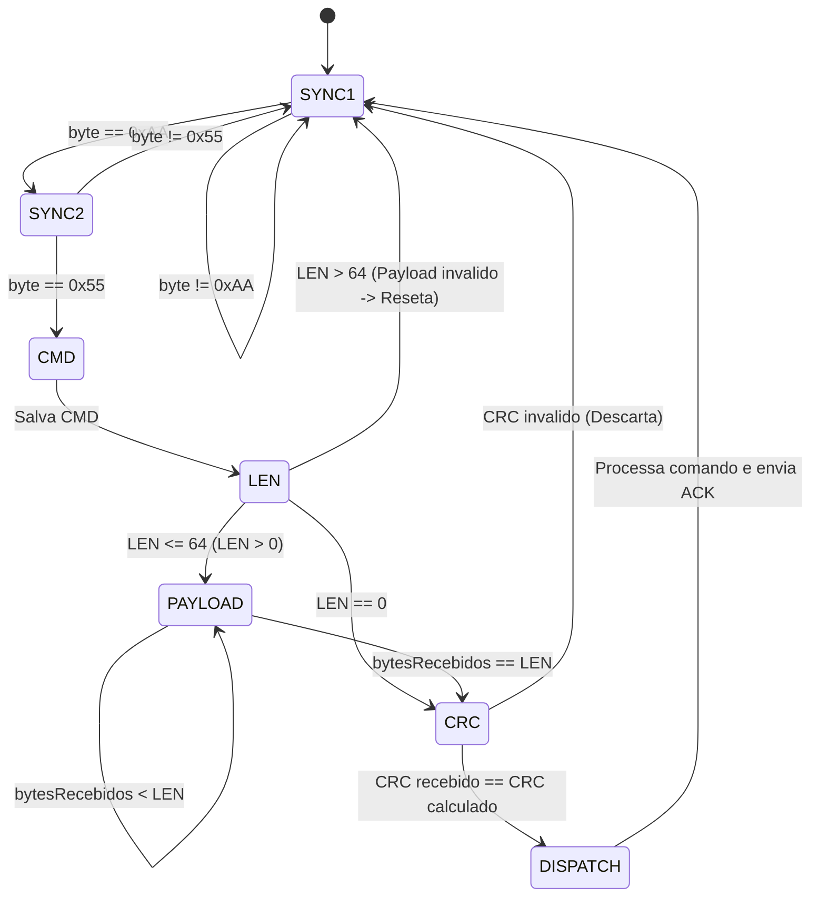

# Inter-MCU Serial Protocol Specification (STM32H723 <-> ESP32)

Este guia documenta o protocolo serial binario assincrono de baixa latencia e alta integridade implementado entre o microcontrolador DSP principal (**STM32H723VGT6**) e a ponte de comunicacao sem fio IoT (**ESP32 DevKit**).

---

## 1. Camada Fisica e Configuracao UART

A comunicacao ocorre em barramento UART dedicado sem necessidade de conversores de nivel logico:

| Parametro | Valor | Justificativa |
| :--- | :--- | :--- |
| **Baud Rate** | **115.200 bps** | Transmissao de pacote tipico (< 10 bytes) em menos de 1 ms com alta imunidade a ruido. |
| **Formato** | **8-N-1** (8 bits de dados, sem paridade, 1 stop bit) | Padrao universal sem overhead de enquadramento. |
| **Nivel Logico** | **3.3V LVCMOS** | Compatibilidade nativa entre ambos os MCUs. |
| **Pinout** | **STM32 PD8 (TX) -> ESP32 GPIO16 (RX2)**<br/>**STM32 PD9 (RX) <- ESP32 GPIO17 (TX2)** | Linhas cruzadas com GND comum de baixo retorno. |
| **Mecanismo de Recepcao** | **DMA Circular / Ring Buffer Interrupt** | Processamento desacoplado do loop critico de DSP. |

---

## 2. Estrutura do Frame Binario Determinístico

Para eliminar overhead de serializacao JSON/texto no STM32, os dados trafegam em pacotes binarios rigidamente tipados:

```
+------------+------------+---------+---------+------------------------+---------+
| SYNC_1     | SYNC_2     | CMD     | LEN     | PAYLOAD (0 a 64 bytes) | CRC8    |
| (1 byte)   | (1 byte)   | (1 byte)| (1 byte)| (N bytes)              | (1 byte)|
| 0xAA       | 0x55       | CMD_ID  | N <= 64 | Dados especificos      | CRC-8   |
+------------+------------+---------+---------+------------------------+---------+
```

### Campos do Quadro
1. **`SYNC_1` (`0xAA`)**: Primeiro byte de sincronismo fixo (padrao alternado `10101010b`).
2. **`SYNC_2` (`0x55`)**: Segundo byte de sincronismo fixo (padrao alternado `01010101b`).
3. **`CMD`**: Identificador do comando (`interMcuUartCmd_t`).
4. **`LEN`**: Tamanho do payload ($0 \le N \le 64$). Pacotes com $N > 64$ sao imediatamente rejeitados pela FSM.
5. **`PAYLOAD`**: Sequencia de $N$ bytes contendo identificadores de modulo, parametros ou dados brutos.
6. **`CRC8`**: Checksum CRC-8 CCITT calculado estritamente sobre a fatia `[CMD, LEN, PAYLOAD...]` (os bytes `SYNC_1` e `SYNC_2` sao excluidos do checksum).

---

## 3. Algoritmo de Verificacao de Integridade (CRC-8 CCITT)

O algoritmo utiliza o polinomio padrao ITU/CCITT $x^8 + x^2 + x + 1$ (representacao binaria `0x07` nao refletida) com valor inicial `0x00`:

### Implementacao de Referencia em C++ (`InterMcuUart.cpp`)
```cpp
u8 InterMcuUart::CalculateCrc8(const u8 *pData, u8 length)
{
    u8 crc = 0x00U;
    while(length > 0U)
    {
        crc ^= *pData++;
        for(u8 bit = 0U; bit < 8U; ++bit)
        {
            if((crc & 0x80U) != 0U)
            {
                crc = static_cast<u8>((crc << 1U) ^ dINTER_MCU_UART_CRC_POLY);
            }
            else
            {
                crc = static_cast<u8>(crc << 1U);
            }
        }
        length--;
    }
    return crc;
}
```

### Vetores de Teste Determinísticos
- **Vetor Vazio**: `CalculateCrc8(NULL, 0) == 0x00`
- **Heartbeat**: `[0x07, 0x00]` -> `CRC = 0x6B`
- **Ajuste Overdrive (Gain 75%)**: `[0x01, 0x03, 0x01, 0x01, 0x4B]` -> `CRC = 0xD0`
- **Switch Event (SW1 ON)**: `[0x04, 0x02, 0x01, 0x01]` -> `CRC = 0x9C`

---

## 4. Conjunto Padrao de Comandos (`interMcuUartCmd_t`)

| CMD (Hex) | Nome Enum | Direcao | Descricao | Estrutura Payload |
| :---: | :--- | :---: | :--- | :--- |
| `0x01` | `eINTER_MCU_UART_CMD_SET_PARAM` | ESP32 -> STM32 | Modifica parametro de audio contínuo | `[MODULE_ID, PARAM_ID, VALUE...]` |
| `0x02` | `eINTER_MCU_UART_CMD_GET_STATE` | ESP32 -> STM32 | Requisita estado completo do DSP | *Vazio* ($LEN = 0$) |
| `0x03` | `eINTER_MCU_UART_CMD_STATE_REPORT` | STM32 -> ESP32 | Resposta contendo o estado completo | `[FLAGS, DRIVE, TONE, LVL, BASS, MID, TREB, DTIME_L, DTIME_H, DFBK, DMIX]` |
| `0x04` | `eINTER_MCU_UART_CMD_SWITCH_EVENT` | STM32 -> ESP32 | Evento assincrono de acionamento de chave | `[SWITCH_ID, PHYSICAL_STATE]` |
| `0x05` | `eINTER_MCU_UART_CMD_ACK` | Ambos | Confirmacao de execucao com sucesso | `[ORIGINAL_CMD, STATUS_CODE]` |
| `0x06` | `eINTER_MCU_UART_CMD_NACK` | Ambos | Notificacao de erro (CRC ou comando invalido) | `[ORIGINAL_CMD, ERROR_CODE]` |
| `0x07` | `eINTER_MCU_UART_CMD_HEARTBEAT` | Ambos | Verificacao periodica de enlace ativo (Keep-Alive)| *Vazio* ($LEN = 0$) |

### Mapeamento de Modulos (`MODULE_ID`) e Parametros
- **Global (`0x00`)**: Master Volume (`0x01`), Master Bypass (`0x02`), Master Mute (`0x03`).
- **Overdrive (`0x01`)**: Enable (`0x00`), Drive (`0x01`, 0-100), Tone (`0x02`, 0-100), Level (`0x03`, 0-100).
- **Equalizador (`0x02`)**: Enable (`0x00`), Bass (`0x01`, -12 a +12 dB), Mid (`0x02`, -12 a +12 dB), Treble (`0x03`, -12 a +12 dB).
- **Delay (`0x03`)**: Enable (`0x00`), Time (`0x01`, 20-1000 ms, uint16 Little-Endian), Feedback (`0x02`, 0-95%), Mix (`0x03`, 0-100%).

---

## 5. Maquina de Estados Finita (FSM) de Recepcao

A decodificacao de bytes recebidos pela UART e executada por um parser FSM com rejeicao automatica de dados corrompidos:



---

## 6. Sincronizacao de Estado: Modelo *Hardware Master Gate*

Um dos desafios fundamentais do projeto e a coexistencia de **chaves mecanicas de alavanca com retencao fisica** no painel da pedaleira e o **controle remoto via aplicativo (MQTT / Wi-Fi)**.

### Principio da Arbitragem
1. **A Chave Fisica e o Master Gate Incondicional**:
   - A comutacao fisica define soberanamente se o bloco de DSP esta em Bypass ou Ativo.
   - **Chave em OFF (Aberta)**: O efeito e forçado em bypass digital transparente (crossfade). O LED de painel correspondente permanece apagado.
   - **Chave em ON (Fechada)**: O efeito processa audio no loop de DSP e o LED fisico acende.
2. **O Aplicativo Governa os Parametros Continuos**:
   - O aplicativo tem liberdade para alterar ganho, tonalidade, tempo de atraso e equalizacao a qualquer momento.
   - **Ajuste com Chave em OFF**: Se o usuario mudar o Drive de 20% para 80% via app enquanto a chave fisica do Overdrive estiver desligada, o STM32 salva imediatamente os novos parametros na RAM. Quando o instrumentista acionar a chave com o pe, o efeito entrara instantaneamente com os 80% pre-configurados.
3. **Notificacao Assincrona**:
   - Sempre que uma chave fisica e comutada, a interrupcao GPIO do STM32 gera imediatamente um quadro `CMD_SWITCH_EVENT` (`0x04`) para o ESP32, que publica nos topicos MQTT `pedaleira/v1/{device_id}/switches` e `state`, mantendo o aplicativo 100% sincronizado sem necessidade de polling.

---

## 7. Guia Passo a Passo: Adicionando um Novo Comando ao Protocolo

Para incluir um novo comando determinístico (exemplo: `CMD_PRESET_SAVE` = `0x08`):

### Passo 1: Atualizar o Enum em `InterMcuUart.hpp`
Adicionar o novo identificador a [`interMcuUartCmd_t`](file:///home/rodrigues/Pedaleira-digital/firmware/stm32/Core/Inc/InterMcuUart.hpp):
```cpp
typedef enum
{
    // ... comandos existentes ...
    eINTER_MCU_UART_CMD_PRESET_SAVE         = 0x08
} interMcuUartCmd_t;
```

### Passo 2: Definir a Estrutura de Payload
Defina a carga util e seu comprimento maximo (sempre $\le 64$ bytes). Exemplo: `[PRESET_INDEX (1 byte), CHECKSUM (1 byte)]`.

### Passo 3: Tratar o Comando em `main.cpp` ou `InterMcuUart.cpp`
No loop principal ou tratador de eventos do STM32:
```cpp
case eINTER_MCU_UART_CMD_PRESET_SAVE:
{
    if(packet.length == 1U)
    {
        u8 presetIdx = packet.payload[0];
        SavePreset(presetIdx);
        // Responder ACK
        u8 ackPayload[2] = { eINTER_MCU_UART_CMD_PRESET_SAVE, 0x00 };
        interMcuUart.SendPacket(eINTER_MCU_UART_CMD_ACK, ackPayload, 2U);
    }
    else
    {
        // Enviar NACK de tamanho incorreto
        u8 nackPayload[2] = { eINTER_MCU_UART_CMD_PRESET_SAVE, 0x01 };
        interMcuUart.SendPacket(eINTER_MCU_UART_CMD_NACK, nackPayload, 2U);
    }
    break;
}
```

### Passo 4: Atualizar a Ponte Serial no ESP32 (`firmware/esp32`)
- Adicione o parser correspondente na rotina serial do FreeRTOS.
- Associe o comando a um novo topico MQTT (ex.: `pedaleira/v1/{device_id}/set/preset`).

### Passo 5: Adicionar Vetor de Teste Unitario
No arquivo de Quality Gate [`tests/test_stm32_cpp_dsp_quality.py`](file:///home/rodrigues/Pedaleira-digital/tests/test_stm32_cpp_dsp_quality.py), adicione a validacao do novo comando e de seu CRC-8 esperado no metodo `test_inter_mcu_uart_crc8_vectors`.
