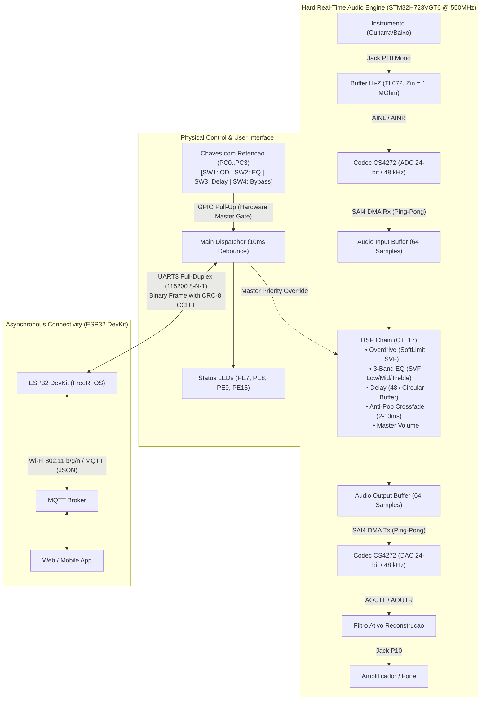
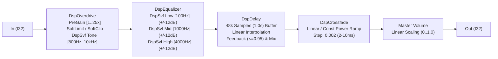

# CLAUDE.md — Authoritative Repository Knowledge Base


-brightgreen?style=flat-square)


This document is the canonical, authoritative reference for AI agents and developers working on the **Pedaleira Digital** (Digital Multi-Effects Audio Pedal) repository.

---

## 1. Project Overview & Institutional Identity

- **Project Name**: Pedaleira Digital (`PED-DIGITAL`)
- **Institution**: Instituto Federal de Educacao, Ciencia e Tecnologia da Paraiba (IFPB) — Campus Joao Pessoa
- **Academic Discipline**: Tecnicas de Prototipagem
- **Quality Standard**: Manual *Assert Capacita v1.0* — Polo de Inovacao IFPB / Laboratorio ASSERT
- **Engineering Authors** (in strict alphabetical order):
  - **Arthur Ramalho**
  - **Isabelle Lavinia**
  - **Joao Paulo**
  - **Rodrigues Matheus**
- **Repository Purpose**: Real-time digital signal processing (DSP) pedalboard for electric guitar and bass, replacing physical analog pedals with embedded C++ DSP algorithms executed on an ARM Cortex-M7 core, with hardware retention switches and wireless IoT telemetery/parameter control via ESP32 and MQTT.

---

## 2. System Architecture

The system features a decoupled dual-MCU architecture ensuring real-time audio integrity:



---

## 3. Hardware Pinout & Peripheral Map

Based on **WeAct Studio MiniSTM32H723 V1.2 (STM32H723VGT6, LQFP100)**:

| Category | Pin | Peripheral / Alternate Function | Target Device / Connection | Signal Description | Mode / Electrical Level |
| :--- | :--- | :--- | :--- | :--- | :--- |
| **Audio SAI4** | `PE0` | `SAI4_MCLK_A` (AF10) | CS4272 `MCLK` | Master Audio Clock (12.288 MHz @ 256x Fs) | Push-Pull, High Speed |
| **Audio SAI4** | `PE4` | `SAI4_FS_A` (AF10) | CS4272 `LRCK` | Frame Sync / Word Select (48 kHz) | Push-Pull, High Speed |
| **Audio SAI4** | `PE5` | `SAI4_SCK_A` (AF10) | CS4272 `SCLK` | Serial Bit Clock (3.072 MHz @ 64x Fs) | Push-Pull, High Speed |
| **Audio SAI4** | `PE6` | `SAI4_SD_A` (AF10) | CS4272 `SDIN` | Serial Audio Data DAC Out | Push-Pull, High Speed |
| **Audio SAI4** | `PA0` | `SAI4_SD_B` (AF10) | CS4272 `SDOUT` | Serial Audio Data ADC In | Input Float, High Speed |
| **Codec I2C1** | `PB8` | `I2C1_SCL` (AF4) | CS4272 `SCL/CCLK` | Codec Configuration Clock | Open-Drain, 4.7k Pull-Up |
| **Codec I2C1** | `PB9` | `I2C1_SDA` (AF4) | CS4272 `SDA/CDIN` | Codec Configuration Data | Open-Drain, 4.7k Pull-Up |
| **Codec Reset** | `PD10` | `GPIO_Output` | CS4272 `RESET` | Active-Low Hardware Reset Pulse | Push-Pull, Active LOW |
| **UART3 Inter-MCU** | `PD8` | `USART3_TX` (AF7) | ESP32 `GPIO16 (RX2)` | Serial Transmit to ESP32 (115200 bps) | Push-Pull, 3.3V LVCMOS |
| **UART3 Inter-MCU** | `PD9` | `USART3_RX` (AF7) | ESP32 `GPIO17 (TX2)` | Serial Receive from ESP32 (115200 bps) | Input Float, 3.3V LVCMOS |
| **Footswitch SW1** | `PC0` | `GPIO_Input` | Toggle Switch 1 -> GND | Overdrive Enable/Bypass | Input with Internal Pull-Up |
| **Footswitch SW2** | `PC1` | `GPIO_Input` | Toggle Switch 2 -> GND | 3-Band Equalizer Enable/Bypass | Input with Internal Pull-Up |
| **Footswitch SW3** | `PC2` | `GPIO_Input` | Toggle Switch 3 -> GND | Delay Enable/Bypass | Input with Internal Pull-Up |
| **Footswitch SW4** | `PC3` | `GPIO_Input` | Toggle Switch 4 -> GND | Hardware Master Bypass / Mute | Input with Internal Pull-Up |
| **Indicator LED1** | `PE7` | `GPIO_Output` | Overdrive LED Anode (330R) | Overdrive Active Status | Output Push-Pull |
| **Indicator LED2** | `PE8` | `GPIO_Output` | Equalizer LED Anode (330R) | Equalizer Active Status | Output Push-Pull |
| **Indicator LED3** | `PE9` | `GPIO_Output` | Delay LED Anode (330R) | Delay Active Status | Output Push-Pull |
| **Indicator LED4** | `PE15` | `GPIO_Output` | Status/Link LED Anode (330R)| System Link / Master Bypass Status | Output Push-Pull |
| **Onboard LED** | `PE3` | `GPIO_Output` | WeAct VT2 Transistor | Onboard Indicator / Heartbeat | Output Push-Pull |
| **SWD Debug** | `PA13` | `SWDIO` | ST-LINK V2/V3 | Serial Wire Debug Data | Alternate Function |
| **SWD Debug** | `PA14` | `SWCLK` | ST-LINK V2/V3 | Serial Wire Debug Clock | Alternate Function |

---

## 4. Architectural & Domain Invariants

### 4.1. Real-Time Audio Timing Budget
- **Sampling Rate ($f_s$)**: 48.0 kHz, 24-bit stereo format.
- **DMA Block Size**: 64 samples ping-pong double buffer (`Half-Transfer` and `Transfer-Complete` callbacks).
- **Available Block Budget**: $T_{\text{block}} = \frac{64}{48000} \approx 1333.33\,\mu\text{s}$.
- **Hard Execution Invariant**: Maximum DSP execution time per 64-sample block must remain strictly under **$250\,\mu\text{s}$** ($< 18.75\%$ CPU utilization at 550 MHz).
- **Headroom**: $> 80\%$ CPU headroom reserved for background tasks (switch debouncing, UART message parsing, heartbeat).

### 4.2. Zero Dynamic Memory Allocation
- **Strict Prohibition**: `malloc()`, `free()`, `calloc()`, `realloc()`, and C++ `new` / `delete` are strictly banned from all runtime code and the audio processing path.
- All state classes, filters, and delay buffers (e.g., 48,000-sample circular delay buffer) must be statically allocated or allocated once at startup.
- Container structures in the audio loop must have fixed compile-time capacities.

### 4.3. Hardware Master Gate Priority
- Physical mechanical retention switches (`PC0`..`PC3`) hold **absolute priority** over remote software commands (MQTT/UART).
- If a physical switch is toggled to `OFF` (`HIGH` level via pull-up), the corresponding effect is forced into hardware bypass regardless of incoming serial packets.
- Software commands via `CMD_SET_PARAM` cannot override a physical switch forced into bypass.

### 4.4. Audio Anti-Pop Transitions
- Every effect engagement and bypass transition must traverse the `DspCrossfade` stage (2 ms to 10 ms linear ramp).
- Direct binary switching of audio states is prohibited to prevent DC offsets, phase discontinuities, and audible pop/click artifacts ($< -60\text{ dBFS}$ transient threshold).

---

## 5. DSP Core Pipeline & Algorithms

Execution order per sample/block:
$$\text{Input Sample} \longrightarrow \text{Overdrive} \longrightarrow \text{3-Band EQ} \longrightarrow \text{Delay} \longrightarrow \text{Crossfade} \longrightarrow \text{Master Volume} \longrightarrow \text{Output Sample}$$



### 5.1. Overdrive (`DspOverdrive`)
- **Preamplification**: Linear drive factor mapping from $1.0\times$ to $25.0\times$ (`dDSP_OVERDRIVE_MIN_GAIN` to `dDSP_OVERDRIVE_MAX_GAIN`).
- **Soft Limiting**: Symmetrical 3rd-order polynomial soft limiter (`DaisySP` function):
  $$\text{SoftLimit}(x) = \begin{cases} -1.0 & x \le -3.0 \\ 1.0 & x \ge 3.0 \\ \frac{x(27 + x^2)}{27 + 9x^2} & \text{otherwise} \end{cases}$$
- **Tone Shaping**: Low-pass State Variable Filter (`DspSvf`) sweepable between 800 Hz and 10,000 Hz.
- **Level Output**: Post-distortion volume attenuation (0.0 to 1.0).

### 5.2. 3-Band Equalizer (`DspEqualizer`)
- Parallel topology utilizing second-order State Variable Filters (`DspSvf`):
  - **Low Band**: 100 Hz center frequency, shelving behavior, gain range: $[-12\text{ dB}, +12\text{ dB}]$.
  - **Mid Band**: 1000 Hz center frequency, band-pass / peaking behavior ($Q \approx 1.414$), gain range: $[-12\text{ dB}, +12\text{ dB}]$.
  - **Treble Band**: 4000 Hz center frequency, shelving behavior, gain range: $[-12\text{ dB}, +12\text{ dB}]$.
- dB to linear gain conversion: $G = 10^{\frac{\text{gainDb}}{20}}$.

### 5.3. Digital Delay (`DspDelay`)
- **Buffer Size**: Fixed static allocation of 48,000 samples (`dDSP_DELAY_MAX_SAMPLES`) corresponding to 1.0 second at 48 kHz.
- **Delay Range**: 20 ms to 1000 ms (`dDSP_DELAY_MIN_TIME_MS` to `dDSP_DELAY_MAX_TIME_MS`).
- **Interpolation**: Fractional sub-sample read with 2-point linear interpolation:
  $$y[n] = x[n - \lfloor D \rfloor] \cdot (1 - \text{frac}) + x[n - \lfloor D \rfloor - 1] \cdot \text{frac}$$
- **Feedback Stability**: Saturated at maximum $0.95$ (`dDSP_DELAY_MAX_FEEDBACK`) to avoid infinite accumulation and runaway.
- **Mix Control**: Dry / Wet mix scaling ($0.0$ to $1.0$).

### 5.4. Anti-Pop Crossfade (`DspCrossfade`)
- Linear ramp modifier with incremental step `0.002f` per sample ($\approx 10.4\,\text{ms}$ at 48 kHz).
- Eliminates phase popping when switching individual effects or engaging master bypass.

---

## 6. Inter-MCU Serial Protocol (STM32H723 <-> ESP32)

- **Physical Layer**: UART3, 115200 bps, 8-N-1 (8 data bits, no parity, 1 stop bit), 3.3V LVCMOS.
- **Frame Structure**:
  $$\begin{array}{|c|c|c|c|c|c|}
  \hline
  \text{SYNC\_1 (0xAA)} & \text{SYNC\_2 (0x55)} & \text{CMD (1 byte)} & \text{LEN (1 byte)} & \text{PAYLOAD (0..64 bytes)} & \text{CRC8 (1 byte)} \\
  \hline
  \end{array}$$
- **CRC-8 CCITT Checksum**:
  - Polynomial: $0x07$ ($x^8 + x^2 + x + 1$)
  - Initial Value: $0x00$
  - Calculated over: `[CMD, LEN, PAYLOAD...]`

### Command Reference Table

| CMD Hex | Name | Direction | Payload Structure | Purpose |
| :---: | :--- | :---: | :--- | :--- |
| `0x01` | `CMD_SET_PARAM` | ESP32 -> STM32 | `[MODULE_ID, PARAM_ID, VALUE...]` | Update effect parameter or global state |
| `0x02` | `CMD_GET_STATE` | ESP32 -> STM32 | `[]` (LEN = 0) | Request consolidated status report |
| `0x03` | `CMD_STATE_REPORT` | STM32 -> ESP32 | `[STATUS_PAYLOAD]` | Consolidated status of modules, params, and switches |
| `0x04` | `CMD_SWITCH_EVENT` | STM32 -> ESP32 | `[SWITCH_ID (1..4), STATE (0/1)]` | Asynchronous notification of footswitch toggle |
| `0x05` | `CMD_ACK` | Both | `[CMD_ACKED]` | Acknowledge receipt and execution |
| `0x06` | `CMD_NACK` | Both | `[ERROR_CODE]` | Report checksum error, invalid param, or rejection |
| `0x07` | `CMD_HEARTBEAT` | Both | `[]` (LEN = 0) | Keep-alive liveness check (1000 ms periodic) |

### Module and Parameter IDs

| Module ID | Module Name | Param ID | Param Name | Type | Range / Description |
| :---: | :--- | :---: | :--- | :---: | :--- |
| `0x00` | `GLOBAL` | `0x01` | Master Volume | `u8` | 0 to 100 (%) |
| `0x00` | `GLOBAL` | `0x02` | Master Bypass | `u8` | 0 = Active, 1 = Bypass |
| `0x00` | `GLOBAL` | `0x03` | Master Mute | `u8` | 0 = Audio On, 1 = Muted |
| `0x01` | `OVERDRIVE` | `0x00` | Effect Enable | `u8` | 0 = Bypass, 1 = Active |
| `0x01` | `OVERDRIVE` | `0x01` | Drive Gain | `u8` | 0 to 100 (maps to 1.0x .. 25.0x) |
| `0x01` | `OVERDRIVE` | `0x02` | Tone Cutoff | `u8` | 0 to 100 (maps to 800Hz .. 10kHz) |
| `0x01` | `OVERDRIVE` | `0x03` | Output Level | `u8` | 0 to 100 (%) |
| `0x02` | `EQUALIZER` | `0x00` | Effect Enable | `u8` | 0 = Bypass, 1 = Active |
| `0x02` | `EQUALIZER` | `0x01` | Low Gain (100Hz) | `s8` | -12 to +12 dB |
| `0x02` | `EQUALIZER` | `0x02` | Mid Gain (1kHz) | `s8` | -12 to +12 dB |
| `0x02` | `EQUALIZER` | `0x03` | High Gain (4kHz) | `s8` | -12 to +12 dB |
| `0x03` | `DELAY` | `0x00` | Effect Enable | `u8` | 0 = Bypass, 1 = Active |
| `0x03` | `DELAY` | `0x01` | Delay Time | `u16` (LE)| 20 to 1000 (ms, Little-Endian) |
| `0x03` | `DELAY` | `0x02` | Feedback | `u8` | 0 to 95 (%) |
| `0x03` | `DELAY` | `0x03` | Dry/Wet Mix | `u8` | 0 to 100 (%) |

---

## 7. Coding Standards & Conventions (ASSERT Capacita v1.0)

All firmware code in `firmware/stm32/Core/` must strictly comply with the **Assert Capacita v1.0** standard:

### 7.1. Primitive Types
Use standardized types declared in [`AssertTypes.hpp`](file:///home/rodrigues/Pedaleira-digital/firmware/stm32/Core/Inc/AssertTypes.hpp). Standard C types (`unsigned int`, `char`, `long`) are prohibited:

| Standard Type | Underlying C/C++ Type | Description |
| :--- | :--- | :--- |
| `u8` | `uint8_t` | 8-bit unsigned integer |
| `u16` | `uint16_t` | 16-bit unsigned integer |
| `u32` | `uint32_t` | 32-bit unsigned integer |
| `u64` | `uint64_t` | 64-bit unsigned integer |
| `s8` | `int8_t` | 8-bit signed integer |
| `s16` | `int16_t` | 16-bit signed integer |
| `s32` | `int32_t` | 32-bit signed integer |
| `s64` | `int64_t` | 64-bit signed integer |
| `f32` | `float` | 32-bit single precision IEEE-754 |
| `f64` | `double` | 64-bit double precision IEEE-754 |
| `dTRUE` / `dFALSE` | `1` / `0` | Boolean macro constants |

### 7.2. Formatting Rules
1. **Character Encoding**: Strictly 7-bit ASCII. No accents or non-ASCII characters permitted in source files.
2. **Indentation**: 4 spaces per indent level. **NO TAB characters (`\t`) allowed**.
3. **Brace Style**: Strict Allman style. Opening brace `{` MUST appear on its own newline matching the indentation of the control statement.
4. **Control Statements**: Single-line control statements (`if(cond) stmt;`) are strictly forbidden. All blocks must have braces on dedicated lines.
5. **Doxygen Headers**: Every file must start with a Doxygen block including `@file`, `@addtogroup`, `@brief`, `@author Arthur Ramalho, Isabelle Lavinia, Joao Paulo, Rodrigues Matheus` (alphabetical order), `@copyright`, and `@note Normas de codificacao: Assert Capacita v1.0 - Polo de Inovacao IFPB.`.

### 7.3. Mandatory File Section Banners
Header files (`.hpp`) and source files (`.cpp`) must contain exactly the following comment banners:

**For Header Files (`.hpp`)**:
```cpp
/*******************************************************************************
 * INCLUDES NECESSARIOS
 ******************************************************************************/
/*******************************************************************************
 * CONFIGURACOES
 ******************************************************************************/
/*******************************************************************************
 * DEFINES PUBLICOS
 ******************************************************************************/
/*******************************************************************************
 * TIPOS DE DADOS PUBLICOS
 ******************************************************************************/
/*******************************************************************************
 * PROTOTIPOS PUBLICOS
 ******************************************************************************/
```

**For Source Files (`.cpp`)**:
```cpp
/*******************************************************************************
 * INCLUDES
 ******************************************************************************/
/*******************************************************************************
 * DEFINES LOCAIS
 ******************************************************************************/
/*******************************************************************************
 * CONSTANTES
 ******************************************************************************/
/*******************************************************************************
 * ESTRUTURAS DE DADOS LOCAIS
 ******************************************************************************/
/*******************************************************************************
 * PROTOTIPOS LOCAIS
 ******************************************************************************/
/*******************************************************************************
 * FUNCOES PUBLICAS
 ******************************************************************************/
/*******************************************************************************
 * FUNCOES LOCAIS
 ******************************************************************************/
```

---

## 8. Build, Test, and Flashing Commands

| Workflow / Task | Command String | Notes |
| :--- | :--- | :--- |
| **Run Quality Gate Test Suite** | `python3 tests/test_stm32_cpp_dsp_quality.py` | Verifies ASCII, No-Tabs, Allman braces, headers, authorship, CRC8 vectors, and host compilation |
| **Host Native Compilation (Syntax Check)** | `g++ -std=c++17 -fsyntax-only -Wall -Wextra -Werror -Wno-unused-parameter -DSTM32H723xx -DUSE_HAL_DRIVER -Ifirmware/stm32/Core/Inc -Ifirmware/stm32/Drivers/STM32H7xx_HAL_Driver/Inc -Ifirmware/stm32/Drivers/STM32H7xx_HAL_Driver/Inc/Legacy -Ifirmware/stm32/Drivers/CMSIS/Device/ST/STM32H7xx/Include -Ifirmware/stm32/Drivers/CMSIS/Include firmware/stm32/Core/Src/*.cpp` | Compiles all firmware C++ sources with host g++ |
| **ARM Embedded GCC Cross-Compilation** | `arm-none-eabi-gcc -mcpu=cortex-m7 -mthumb -mfpu=fpv5-d16 -mfloat-abi=hard -O3 -std=c++17 -DSTM32H723xx -DUSE_HAL_DRIVER -Ifirmware/stm32/Core/Inc -Ifirmware/stm32/Drivers/STM32H7xx_HAL_Driver/Inc -Ifirmware/stm32/Drivers/CMSIS/Device/ST/STM32H7xx/Include -Ifirmware/stm32/Drivers/CMSIS/Include -c firmware/stm32/Core/Src/main.cpp -o build/main.o` | Target Cortex-M7 with hardware double/single precision FPU |
| **Flashing via OpenOCD** | `openocd -f interface/stlink.cfg -f target/stm32h7x.cfg -c "program build/pedaleira.elf verify reset exit"` | Program STM32H723 flash via ST-LINK |
| **Flashing via STM32CubeProgrammer CLI** | `STM32_Programmer_CLI -c port=SWD mode=UR -w build/pedaleira.elf 0x08000000 -v -rst` | ST-LINK CLI programming |
| **Flashing via pyOCD** | `pyocd flash -t stm32h723vg build/pedaleira.elf` | Python CMSIS-DAP/ST-LINK programmer |

---

## 9. Repository Directory Layout & Key Files

- [`CLAUDE.md`](file:///home/rodrigues/Pedaleira-digital/CLAUDE.md): Authoritative repository knowledge base for AI agents and developers.
- [`README.md`](file:///home/rodrigues/Pedaleira-digital/README.md): High-level project summary and milestone tracker.
- [`CONTRIBUTING.md`](file:///home/rodrigues/Pedaleira-digital/CONTRIBUTING.md): Git branch model and contribution rules.
- **Tests**:
  - [`tests/test_stm32_cpp_dsp_quality.py`](file:///home/rodrigues/Pedaleira-digital/tests/test_stm32_cpp_dsp_quality.py): Python Quality Gate and regression test suite.
- **Documentation**:
  - [`docs/requisitos.md`](file:///home/rodrigues/Pedaleira-digital/docs/requisitos.md): Formal requirements specification (RF01..RF07, RNF01..RNF06).
  - [`docs/escopo.md`](file:///home/rodrigues/Pedaleira-digital/docs/escopo.md): Scope, schedule, and risks.
  - [`docs/hardware/pinout_e_bom.md`](file:///home/rodrigues/Pedaleira-digital/docs/hardware/pinout_e_bom.md): Physical pinout, bill of materials, and circuit conditioning.
  - [`docs/code/protocolo_comunicacao.md`](file:///home/rodrigues/Pedaleira-digital/docs/code/protocolo_comunicacao.md): Complete serial protocol and MQTT topic mapping.
  - [`docs/code/plano_testes_bancada_efeitos.md`](file:///home/rodrigues/Pedaleira-digital/docs/code/plano_testes_bancada_efeitos.md): 6-stage experimental bench validation procedure.
- **STM32 Firmware (`firmware/stm32/Core/`)**:
  - Types & BSP:
    - [`firmware/stm32/Core/Inc/AssertTypes.hpp`](file:///home/rodrigues/Pedaleira-digital/firmware/stm32/Core/Inc/AssertTypes.hpp): ASSERT Capacita standardized types (`u8`..`u64`, `s8`..`s64`, `f32`, `f64`).
    - [`firmware/stm32/Core/Inc/Bsp.hpp`](file:///home/rodrigues/Pedaleira-digital/firmware/stm32/Core/Inc/Bsp.hpp) / [`Bsp.cpp`](file:///home/rodrigues/Pedaleira-digital/firmware/stm32/Core/Src/Bsp.cpp): Board Support Package (clocks, DWT, caches, UART).
  - Codec Driver:
    - [`firmware/stm32/Core/Inc/Cs4272.hpp`](file:///home/rodrigues/Pedaleira-digital/firmware/stm32/Core/Inc/Cs4272.hpp) / [`Cs4272.cpp`](file:///home/rodrigues/Pedaleira-digital/firmware/stm32/Core/Src/Cs4272.cpp): I2C control driver for Cirrus Logic CS4272 codec.
  - DSP Core Algorithms:
    - [`firmware/stm32/Core/Inc/DspMath.hpp`](file:///home/rodrigues/Pedaleira-digital/firmware/stm32/Core/Inc/DspMath.hpp): Math helpers, `SoftLimit`, `SoftClip`, and `fclamp`.
    - [`firmware/stm32/Core/Inc/DspSvf.hpp`](file:///home/rodrigues/Pedaleira-digital/firmware/stm32/Core/Inc/DspSvf.hpp) / [`DspSvf.cpp`](file:///home/rodrigues/Pedaleira-digital/firmware/stm32/Core/Src/DspSvf.cpp): DaisySP State Variable Filter (LP, HP, BP, Notch, Peak).
    - [`firmware/stm32/Core/Inc/DspOverdrive.hpp`](file:///home/rodrigues/Pedaleira-digital/firmware/stm32/Core/Inc/DspOverdrive.hpp) / [`DspOverdrive.cpp`](file:///home/rodrigues/Pedaleira-digital/firmware/stm32/Core/Src/DspOverdrive.cpp): Drive gain, soft clipping, and tone filter.
    - [`firmware/stm32/Core/Inc/DspEqualizer.hpp`](file:///home/rodrigues/Pedaleira-digital/firmware/stm32/Core/Inc/DspEqualizer.hpp) / [`DspEqualizer.cpp`](file:///home/rodrigues/Pedaleira-digital/firmware/stm32/Core/Src/DspEqualizer.cpp): 3-Band parametric EQ (100Hz, 1kHz, 4kHz).
    - [`firmware/stm32/Core/Inc/DspDelay.hpp`](file:///home/rodrigues/Pedaleira-digital/firmware/stm32/Core/Inc/DspDelay.hpp) / [`DspDelay.cpp`](file:///home/rodrigues/Pedaleira-digital/firmware/stm32/Core/Src/DspDelay.cpp): Digital delay line (48k buffer, linear interpolation).
    - [`firmware/stm32/Core/Inc/DspCrossfade.hpp`](file:///home/rodrigues/Pedaleira-digital/firmware/stm32/Core/Inc/DspCrossfade.hpp) / [`DspCrossfade.cpp`](file:///home/rodrigues/Pedaleira-digital/firmware/stm32/Core/Src/DspCrossfade.cpp): Anti-pop smooth crossfader.
    - [`firmware/stm32/Core/Inc/DspEngine.hpp`](file:///home/rodrigues/Pedaleira-digital/firmware/stm32/Core/Inc/DspEngine.hpp) / [`DspEngine.cpp`](file:///home/rodrigues/Pedaleira-digital/firmware/stm32/Core/Src/DspEngine.cpp): Master DSP orchestration and effect pipeline.
  - Peripherals & Protocol:
    - [`firmware/stm32/Core/Inc/PedalSwitches.hpp`](file:///home/rodrigues/Pedaleira-digital/firmware/stm32/Core/Inc/PedalSwitches.hpp) / [`PedalSwitches.cpp`](file:///home/rodrigues/Pedaleira-digital/firmware/stm32/Core/Src/PedalSwitches.cpp): Footswitch reading with 20ms debounce.
    - [`firmware/stm32/Core/Inc/PedalLeds.hpp`](file:///home/rodrigues/Pedaleira-digital/firmware/stm32/Core/Inc/PedalLeds.hpp) / [`PedalLeds.cpp`](file:///home/rodrigues/Pedaleira-digital/firmware/stm32/Core/Src/PedalLeds.cpp): Status LED controller.
    - [`firmware/stm32/Core/Inc/InterMcuUart.hpp`](file:///home/rodrigues/Pedaleira-digital/firmware/stm32/Core/Inc/InterMcuUart.hpp) / [`InterMcuUart.cpp`](file:///home/rodrigues/Pedaleira-digital/firmware/stm32/Core/Src/InterMcuUart.cpp): UART binary protocol transceiver with CRC-8 CCITT.
    - [`firmware/stm32/Core/Src/main.cpp`](file:///home/rodrigues/Pedaleira-digital/firmware/stm32/Core/Src/main.cpp): System entry point, loop dispatcher, and peripheral synchronization.
