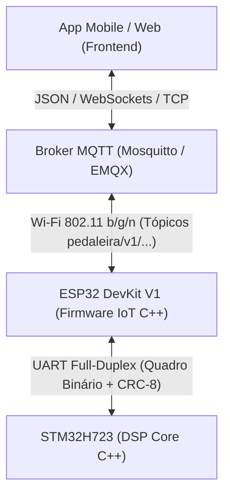

# Documentação de Código e Protocolos

## Sobre

Esta seção reúne a documentação de firmware, arquitetura de software e protocolos de comunicação do projeto **Pedaleira Digital**, detalhando a interface inter-microcontroladores entre [STM32](../../firmware/stm32) e [ESP32](../../firmware/esp32), a especificação de tópicos e payloads MQTT e as decisões de sincronização de estado com o aplicativo móvel/desktop.

---

## Documentos Técnicos Disponíveis

- [**Plano Experimental de Testes de Bancada: Efeitos de Áudio (DSP)**](./plano_testes_bancada_efeitos.md):
  - Procedimento operacional padrão (POP) em 6 etapas determinísticas (Pass-Through, Overdrive, EQ 3 bandas, Delay, Crossfade anti-pop e Cadeia Completa).
  - Configuração de instrumentos de medição (osciloscópio, gerador de funções e medições True-RMS).
  - Critérios objetivos de aceitação (PASS/FAIL) e folha formal de homologação e assinaturas.
- [**Especificação do Protocolo de Comunicação Serial e Tópicos MQTT**](./protocolo_comunicacao.md):
  - Camada física serial UART (115200 bps, 8-N-1, níveis 3.3V).
  - Estrutura de frame binário determinístico (`SYNC_1`, `SYNC_2`, `CMD`, `LEN`, `PAYLOAD`, `CRC8`).
  - Tabela formal de comandos (`CMD_SET_PARAM`, `CMD_GET_STATE`, `CMD_STATE_REPORT`, `CMD_SWITCH_EVENT`, `CMD_ACK`, `CMD_NACK`, `CMD_HEARTBEAT`).
  - Mapeamento de módulos e parâmetros de efeitos (Overdrive, EQ de 3 bandas, Delay e Master Volume).
  - Implementação em código C++ do cálculo de CRC-8 e Máquina de Estados Finita (FSM) de recepção.
  - Hierarquia de tópicos MQTT versionada (`pedaleira/v1/{device_id}/...`) com esquemas JSON completos e suporte a Last Will and Testament (LWT).
  - Mecanismo de resolução de conflitos e sincronização bidirecional entre chaves de retenção mecânica (*Hardware Master Gate*) e ajustes finos pelo aplicativo.

---

## Arquitetura de Software Resumida

| Módulo de Software | Plataforma / Ferramenta | Responsabilidades Principais |
| :--- | :--- | :--- |
| **DSP Core & Audio Engine** | STM32H723 (C++17 / CMSIS-DSP / STM32CubeIDE) | Aquisição e reprodução de áudio via DMA circular (SAI/I2S), algoritmos de efeito em tempo real, debounce de chaves e acionamento de LEDs |
| **IoT & Communications Bridge** | ESP32 (C++ / ESP-IDF ou Arduino-ESP32 / FreeRTOS) | Conexão Wi-Fi, cliente MQTT com auto-reconexão, parsing/validação de JSON e ponte serial UART assíncrona |
| **Application Layer** | Mobile / Web / Desktop | Interface visual do usuário, ajuste em tempo real de parâmetros, gerenciador de presets e monitoramento de telemetria |

---

## Próximas Entregas de Software

- [ ] Implementação da ponte serial UART e cliente MQTT no firmware base do ESP32 ([Issue #13](https://github.com/Rodriguesmath/Pedaleira-digital/issues/13)).
- [ ] Configuração dos periféricos SAI/I2S, DMA circular e driver do Codec CS4272 na STM32H7 ([Issue #6](https://github.com/Rodriguesmath/Pedaleira-digital/issues/6)).
- [ ] Implementação dos algoritmos fundamentais de efeito de áudio: Overdrive e EQ ([Issue #12](https://github.com/Rodriguesmath/Pedaleira-digital/issues/12)).
- [ ] Integração e sincronização bidirecional de ponta a ponta com o app ([Issue #17](https://github.com/Rodriguesmath/Pedaleira-digital/issues/17)).
