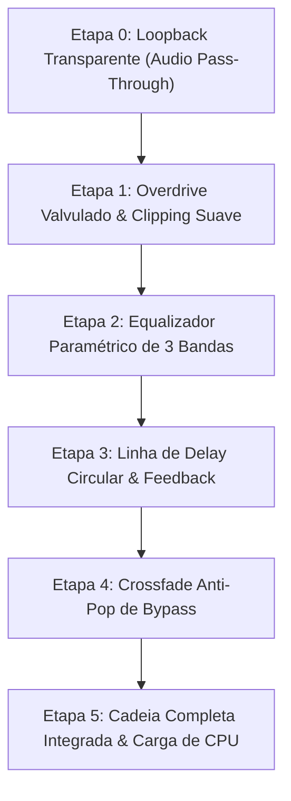
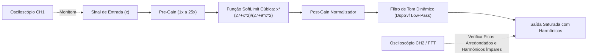
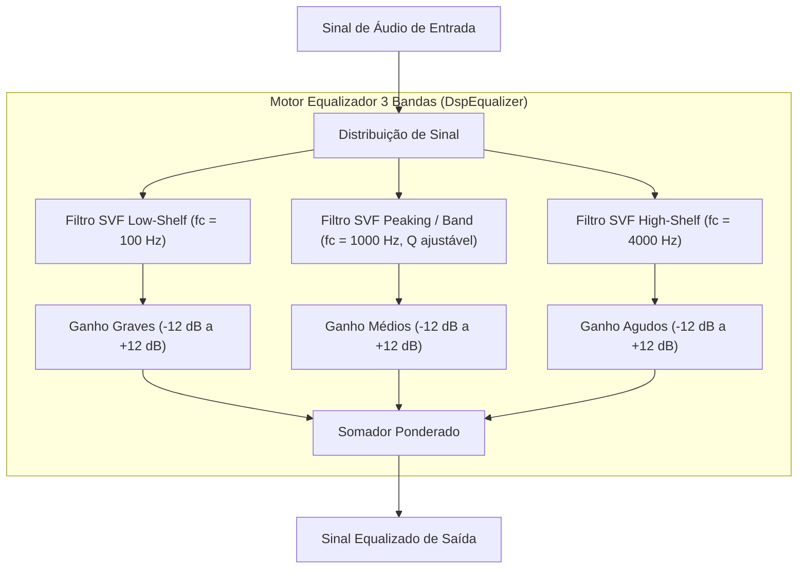
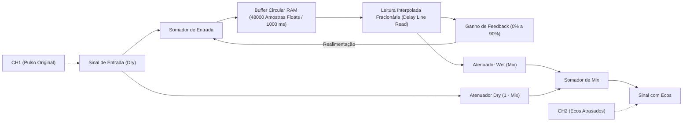
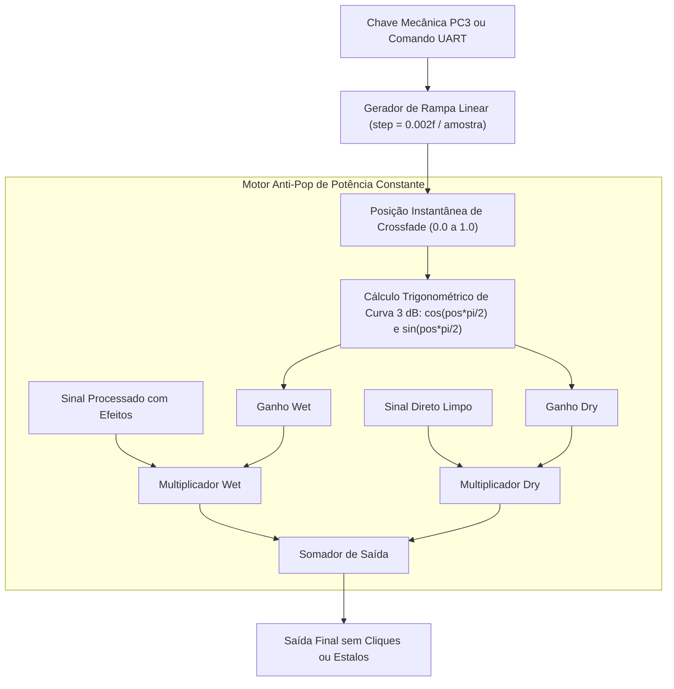

# Plano Experimental de Testes de Bancada: Validação dos Efeitos de Áudio (DSP)

| Metadado | Informação |
| :--- | :--- |
| **Projeto** | Pedaleira Digital de Efeitos para Instrumentos Musicais (`PED-DIGITAL`) |
| **Instituição** | Instituto Federal da Paraíba (IFPB) — Campus João Pessoa |
| **Disciplina** | Técnicas de Prototipagem |
| **Equipe de Engenharia** | **Arthur Ramalho**, **Isabelle Lavínia**, **João Paulo**, **Rodrigues Matheus** (ordem alfabética) |
| **Normas Técnicas** | Manual *Assert Capacita v1.0* (Polo de Inovação IFPB / Laboratório ASSERT) |
| **Plataforma DSP** | WeAct Studio MiniSTM32H723 V1.2 (STM32H723VGT6 @ 550 MHz, ARM Cortex-M7) |
| **Codec de Áudio** | Cirrus Logic CS4272 (I2C1 + SAI4 DMA, 48 kHz / 24-bit estéreo) |
| **Versão do Documento** | 1.1.0 (Outubro de 2026) |

---

## 1. Visão Geral e Estrutura dos Ensaios de Bancada

Este documento estabelece o procedimento operacional padrão (POP) para validação progressiva e experimental em bancada dos algoritmos de processamento digital de sinal (DSP) implementados em C++17 para a pedaleira digital.

Os testes são divididos em **6 etapas determinísticas**, evoluindo da integridade elétrica e loopback transparente até a operação combinada sob dinâmica real de instrumento musical:



---

## 2. Setup e Instrumentação de Bancada

### 2.1. Equipamentos e Instrumentos Necessários

1. **Osciloscópio Digital**: Mínimo 2 canais (largura de banda $\ge 20\text{ MHz}$), com cursores de tempo/tensão e modo FFT (para análise espectral de harmônicos).
2. **Gerador de Funções**: Gerador de bancada ou aplicativo gerador de áudio via saída P2 de smartphone/computador calibrado com cabo P2 para P10 mono.
3. **Multímetro Digital**: True-RMS para verificação de tensões DC de alimentação (3,3 V, 5 V e referência analógica VA/VD).
4. **Sistema de Escuta**: Fone de ouvido estéreo com adaptador P10 ou amplificador de instrumento musical com controle de ganho.
5. **Carga e Cabos**: Cabos blindados P10-P10 mono de baixa capacitância, garras ponta-de-prova BNC-Jacaré e jumpers de bancada rígidos.

### 2.2. Diagrama de Interligação de Bancada

```mermaid
flowchart LR
    subgraph INSP["Instrumentação de Entrada"]
        GEN["Gerador de Funções (Senoide 100 Hz a 4 kHz)"]
        PROBE1["Ponta de Prova CH1 (Osciloscópio)"]
    end

    subgraph PEDAL["Hardware da Pedaleira Digital"]
        JIN["Jack de Entrada P10 Fêmea"]
        HIZ["Buffer Hi-Z TL072 (Zin = 1 MOhm)"]
        CODEC_ADC["Codec CS4272 (ADC 24-bit / 48 kHz)"]
        STM["STM32H723VGT6 (DSP Core C++17 @ 550 MHz)"]
        CODEC_DAC["Codec CS4272 (DAC 24-bit / 48 kHz)"]
        JOUT["Jack de Saída P10 Fêmea"]
    end

    subgraph OUTSP["Instrumentação de Saída"]
        PROBE2["Ponta de Prova CH2 (Osciloscópio / FFT)"]
        OUTDEV["Fone de Ouvido / Amplificador de Bancada"]
    end

    GEN -->|"Sinal Analógico (0,1 a 1,0 Vpp)"| JIN
    GEN -.->|"Monitoramento de Entrada"| PROBE1
    JIN --> HIZ
    HIZ -->|"Entrada Analógica (AINL/AINR)"| CODEC_ADC
    CODEC_ADC <==|"SAI4 DMA I2S (48 kHz)"| STM
    STM ==>|"SAI4 DMA I2S (48 kHz)"| CODEC_DAC
    CODEC_DAC -->|"Saída Analógica (AOUTL/AOUTR)"| JOUT
    JOUT -.->|"Monitoramento de Saída"| PROBE2
    JOUT --> OUTDEV
```

---

## 3. Procedimentos Experimentais por Etapa

---

### ETAPA 0: Verificação Elétrica e Loopback Inicial (Audio Pass-Through)

- **Objetivo**: Comprovar a linearidade da cadeia analógica e do codec CS4272 sem nenhuma alteração digital de sinal (modo Bypass puro).
- **Módulos do Firmware Envolvidos**: [`Bsp.hpp`](file:///home/rodrigues/Pedaleira-digital/firmware/stm32/Core/Inc/Bsp.hpp), [`Cs4272.hpp`](file:///home/rodrigues/Pedaleira-digital/firmware/stm32/Core/Inc/Cs4272.hpp), [`main.cpp`](file:///home/rodrigues/Pedaleira-digital/firmware/stm32/Core/Src/main.cpp).

```mermaid
flowchart LR
    S_IN["Sinal de Teste (Senoide 1 kHz, 500 mVpp)"] --> IN_PROBE["Ponto de Teste Entrada (CH1)"]
    IN_PROBE --> ADC["CS4272 ADC"]
    ADC --> DMA_IN["SAI4 DMA Rx Buffer"]
    DMA_IN --> PASS["DSP Pass-Through (Cópia Direta)"]
    PASS --> DMA_OUT["SAI4 DMA Tx Buffer"]
    DMA_OUT --> DAC["CS4272 DAC"]
    DAC --> OUT_PROBE["Ponto de Teste Saída (CH2)"]
    OUT_PROBE --> SCOPE["Osciloscópio (Medição de Ganho e Latência Delta-t)"]
```



#### Procedimento Passo a Passo
1. Conectar a alimentação da WeAct STM32H723 via USB-C (5 V) e verificar com o multímetro nos pinos de alimentação:
   - Barramento digital: $3{,}30\text{ V} \pm 0{,}05\text{ V}$.
   - Barramento analógico VA do CS4272: $5{,}00\text{ V} \pm 0{,}10\text{ V}$.
2. Posicionar a **Chave 4 (Master Bypass / PC3)** no modo **BYPASS** (LED PE15 aceso).
3. Ajustar o gerador de sinais para: **Onda senoidal pura, frequência de 1,00 kHz, amplitude de 500 mVpp (0,5 Vpp), offset DC = 0 V**.
4. Conectar o Canal 1 do osciloscópio no Jack de Entrada (pino de entrada do TL072).
5. Conectar o Canal 2 do osciloscópio no Jack de Saída de Áudio (saída do CS4272 após o filtro passa-baixas passivo).
6. Ajustar a base de tempo do osciloscópio para **500 µs/div** e escala vertical em **100 mV/div** em ambos os canais.

#### Critérios de Aceitação (PASS / FAIL)
- [ ] **Linearidade de Ganho**: $V_{\text{out}} \approx V_{\text{in}}$ (relação de amplitude unitária $\pm 1\text{ dB}$, aproximadamente 500 mVpp na saída).
- [ ] **Pureza Espectral**: Senoide de saída perfeitamente limpa, sem distorção visível nos picos ou desvio DC.
- [ ] **Latência Fim-a-Fim**: Medir o atraso de tempo horizontal entre o pico positivo do CH1 e o pico do CH2. O valor deve ser inferior a **2,0 ms** (correspondente ao tempo de conversão de grupo do codec + buffer DMA ping-pong).

---

### ETAPA 1: Validação do Efeito Overdrive (Saturação Suave & Tone)

- **Objetivo**: Comprovar a curva não-linear de ceifamento cúbico (`SoftLimit`), o ganho de pré-amplificação dinâmico e a atuação do filtro de tom do overdrive.
- **Módulos do Firmware Envolvidos**: [`DspOverdrive.hpp`](file:///home/rodrigues/Pedaleira-digital/firmware/stm32/Core/Inc/DspOverdrive.hpp), [`DspMath.hpp`](file:///home/rodrigues/Pedaleira-digital/firmware/stm32/Core/Inc/DspMath.hpp), [`PedalSwitches.hpp`](file:///home/rodrigues/Pedaleira-digital/firmware/stm32/Core/Inc/PedalSwitches.hpp).



#### Procedimento Passo a Passo
1. Colocar a **Chave 4 (Master Bypass / PC3)** em modo **ATIVO** (LED PE15 apagado).
2. Ligar a **Chave 1 (Overdrive / PC0)**: O LED **PE7** deve acender imediatamente.
3. Injetar onda senoidal de **440 Hz (Nota Lá)** com amplitude inicial de **100 mVpp**.
   - No osciloscópio, verificar que com sinal baixo a forma de onda permanece senoidal, evidenciando resposta limpa para toques leves de palheta.
4. Elevar progressivamente a amplitude de entrada do gerador de **100 mVpp até 1,00 Vpp** (simulando a dinâmica de um ataque forte de captador humbucker):
   - Observar no CH2 do osciloscópio a transição não-linear: os topos da senoide devem arredondar suavemente (curva parabólica/cúbica da fórmula `SoftLimit` do DaisySP), sem cortar abruptamente em linha reta como em clipping digital espúrio.
5. Pelo terminal serial/UART (ou via aplicativo), enviar o comando de parâmetro de Drive:
   - `Drive = 20%`: Saturação sutil (crunch leve).
   - `Drive = 80%`: Compressão intensa, achatamento suave simétrico e aumento de sustentação de sinal.
6. Habilitar a função FFT no osciloscópio (Janela Hanning, escala logarítmica dBV):
   - Observar o surgimento característico de harmônicos ímpares (3ª ordem em 1,32 kHz; 5ª ordem em 2,20 kHz) com decaimento suave.
7. Teste de Audição com Instrumento:
   - Conectar a guitarra e verificar se acordes permanecem articulados e se notas individuais sustentam naturalmente sem ruído de quantização no decaimento (*noise gate gating*).

#### Critérios de Aceitação (PASS / FAIL)
- [ ] **Curva de Transferência Suave**: Ausência completa de esquinas duras (*hard-clipping*) na forma de onda.
- [ ] **Sinalização Visual**: LED PE7 acende com chave PC0 em nível LOW e apaga com PC0 em nível HIGH.
- [ ] **Resposta Dinâmica**: Amplitude de pico estabilizada em $\approx 1{,}5\text{ Vpp}$ para sinais de entrada elevados, com ganho pós-ceifamento devidamente normalizado.

---

### ETAPA 2: Validação do Equalizador Paramétrico de 3 Bandas

- **Objetivo**: Comprovar a atuação independente e o isolamento de frequência das três seções de equalização baseadas em filtros SVF (*State Variable Filter*).
- **Módulos do Firmware Envolvidos**: [`DspEqualizer.hpp`](file:///home/rodrigues/Pedaleira-digital/firmware/stm32/Core/Inc/DspEqualizer.hpp), [`DspSvf.hpp`](file:///home/rodrigues/Pedaleira-digital/firmware/stm32/Core/Inc/DspSvf.hpp).



#### Procedimento Passo a Passo
1. Desligar a Chave 1 (Overdrive).
2. Ligar a **Chave 2 (Equalizador / PC1)**: O LED **PE8** deve acender.
3. Ajustar o gerador para uma amplitude fixa de **300 mVpp**.

#### 2.1. Teste da Banda de Graves (Low-Shelf @ 100 Hz)
- Configurar o gerador em **100 Hz**.
- Com os três controles em flat (0 dB), verificar saída em 300 mVpp.
- Ajustar ganho de graves para **+12 dB**: A saída deve subir para $\approx 1{,}20\text{ Vpp}$ (ganho $\approx 4\times$).
- Ajustar ganho de graves para **-12 dB**: A saída deve atenuar para $\approx 75\text{ mVpp}$ (atenuação para $\approx 1/4$).
- Alterar o gerador para **1,00 kHz** e **4,00 kHz**: Confirmar que a alteração no ganho de graves **não altera** a amplitude das frequências médias e altas.

#### 2.2. Teste da Banda de Médios (Peaking @ 1000 Hz)
- Configurar o gerador em **1,00 kHz**.
- Ajustar ganho de médios para **+12 dB**: A saída deve amplificar para $\approx 1{,}20\text{ Vpp}$.
- Ajustar ganho de médios para **-12 dB**: A saída deve cair para $\approx 75\text{ mVpp}$.
- Alterar o gerador para **100 Hz** e **5,00 kHz**: Confirmar que o pico do filtro é seletivo e não deforma as extremidades da banda audível.

#### 2.3. Teste da Banda de Agudos (High-Shelf @ 4000 Hz)
- Configurar o gerador em **4,00 kHz**.
- Ajustar ganho de agudos para **+12 dB**: A saída deve subir para $\approx 1{,}20\text{ Vpp}$.
- Ajustar ganho de agudos para **-12 dB**: A saída deve atenuar para $\approx 75\text{ mVpp}$.
- Alterar o gerador para **200 Hz**: Confirmar isolamento da banda grave.

#### Critérios de Aceitação (PASS / FAIL)
- [ ] **Faixa de Atuação**: Cada banda deve fornecer curso efetivo de $\pm 12\text{ dB} \pm 1{,}5\text{ dB}$.
- [ ] **Estabilidade Incondicional**: Ausência total de oscilação parasita, apito de alta frequência ou deslocamento DC quando os ganhos estão no máximo.
- [ ] **Sinalização Visual**: LED PE8 reflete com precisão o estado da chave PC1.

---

### ETAPA 3: Validação da Linha de Delay Circular (Tempo, Feedback e Mix)

- **Objetivo**: Validar a precisão temporal do buffer circular de 48.000 amostras, o decaimento exponencial da malha de feedback e o balanço wet/dry.
- **Módulos do Firmware Envolvidos**: [`DspDelay.hpp`](file:///home/rodrigues/Pedaleira-digital/firmware/stm32/Core/Inc/DspDelay.hpp).



#### Procedimento Passo a Passo
1. Desligar Chaves 1 e 2.
2. Ligar a **Chave 3 (Delay / PC2)**: O LED **PE9** deve acender.
3. Ajustar o gerador para **Trem de Pulsos (ou Burst Senoidal de 1 ciclo @ 1 kHz)** repetido a cada **2,0 segundos**, amplitude de 500 mVpp.
4. Ajustar o osciloscópio:
   - Base de tempo: **100 ms/div** (permite visualizar uma janela horizontal de 1 segundo).
   - Trigger no Canal 1 (borda de subida do pulso de entrada).

#### 3.1. Teste de Precisão do Tempo de Atraso
- Configurar parâmetro de tempo para **$T_{\text{delay}} = 300\text{ ms}$**, Feedback em 0% e Mix em 50%.
- Posicionar os cursores de tempo do osciloscópio:
  - Cursor A no início do pulso de entrada (CH1).
  - Cursor B no início do pulso atrasado (CH2).
- Medir $\Delta t$: O valor medido deve ser **$300\text{ ms} \pm 1\text{ ms}$**.
- Repetir para **$T_{\text{delay}} = 500\text{ ms}$** e **$T_{\text{delay}} = 1000\text{ ms}$** (verificando os limites máximo e intermediário do buffer).

#### 3.2. Teste da Malha de Feedback (Repetições Sucessivas)
- Com $T_{\text{delay}} = 300\text{ ms}$, ajustar o Feedback para **50% (0,50)**:
  - 1º eco (em 300 ms): amplitude deve ser $\approx 50\%$ do pulso original.
  - 2º eco (em 600 ms): amplitude deve ser $\approx 25\%$ do pulso original.
  - 3º eco (em 900 ms): amplitude deve ser $\approx 12{,}5\%$ do pulso original.
- Ajustar Feedback para **85%**: Observar a cauda longa de mais de 8 repetições decrescentes limpas, sem saturação descontrolada (*runaway*) nem instabilidade numérica.

#### 3.3. Teste de Controle Dry/Wet
- Configurar Mix para **0%**: Somente o pulso original no CH2 (zero eco).
- Configurar Mix para **100%**: Apenas as repetições atrasadas aparecem no CH2 (sinal direto completamente silenciado).

#### Critérios de Aceitação (PASS / FAIL)
- [ ] **Erro de Delay**: Desvio temporal medido inferior a $0{,}5\%$ do valor configurado.
- [ ] **Integridade de Memória**: Ausência de estalos de descontinuidade (*wrap-around glitch*) quando o ponteiro circular reinicia em 48.000 amostras.
- [ ] **Sinalização Visual**: LED PE9 aceso com chave PC2 ativa.

---

### ETAPA 4: Validação do Master Crossfade Anti-Pop (Comutação Suave)

- **Objetivo**: Comprovar que o acionamento mecânico das chaves ou o comando de bypass não geram estalos audíveis (*clicks/pops*) ou descontinuidades verticais de tensão no sinal de áudio.
- **Módulos do Firmware Envolvidos**: [`DspCrossfade.hpp`](file:///home/rodrigues/Pedaleira-digital/firmware/stm32/Core/Inc/DspCrossfade.hpp), [`DspEngine.hpp`](file:///home/rodrigues/Pedaleira-digital/firmware/stm32/Core/Inc/DspEngine.hpp).



#### Procedimento Passo a Passo
1. Ativar todos os efeitos: Overdrive ligado em ganho alto + EQ com boost de médios + Delay em 50%.
2. Injetar senoide contínua de **1,00 kHz, amplitude de 1,00 Vpp**.
3. Configurar o osciloscópio:
   - Canal 2 na saída de áudio.
   - Modo de Trigger: **Normal** (ou Single), borda de descida com nível ligeiramente acima do ruído.
   - Base de tempo em **2 ms/div**.
4. Acionar e desarmar repetidamente a **Chave 4 (Master Bypass / PC3)**.
5. Capturar o instante exato da comutação:
   - Inspecionar a forma de onda congelada na tela.
   - Medir a rampa de transição de amplitude: deve haver uma modulação contínua e suave de aproximadamente **10 ms** (correspondente ao passo de amortecimento `step_ = 0.002f` por amostra a 48 kHz).
6. Verificar que **não ocorre nenhum degrau vertical instantâneo** ($\Delta V$ abrupto) na tensão de saída.
7. Teste de Audição com Fones de Ouvido em Volume Alto:
   - Alternar o bypass repetidas vezes sem sinal de entrada e com sinal de entrada.
   - Confirmar silêncio e suavidade acústica absoluta (zero estalos perceptíveis).

#### Critérios de Aceitação (PASS / FAIL)
- [ ] **Continuidade Temporal**: Curva envelope contínua com tempo de transição entre $8\text{ ms}$ e $15\text{ ms}$.
- [ ] **Anti-Pop Acústico**: Zero cliques ou estalos mecânicos vazando para o sinal de áudio.
- [ ] **Sinalização Visual**: LED PE15 alterna perfeitamente entre modo ativo e modo bypass.

---

### ETAPA 5: Validação da Cadeia Completa Integrada e Desempenho de CPU

- **Objetivo**: Testar a convivência de todos os algoritmos simultâneos, o tempo de cálculo em tempo real e a fidelidade dinâmica com guitarra/baixo reais.
- **Módulos do Firmware Envolvidos**: Todo o firmware C++17 ([`main.cpp`](file:///home/rodrigues/Pedaleira-digital/firmware/stm32/Core/Src/main.cpp), [`DspEngine.cpp`](file:///home/rodrigues/Pedaleira-digital/firmware/stm32/Core/Src/DspEngine.cpp)).

```mermaid
flowchart LR
    INST["Guitarra / Baixo Elétrico"] --> HIZ["Buffer Hi-Z TL072"]
    HIZ --> ADC["CS4272 ADC (24-bit / 48 kHz)"]
    ADC --> DMA_RX["DMA SAI4 Rx (Ping-Pong 64 Amostras)"]

    subgraph ENGINE["Cadeia Serial de Processamento C++17 (DspEngine)"]
        DMA_RX --> OD["DspOverdrive (Chave PC0 / LED PE7)"]
        OD --> EQ["DspEqualizer (Chave PC1 / LED PE8)"]
        EQ --> DELAY["DspDelay (Chave PC2 / LED PE9)"]
        DELAY --> XFADE["DspCrossfade Master (Chave PC3 / LED PE15)"]
        XFADE --> VOL["Controle Master Volume e Mute"]
    end

    VOL --> DMA_TX["DMA SAI4 Tx (Ping-Pong 64 Amostras)"]
    DMA_TX --> DAC["CS4272 DAC (24-bit / 48 kHz)"]
    DAC --> AMP["Amplificador de Guitarra / Fone"]

    subgraph BENCHMARK["Monitoramento de Tempo Real"]
        DWT["Contador de Ciclos DWT Cortex-M7"] -.->|"Mede Delta-Ciclos de Processamento"| ENGINE
    end
```



#### Procedimento Passo a Passo
1. Conectar a guitarra ou contrabaixo no Jack de Entrada.
2. Ligar a saída ao amplificador de bancada.
3. Ativar simultaneamente:
   - **Overdrive**: Drive em 60%, Tone em 2,5 kHz.
   - **Equalizador**: Graves +3 dB, Médios +2 dB, Agudos -1 dB.
   - **Delay**: Tempo em 380 ms, Feedback em 45%, Mix em 35%.
4. Teste de Toque e Dinâmica:
   - Executar palhetadas fortes em cordas graves soltas: verificar se a compressão do overdrive responde sem "rachar" ou gerar distorção intermodulada digital desagradável.
   - Tocar solos rápidos na região aguda: verificar clareza nas repetições do delay sem embolar com o overdrive.
5. Teste de Relação Sinal-Ruído com Instrumento Parado:
   - Soltar as cordas com o instrumento conectado: verificar se o ruído de fundo (hiss) é mínimo e se não há vazamento audível de clocks digitais (apito de 48 kHz ou ruído de chaveamento da USB/DWT).
6. Medição de Consumo de Tempo de Execução da CPU:
   - Utilizando o contador de ciclos DWT do Cortex-M7 (`Bsp::GetTick()` / registradores `DWT->CYCCNT`):
   - Tempo disponível por bloco de 64 amostras a 48 kHz: $64 / 48000 \approx 1333\text{ µs}$.
   - O tempo de processamento gasto pelo método `DspEngine::ProcessBlock()` medido deve ser **inferior a 250 µs** (representando carga de CPU $< 20\%$ da capacidade de 550 MHz da placa WeAct).

#### Critérios de Aceitação (PASS / FAIL)
- [ ] **Musicalidade e Fidelidade**: Qualidade sonora equivalente a pedais comerciais de DSP (como linha Mooer/Line 6).
- [ ] **Carga de CPU Segura**: Carga de processamento do bloco de áudio $< 25\%$, garantindo margem para tarefas de comunicação e controle.
- [ ] **Sem Dropouts**: Zero interrupções ou engasgos de áudio durante 30 minutos contínuos de execução ininterrupta.

---

## 4. Folha de Registro e Homologação de Bancada

Esta folha deve ser preenchida e assinada pelos membros da equipe durante a realização dos ensaios no laboratório:

| Etapa | Item de Verificação | Sinal / Condição de Teste | Resultado Esperado | Resultado Medido na Bancada | Status |
| :---: | :--- | :--- | :--- | :--- | :---: |
| **E0** | Tensão de Alimentação 3,3V | Multímetro na barra de VDD | $3{,}30\text{ V} \pm 0{,}05\text{ V}$ | | `[ ] PASS [ ] FAIL` |
| **E0** | Tensão Analógica VA Codec | Multímetro no pino VA CS4272 | $5{,}00\text{ V} \pm 0{,}10\text{ V}$ | | `[ ] PASS [ ] FAIL` |
| **E0** | Ganho do Pass-Through | Senoide 1 kHz, 500 mVpp | $500\text{ mVpp} \pm 10\%$ | | `[ ] PASS [ ] FAIL` |
| **E0** | Latência Total de Conversão | Cursores horizontal Osciloscópio | $< 2{,}0\text{ ms}$ | | `[ ] PASS [ ] FAIL` |
| **E1** | Acionamento LED Chave 1 | Comutar PC0 para GND | LED PE7 acende | | `[ ] PASS [ ] FAIL` |
| **E1** | Ceifamento Suave Overdrive | Senoide 440 Hz, 800 mVpp | Picos parabólicos cúbicos | | `[ ] PASS [ ] FAIL` |
| **E1** | Harmônicos Ímpares (FFT) | Analisador FFT no osciloscópio | Picos em 3x e 5x a fundamental | | `[ ] PASS [ ] FAIL` |
| **E2** | Acionamento LED Chave 2 | Comutar PC1 para GND | LED PE8 acende | | `[ ] PASS [ ] FAIL` |
| **E2** | Boost Graves (+12 dB) | Senoide 100 Hz, 300 mVpp | $\approx 1{,}20\text{ Vpp}$ | | `[ ] PASS [ ] FAIL` |
| **E2** | Corte Graves (-12 dB) | Senoide 100 Hz, 300 mVpp | $\approx 75\text{ mVpp}$ | | `[ ] PASS [ ] FAIL` |
| **E2** | Boost Médios (+12 dB) | Senoide 1 kHz, 300 mVpp | $\approx 1{,}20\text{ Vpp}$ | | `[ ] PASS [ ] FAIL` |
| **E2** | Boost Agudos (+12 dB) | Senoide 4 kHz, 300 mVpp | $\approx 1{,}20\text{ Vpp}$ | | `[ ] PASS [ ] FAIL` |
| **E3** | Acionamento LED Chave 3 | Comutar PC2 para GND | LED PE9 acende | | `[ ] PASS [ ] FAIL` |
| **E3** | Precisão de Tempo 300 ms | Burst 1 kHz, espaçado 2s | $300\text{ ms} \pm 1\text{ ms}$ | | `[ ] PASS [ ] FAIL` |
| **E3** | Feedback e Decaimento | Feedback = 50% | Decaimento exponencial 50%/eco | | `[ ] PASS [ ] FAIL` |
| **E3** | Balanço Mix 100% Wet | Mix = 100% | Ausência de sinal direto | | `[ ] PASS [ ] FAIL` |
| **E4** | Acionamento LED Chave 4 | Comutar PC3 (Bypass) | LED PE15 alterna status | | `[ ] PASS [ ] FAIL` |
| **E4** | Rampa Anti-Pop | Comutação com senoide 1 kHz | Rampa contínua de $\approx 10\text{ ms}$ | | `[ ] PASS [ ] FAIL` |
| **E4** | Ruído Acústico de Chaveamento | Fone de ouvido em alto ganho | Ausência de cliques ou estalos | | `[ ] PASS [ ] FAIL` |
| **E5** | Ensaio com Instrumento Real | Guitarra / Contrabaixo conectado | Som dinâmico, sem artefatos | | `[ ] PASS [ ] FAIL` |
| **E5** | Carga de CPU em Tempo Real | Medição DWT no bloco de áudio | $< 25\%$ do orçamento de tempo | | `[ ] PASS [ ] FAIL` |

---

### Assinaturas dos Responsáveis Técnicos (Ordem Alfabética):

- **Arthur Ramalho**: ______________________________________ Data: ____/____/2026
- **Isabelle Lavínia**: ______________________________________ Data: ____/____/2026
- **João Paulo**: ______________________________________ Data: ____/____/2026
- **Rodrigues Matheus**: ______________________________________ Data: ____/____/2026
