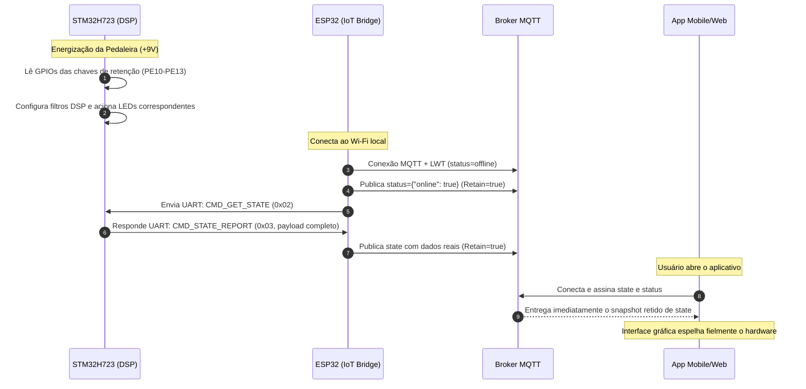
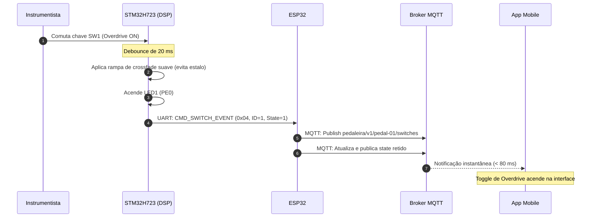
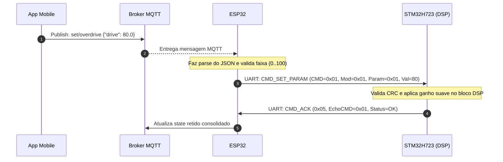

# Especificação do Protocolo de Comunicação Serial (STM32 <-> ESP32) e Tópicos MQTT


Este documento especifica formalmente a arquitetura de comunicação da **Pedaleira Digital**, cobrindo o protocolo serial inter-microcontroladores (STM32H723 <-> ESP32) e a interface IoT baseada em tópicos e payloads MQTT (ESP32 <-> Broker <-> App Mobile/Desktop), em atendimento aos requisitos das Issues [#9](https://github.com/Rodriguesmath/Pedaleira-digital/issues/9), [#13](https://github.com/Rodriguesmath/Pedaleira-digital/issues/13) e [#17](https://github.com/Rodriguesmath/Pedaleira-digital/issues/17).

---

## 1. Visão Geral da Arquitetura de Comunicação

O ecossistema de software é dividido em camadas desacopladas para assegurar que a pilha de rede sem fio não introduza latência ou interrupções concorrentes (*jitter*) no loop crítico de processamento digital de sinal (DSP):

```
┌────────────────────────────────┐
│      Aplicação do Usuário      │ (Interface gráfica: Mobile Android/iOS ou Desktop)
│     (Flutter / React Native)   │
└───────────────▲────────────────┘
                │ JSON via TCP/IP
                ▼
┌────────────────────────────────┐
│          Broker MQTT           │ (Mosquitto / EMQX local ou na nuvem)
│ (pedaleira/v1/{device_id}/...) │
└───────────────▲────────────────┘
                │ Wi-Fi 802.11 b/g/n (MQTT QoS 1)
                ▼
┌────────────────────────────────┐
│          ESP32 DevKit          │ (Ponte de rede, parsing de JSON, serialização)
│ (FreeRTOS: Wi-Fi + MQTT Tasks) │
└───────────────▲────────────────┘
                │ UART Full-Duplex (115200 bps, 8-N-1, Frame Binário com CRC)
                ▼
┌────────────────────────────────┐
│      STM32H723VGT6 (DSP)       │ (DMA Circular I2S, Algoritmos de Efeito CMSIS-DSP,
│  (Cortex-M7 @ 550 MHz, Bare)   │  Leitura de Chaves Mecânicas com Debounce)
└────────────────────────────────┘
```

---

## 2. Protocolo Serial Inter-MCU (STM32 <-> ESP32)

### 2.1. Configuração da Camada Física (UART)

| Parâmetro | Valor Configurado | Justificativa Técnica |
| :--- | :--- | :--- |
| **Taxa de Transmissão (Baud Rate)** | **115.200 bps** | Vazão suficiente para pacotes de controle (< 64 bytes em < 6 ms) com excelente imunidade a ruídos em bancada. |
| **Formato de Dados** | **8 data bits, sem paridade, 1 stop bit (8-N-1)** | Padrão universal sem overhead de paridade. |
| **Níveis de Tensão** | **3.3V LVCMOS** | Nível lógico nativo de ambos os microcontroladores (conexão direta sem conversor de nível). |
| **Linhas Conectadas** | **TX, RX, GND Comum** | STM32 `PD8 (TX)` -> ESP32 `GPIO16 (RX2)`; STM32 `PD9 (RX)` <- ESP32 `GPIO17 (TX2)`. |
| **Modo de Recepção** | **DMA Circular / Interrupt com Ring Buffer** | Recepção sem bloqueio da CPU Cortex-M7. |

---

### 2.2. Estrutura do Frame Serial Binário

Para eliminar o overhead de CPU associado a parsers de texto/JSON no STM32, a comunicação direta adota um protocolo em **quadro binário determinístico** com bytes de sincronismo e verificação de redundância cíclica (CRC-8):

```
+------------+------------+--------+--------+--------------------------+----------+
| SYNC_1     | SYNC_2     | CMD    | LEN    | PAYLOAD (0 a 64 bytes)   | CRC8     |
| 1 byte     | 1 byte     | 1 byte | 1 byte | N bytes                  | 1 byte   |
| (0xAA)     | (0x55)     |        | (N)    |                          |          |
+------------+------------+--------+--------+--------------------------+----------+
```

| Campo | Tamanho | Descrição |
| :--- | :---: | :--- |
| `SYNC_1` | 1 byte | Byte de sincronismo fixo: `0xAA` (10101010b). |
| `SYNC_2` | 1 byte | Byte de sincronismo fixo: `0x55` (01010101b). |
| `CMD` | 1 byte | Identificador do comando da mensagem (veja tabela de comandos). |
| `LEN` | 1 byte | Quantidade de bytes no campo `PAYLOAD` ($0 \le N \le 64$). |
| `PAYLOAD` | $N$ bytes | Bytes de parâmetros, dados de estado ou eventos específicos do comando. |
| `CRC8` | 1 byte | Checksum CRC-8 CCITT calculado sobre os campos `[CMD, LEN, PAYLOAD...]`. |

---

### 2.3. Tabela de Comandos (`CMD_ID`)

| CMD (Hex) | Nome do Comando | Sentido | Descrição |
| :---: | :--- | :---: | :--- |
| `0x01` | `CMD_SET_PARAM` | ESP32 -> STM32 | Altera um parâmetro contínuo de um efeito (ex.: ganho, tonalidade, tempo). |
| `0x02` | `CMD_GET_STATE` | ESP32 -> STM32 | Solicita o envio completo do estado atual da pedaleira. |
| `0x03` | `CMD_STATE_REPORT` | STM32 -> ESP32 | Resposta contendo o estado consolidado de todos os módulos e chaves. |
| `0x04` | `CMD_SWITCH_EVENT` | STM32 -> ESP32 | Notificação assíncrona gerada na comutação de uma chave física de retenção. |
| `0x05` | `CMD_ACK` | Ambos | Confirmação de recebimento e execução com sucesso de um comando anterior. |
| `0x06` | `CMD_NACK` | Ambos | Notificação de falha (erro de checksum, parâmetro fora da faixa ou comando desconhecido). |
| `0x07` | `CMD_HEARTBEAT` | Ambos | Monitoramento periódico de conectividade física (Link Keep-Alive / Liveness). |

---

### 2.4. Mapeamento de Módulos e Parâmetros

Os comandos que operam sobre efeitos (`CMD_SET_PARAM`, `CMD_STATE_REPORT`) utilizam a seguinte codificação hierárquica no payload:

#### Identificadores de Módulo (`MODULE_ID`)
- `0x00`: **Configurações Globais / Sistema** (`MODULE_GLOBAL`)
- `0x01`: **Overdrive / Distorção** (`MODULE_OVERDRIVE`)
- `0x02`: **Equalizador de 3 Bandas** (`MODULE_EQUALIZER`)
- `0x03`: **Delay Digital** (`MODULE_DELAY`)

#### Tabela Detalhada de Parâmetros por Módulo

| Módulo | Parâmetro | PARAM_ID | Tipo de Dado | Faixa de Valores | Unidade / Observação |
| :--- | :--- | :---: | :---: | :---: | :--- |
| **GLOBAL (`0x00`)** | Master Volume | `0x01` | `uint8_t` | 0 a 100 | Volume mestre de saída (%) |
| | Master Bypass | `0x02` | `uint8_t` | 0 ou 1 | 0 = Ativo, 1 = Bypass de todos os efeitos |
| | Master Mute | `0x03` | `uint8_t` | 0 ou 1 | 0 = Som liberado, 1 = Silenciado |
| **OVERDRIVE (`0x01`)** | Effect Enable | `0x00` | `uint8_t` | 0 ou 1 | 0 = Bypass do bloco, 1 = Efeito ativo |
| | Drive / Ganho | `0x01` | `uint8_t` | 0 a 100 | Quantidade de saturação / clipagem |
| | Tone / Tonalidade | `0x02` | `uint8_t` | 0 a 100 | Posição do filtro passa-altas/baixas |
| | Level / Saída | `0x03` | `uint8_t` | 0 a 100 | Volume individual do bloco de overdrive |
| **EQUALIZER (`0x02`)** | Effect Enable | `0x00` | `uint8_t` | 0 ou 1 | 0 = Bypass do bloco, 1 = Efeito ativo |
| | Bass (Grave - 100 Hz) | `0x01` | `int8_t` | -12 a +12 | Ganho em dB (filtro shelving) |
| | Mid (Médio - 1 kHz) | `0x02` | `int8_t` | -12 a +12 | Ganho em dB (filtro pico/peaking) |
| | Treble (Agudo - 4 kHz)| `0x03` | `int8_t` | -12 a +12 | Ganho em dB (filtro shelving) |
| **DELAY (`0x03`)** | Effect Enable | `0x00` | `uint8_t` | 0 ou 1 | 0 = Bypass do bloco, 1 = Efeito ativo |
| | Time (Tempo de atraso)| `0x01` | `uint16_t` (LE)| 20 a 1000 | Tempo em milissegundos (Little-Endian) |
| | Feedback | `0x02` | `uint8_t` | 0 a 95 | Realimentação / número de repetições (%) |
| | Mix | `0x03` | `uint8_t` | 0 a 100 | Equilíbrio Dry / Wet (%) |

---

### 2.5. Exemplos de Quadros Binários Detalhados

#### Exemplo 1: Ajustar Ganho do Overdrive para 75% (`CMD_SET_PARAM`)
- `CMD`: `0x01`
- `LEN`: `0x03` (Module: 1 byte, Param: 1 byte, Value: 1 byte)
- `PAYLOAD`: `0x01` (Overdrive), `0x01` (Drive), `0x4B` (75 decimal)
- Cálculo CRC-8 sobre `[0x01, 0x03, 0x01, 0x01, 0x4B]` -> Resultado: `0x7E`
- **Quadro Serial Completo**:
  ```
  [0xAA, 0x55, 0x01, 0x03, 0x01, 0x01, 0x4B, 0x7E]
  ```

#### Exemplo 2: Notificação de Comutação Física da Chave SW1 (`CMD_SWITCH_EVENT`)
- Usuário aciona a chave física SW1 (Overdrive Ligado -> nível LOW nos pinos).
- `CMD`: `0x04`
- `LEN`: `0x02`
- `PAYLOAD`: `0x01` (Switch ID 1 = Overdrive), `0x01` (Estado = Ativo / Fechado)
- Cálculo CRC-8 sobre `[0x04, 0x02, 0x01, 0x01]` -> Resultado: `0x89`
- **Quadro Serial Completo**:
  ```
  [0xAA, 0x55, 0x04, 0x02, 0x01, 0x01, 0x89]
  ```

---

### 2.6. Algoritmo de Verificação de Integridade (CRC-8 CCITT)

O cálculo de redundância utiliza o polinômio padrão $x^8 + x^2 + x + 1$ (valor `0x07` ou `0x8C` refletido) com valor inicial `0x00`:

```c
#include <stdint.h>
#include <stddef.h>

/**
 * @brief  Calcula o CRC-8 CCITT de um buffer contíguo sem tabelas grandes na ROM.
 * @param  data: Ponteiro para os dados (CMD, LEN e PAYLOAD)
 * @param  length: Quantidade total de bytes a processar
 * @retval Valor CRC-8 calculado
 */
uint8_t Protocol_CalculateCRC8(const uint8_t *data, size_t length)
{
    uint8_t crc = 0x00;
    while (length--) {
        crc ^= *data++;
        for (uint8_t i = 0; i < 8; i++) {
            if (crc & 0x80) {
                crc = (crc << 1) ^ 0x07;
            } else {
                crc <<= 1;
            }
        }
    }
    return crc;
}
```

---

### 2.7. Máquina de Estados Finita (FSM) do Parser Serial

Para processar a recepção de bytes assíncronos via DMA circular de forma determinística e com tolerância a ruídos de bancada:

```
    [ IDLE ] ──(Recebe 0xAA)──► [ WAIT_SYNC2 ]
       ▲                              │
       │ (Byte != 0x55)               │ (Recebe 0x55)
       ├──────────────────────────────┘
       │                              ▼
       │                        [ WAIT_CMD ]
       │                              │ (Salva CMD)
       │                              ▼
       │                        [ WAIT_LEN ]
       │                              │ (Se LEN <= MAX_LEN)
       │ (Se LEN > MAX)               ▼
       ├──────────────────────── [ WAIT_PAYLOAD ] ◄──┐
       │                              │ (Lê byte)    │ (Ainda faltam bytes)
       │                              │              └───┘
       │                              ▼ (Todos os bytes lidos)
       │                         [ WAIT_CRC ]
       │                              │
       │ (CRC Inválido -> NACK)       │ (CRC Válido -> Processa Comando & Envia ACK)
       └──────────────────────────────┴──────────────► [ DISPATCH ]
```

---

## 3. Arquitetura e Tópicos MQTT (ESP32 <-> Broker <-> App)

### 3.1. Hierarquia de Tópicos Versionada

Todos os tópicos seguem o padrão padronizado com versionamento de API `v1` e identificador unívoco do dispositivo (`{device_id}` derivado do MAC address do ESP32 ou configurado via firmware, ex.: `pedal-01`):

```
pedaleira/v1/{device_id}/
   ├── status              (Publicado pelo ESP32: LWT Online / Offline - Retained)
   ├── state               (Publicado pelo ESP32: Estado completo dos parâmetros - Retained)
   ├── switches            (Publicado pelo ESP32: Eventos instantâneos de comutação física)
   ├── telemetry           (Publicado pelo ESP32: Métricas de CPU, latência e sinal Wi-Fi)
   └── set/                (Assinado pelo ESP32: Comandos enviados pelo aplicativo)
       ├── overdrive       (Ajusta parâmetros do bloco de overdrive)
       ├── eq              (Ajusta parâmetros do equalizador de 3 bandas)
       ├── delay           (Ajusta parâmetros do delay)
       ├── master          (Ajusta volume mestre e mute)
       └── cmd             (Comandos administrativos: sync, reset, preset)
```

---

### 3.2. Especificação Detalhada dos Tópicos e Payloads

#### 1. Status de Conexão e LWT (`pedaleira/v1/{device_id}/status`)
- **Sentido**: ESP32 -> Broker -> App
- **QoS**: `1` | **Retain**: `true`
- **Last Will and Testament (LWT)**: Configurado na conexão MQTT pelo ESP32 para detectar queda de energia ou perda de sinal.
- **Payload Online**:
  ```json
  {
    "online": true,
    "device_id": "pedal-01",
    "firmware_version": "1.0.0",
    "ip": "192.168.1.105",
    "uptime_seconds": 1240
  }
  ```
- **Payload Offline (LWT automático)**:
  ```json
  {
    "online": false,
    "device_id": "pedal-01"
  }
  ```

---

#### 2. Estado Consolidado da Pedaleira (`pedaleira/v1/{device_id}/state`)
- **Sentido**: ESP32 -> Broker -> App
- **QoS**: `1` | **Retain**: `true`
- **Descrição**: Publicado na inicialização, ao reconectar ou após alterações de parâmetros. Garante que qualquer novo app aberto receba o retrato exato do hardware.
- **Payload Exemplo**:
  ```json
  {
    "device_id": "pedal-01",
    "timestamp_ms": 345020,
    "master": {
      "volume": 80.0,
      "mute": false,
      "global_bypass": false
    },
    "effects": {
      "overdrive": {
        "switch_physical": true,
        "active": true,
        "drive": 65.0,
        "tone": 50.0,
        "level": 80.0
      },
      "equalizer": {
        "switch_physical": true,
        "active": true,
        "bass_db": 2.5,
        "mid_db": -1.0,
        "treble_db": 3.0
      },
      "delay": {
        "switch_physical": false,
        "active": false,
        "time_ms": 350,
        "feedback_pct": 40.0,
        "mix_pct": 30.0
      }
    },
    "switches_raw": {
      "sw1": 1,
      "sw2": 1,
      "sw3": 0,
      "sw4": 0
    }
  }
  ```

---

#### 3. Evento Assíncrono de Chaves Físicas (`pedaleira/v1/{device_id}/switches`)
- **Sentido**: ESP32 -> Broker -> App
- **QoS**: `1` | **Retain**: `false`
- **Descrição**: Publicado no milissegundo em que o STM32 detecta a mudança mecânica de uma chave, permitindo ao aplicativo atualizar sua interface sem polling.
- **Payload Exemplo**:
  ```json
  {
    "switch_id": "sw1_overdrive",
    "physical_state": true,
    "effect_active": true,
    "timestamp_ms": 345100
  }
  ```

---

#### 4. Comandos de Ajuste de Parâmetros (App -> ESP32)

##### A. Ajuste de Overdrive (`pedaleira/v1/{device_id}/set/overdrive`)
- **Payload**:
  ```json
  {
    "drive": 75.0,
    "tone": 45.0,
    "level": 85.0
  }
  ```
- *Nota*: Campos omitidos não são alterados.

##### B. Ajuste de Equalizador (`pedaleira/v1/{device_id}/set/eq`)
- **Payload**:
  ```json
  {
    "bass_db": 3.0,
    "mid_db": 0.0,
    "treble_db": 4.5
  }
  ```

##### C. Ajuste de Delay (`pedaleira/v1/{device_id}/set/delay`)
- **Payload**:
  ```json
  {
    "time_ms": 420,
    "feedback_pct": 50.0,
    "mix_pct": 35.0
  }
  ```

##### D. Ajuste de Volume Mestre (`pedaleira/v1/{device_id}/set/master`)
- **Payload**:
  ```json
  {
    "volume": 90.0,
    "mute": false
  }
  ```

##### E. Comandos de Sistema (`pedaleira/v1/{device_id}/cmd`)
- **Payload**:
  ```json
  {
    "action": "request_state_sync"
  }
  ```
  *(Ações suportadas: `request_state_sync`, `reset_dsp`, `reboot_esp32`)*.

---

## 4. Sincronização Bidirecional e Resolução de Conflitos (Hardware vs App)

### 4.1. O Desafio das Chaves com Retenção Mecânica

Diferente de pedais comerciais que utilizam interruptores do tipo botão momentâneo (*push-button sem retenção* acoplado a relés de bypass), chaves mecânicas de alavanca/gangorra possuem posição física fixa visível (alavanca voltada para cima ou para baixo). 

Se o aplicativo pudesse desligar o efeito via software enquanto a chave continuasse fisicamente na posição "LIGADA", criaria-se uma incoerência visual e de usabilidade de bancada.

### 4.2. Matriz de Decisão Arquitetural: Modelo *Hardware Master Gate*

Para resolver esse conflito de forma determinística e intuitiva:
1. **A Chave Física é o Master Gate de Ativação**:
   - A posição da chave física define incondicionalmente a permissão de bypass do bloco no pipeline de processamento DSP:
     - **Chave Aberta (OFF)**: O bloco de DSP do efeito é ignorado (*true bypass* digital por crossfade). O LED físico no painel permanece apagado.
     - **Chave Fechada (ON)**: O bloco de DSP processa as amostras e aplica os parâmetros ativos. O LED físico no painel acende.
2. **O Aplicativo Governa os Parâmetros Contínuos**:
   - O aplicativo tem autonomia total para ajustar os parâmetros finos (Ganho, Frequência, Delay Time, Tonalidade, Volume) tanto com a chave ligada quanto desligada.
   - Se o usuário alterar os parâmetros de um efeito cuja chave física está em OFF, o STM32 salva imediatamente os novos valores na memória RAM. Assim que o instrumentista acionar a chave física com o pé/mão, o efeito entrará em operação imediatamente com as novas regulagens configuradas no aplicativo.
3. **Representação no Aplicativo**:
   - O aplicativo exibe tanto o indicador da chave física (`physical_switch`) quanto o status de processamento efetivo (`active`).
   - Caso a chave esteja em OFF, a interface móvel exibe os controles em modo "standby/preparação", evitando ambiguidades.

---

### 4.3. Fluxo de Inicialização e Boot



---

### 4.4. Fluxo de Comutação Física em Tempo Real



---

### 4.5. Fluxo de Ajuste Fino pelo Aplicativo



---

## 5. Resumo das Decisões de Arquitetura

1. **Baixa Sobrecarga**: O uso de pacotes UART binários com CRC-8 garante tempo de parsing inferior a $15\mu\text{s}$ no STM32, mantendo todo o poder de processamento do Cortex-M7 focado nos algoritmos de áudio.
2. **Determinismo**: Chaves mecânicas operam como *hardware master*, eliminando divergências mecânicas e protegendo a usabilidade de palco.
3. **Resiliência a Quedas de Rede**: Se a conexão Wi-Fi ou o Broker MQTT cair, o processamento de áudio do STM32 continua operando perfeitamente de forma independente. Ao restabelecer a rede, o ESP32 ressincroniza o estado automaticamente sem interrupção de áudio.
