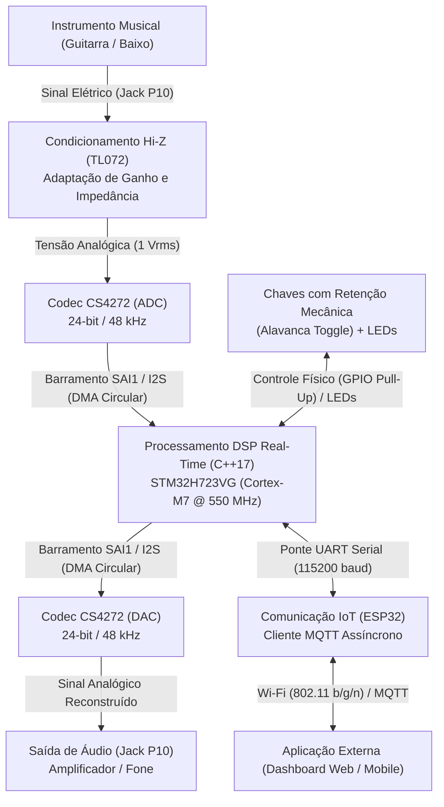
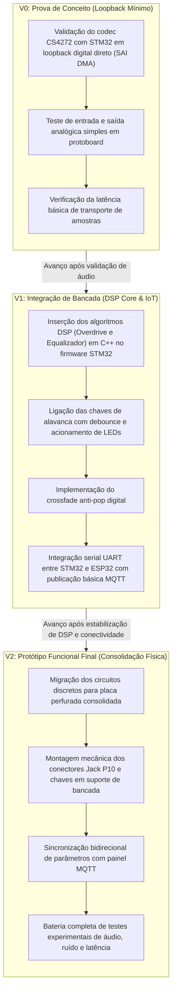

# Especificação de Escopo do Projeto — Pedaleira Digital

Documento formal de definição de Escopo, Arquitetura Preliminar e Estratégia de Prototipagem do projeto **Pedaleira Digital de Efeitos para Instrumentos Musicais**, elaborado em conformidade com as diretrizes do Instituto Federal de Educação, Ciência e Tecnologia da Paraíba (IFPB) para a disciplina de **Técnicas de Prototipagem**.

---

## 1. Identificação do Projeto

| Campo | Descrição |
| :--- | :--- |
| **Nome do Projeto** | Pedaleira Digital de Efeitos para Instrumentos Musicais |
| **Sigla / Identificador** | `PED-DIGITAL` |
| **Curso / Turma** | Engenharia Elétrica / Engenharia de Computação — IFPB |
| **Disciplina** | Técnicas de Prototipagem |
| **Equipe de Desenvolvimento** | Discentes da disciplina de Prototipagem (Repositório `Rodriguesmath/Pedaleira-digital`) |
| **Data da Versão** | Outubro de 2026 |
| **Versão da Documentação** | 1.0.0 |

---

## 2. Descrição da Ideia do Projeto

A **Pedaleira Digital** é um sistema embarcado de processamento de áudio em tempo real destinado a instrumentos musicais de corda (notadamente guitarra elétrica e contrabaixo). O projeto substitui o conjunto tradicional de múltiplos circuitos analógicos volumosos e caros por um núcleo computacional de alta velocidade baseado no microcontrolador **STM32H723VG** (ARM Cortex-M7 a 550 MHz), auxiliado pelo codec dedicado de alta resolução **Cirrus Logic CS4272** e integrado a um coprocessador **ESP32** para conectividade em rede sem fio via protocolo **MQTT**.

Respondendo às diretrizes pedagógicas e metodológicas do IFPB:

1. **O que será desenvolvido?**  
   Um protótipo funcional de pedaleira de efeitos de áudio digital, composto por hardware de condicionamento analógico de entrada/saída, conversão analógico-digital e digital-analógica de alta fidelidade (24 bits a 48 kHz), algoritmos de modelagem matemática de efeitos sonoros em ponto flutuante (Overdrive com saturação suave e Equalizador de 3 bandas paramétrico), interface física simplificada com chaves de retenção mecânica e sincronização remota com aplicativo via MQTT.

2. **Qual problema será abordado?**  
   O elevado custo de aquisição e a rigidez de configuração de pedais analógicos individuais (que exigem cablagem complexa, fontes de alimentação dedicadas e sofrem com ruídos de degradação de sinal), contrastando com a baixa acessibilidade financeira das pedaleiras digitais comerciais de ponta para estudantes, hobbistas e músicos em início de carreira.

3. **Quem utilizará a solução?**  
   Músicos instrumentistas (guitarristas, baixistas), estudantes de engenharia e entusiastas de áudio e música eletrônica que buscam uma solução flexível, de baixo custo, programável e controlável remotamente por dispositivos móveis ou computadores sem perda de fidelidade acústica.

4. **Como o sistema funcionará de maneira geral?**  
   O instrumento musical é conectado à entrada analógica Jack P10 da pedaleira. O sinal passa por um circuito de condicionamento de alta impedância (*Hi-Z*) com amplificador operacional, entra no codec CS4272 onde é digitalizado a 24 bits e 48 kHz, e é transmitido via barramento digital SAI/I2S com DMA circular para o microcontrolador STM32H7. O firmware DSP processa as amostras em blocos ultracompactos (32 a 64 amostras) aplicando os filtros digitais ativos. O sinal resultante retorna pelo barramento SAI ao DAC do codec e é entregue na saída analógica P10 para o amplificador de som. Concomitantemente, o estado das chaves físicas é monitorado por GPIOs e o ESP32 atua como ponte transparente de rede para receber novos parâmetros e publicar telemetria via MQTT sem afetar a latência do áudio.

5. **Quais são as principais funcionalidades previstas?**  
   - Digitalização de áudio em tempo real com baixa latência ($\le 10\text{ ms}$).
   - Efeito de Overdrive modelado com distorção não-linear suave (*soft-clipping*).
   - Efeito de Equalização ativa de 3 bandas (Graves, Médios e Agudos) via filtros biquad IIR.
   - Chaveamento físico determinístico via chaves de alavanca com retenção mecânica de estado.
   - Supressão de estalos sonoros de chaveamento (*anti-pop* por rampa de *crossfade*).
   - Ajuste remoto de ganho, frequências e volumes via tópicos MQTT.
   - Sincronização em tempo real do estado da pedaleira no aplicativo.

6. **Qual é o principal diferencial da proposta?**  
   A arquitetura distribuída e desacoplada em hardware: o núcleo crítico de áudio (STM32H7 bare-metal/DMA) opera de forma 100% determinística, imune a congelamentos ou *jitter* de rede do subsistema de conectividade (ESP32 Wi-Fi). Além disso, a pedaleira adota uma interface física simplificada com chaves de retenção mecânica direta aliada ao controle fino paramétrico remoto via IoT, viabilizando um protótipo robusto de custo acessível montado inteiramente em bancada acadêmica.

---

## 3. Contexto e Justificativa

No cenário da música contemporânea, a manipulação tímbrica por pedais de efeitos é essencial para a expressão artística. Entretanto, o paradigma tradicional de pedais analógicos individuais impõe diversos entraves:
- **Custo Cumulativo e Inflexibilidade**: Cada pedal individual analógico atende a apenas um tipo de efeito e possui custo que frequentemente varia entre R$ 300,00 e R$ 1.200,00 no mercado nacional.
- **Degradação de Sinal e Ruído de Terra**: A interconexão física em cascata de múltiplos pedais gera laços de terra (*ground loops*), atenuação de frequências agudas por capacitância parasita de cabos e ruídos de comutação mecânica.
- **Pedaleiras Digitais Comerciais Inacessíveis**: Processadores comerciais digitais multi-efeito consolidados (marcas como Boss, Line 6, Quad Cortex) apresentam custo proibitivo para o ambiente educacional e hobbista (frequentemente superiores a R$ 3.000,00).

O desenvolvimento deste protótipo no IFPB justifica-se pedagogicamente e tecnicamente pela convergência multidisciplinar entre **Processamento Digital de Sinais (DSP)**, **Sistemas Embarcados de Tempo Real**, **Eletrônica Analógica de Áudio** e **Internet das Coisas (IoT)**. Demonstra-se que é viável projetar um sistema de modelagem acústica de nível profissional empregando componentes de prateleira e placas de desenvolvimento de baixo custo.

---

## 4. Definição do Problema

| Dimensão | Descrição Estruturada |
| :--- | :--- |
| **Situação Atual** | Músicos necessitam carregar setups pesados e caros de pedais analógicos suscetíveis a ruídos, ou recorrer a pedaleiras comerciais fechadas e de custo elevado, sem possibilidade de customização didática ou integração flexível em rede. |
| **Problema Identificado** | Dificuldade de acesso a uma plataforma aberta de efeitos de áudio digital que ofereça processamento determinístico de baixa latência em hardware acessível, sem depender de fabricação de PCBs proprietárias complexas e sem suscetibilidade a falhas de conectividade de rede. |
| **Consequências do Problema** | Limitação no aprendizado prático de engenharia de áudio e DSP por estudantes, dependência de soluções de prateleira caras e falta de integração moderna entre o controle físico e aplicações conectadas. |
| **Solução Proposta** | Um protótipo acadêmico modular de pedaleira digital de efeitos baseado em STM32H723, codec CS4272 e ESP32, construído em bancada acadêmica com chaves de retenção de baixo custo e montagem modular em placa de ensaio/perfurada. |

### Pergunta de Projeto

> *"Como projetar, integrar e validar experimentalmente um protótipo acadêmico de pedaleira de efeitos digitais de baixo custo, utilizando placas de desenvolvimento comerciais e chaves com retenção mecânica, capaz de garantir processamento DSP de alta fidelidade com latência audível inferior a 10 ms e controle remoto via MQTT desacoplado?"*

---

## 5. Público-Alvo e Cenários de Uso

| Usuário ou Público | Necessidade | Cenário de Uso Típico |
| :--- | :--- | :--- |
| **Músico Instrumentista (Guitarrista / Baixista)** | Tocar ao vivo ou ensaiar com resposta imediata e timbres clássicos (overdrive e equalização) sem sofrer com atraso perceptível de som (*latência*) nem ruídos de estalo ao ligar o efeito. | Conecta o instrumento na entrada P10 e a saída na caixa amplificadora; aciona a chave de alavanca com o dedo/pé para ligar o Overdrive no início do solo e desliga ao retornar à base; ouve o som instantâneo sem chiados. |
| **Estudante / Pesquisador de Engenharia e DSP** | Plataforma de desenvolvimento aberta para criar novos algoritmos de efeitos (chorus, delay, filtros não-lineares) e mensurar variáveis físicas de áudio (latência, THD, resposta em frequência). | Conecta a placa de desenvolvimento STM32 ao depurador ST-LINK, monitora buffers DMA e testa rotinas em C++ com CMSIS-DSP em bancada de laboratório. |
| **Operador de Áudio / Ajustador de Estúdio** | Configurar e parametrizar curvas finas de ganho e equalização em tempo real sem precisar interromper o músico ou intervir fisicamente no instrumento. | Utiliza um smartphone conectado à rede Wi-Fi local para enviar comandos via MQTT, afinando os parâmetros de ganho e frequências de corte no dashboard da aplicação. |

---

## 6. Objetivos do Projeto

### 6.1 Objetivo Geral

Desenvolver, integrar e validar experimentalmente um protótipo funcional de **Pedaleira Digital de Efeitos para Instrumentos Musicais**, utilizando as placas de desenvolvimento **STM32H723** e **ESP32**, o codec de áudio **CS4272** e chaves com retenção mecânica de estado, capaz de processar efeitos de overdrive e equalização com latência inferior a $10\text{ ms}$ e comunicação assíncrona via MQTT.

### 6.2 Objetivos Específicos

1. **Condicionamento de Sinal**: Projetar e montar em matriz de contato/placa perfurada um circuito de entrada analógico de alta impedância (*Hi-Z*) com amp-op (TL072/NE5532) para acoplar instrumentos musicais à faixa dinâmica do codec de áudio.
2. **Interface de Áudio e DMA**: Configurar os periféricos seriais de áudio (SAI/I2S) e canais de Direct Memory Access (DMA circular duplo) da STM32H7 para aquisição e emissão ininterrupta de áudio digital a 24 bits / 48 kHz.
3. **Desenvolvimento de Algoritmos DSP**: Implementar em linguagem C++ eficiente (C++17 bare-metal / Cortex-M7 FPU / CMSIS-DSP) os blocos matemáticos de Overdrive com soft-clipping não-linear e Equalizador de 3 bandas paramétrico biquad IIR.
4. **Interface Física com Retenção**: Conectar e tratar em firmware a leitura direta de chaves estáticas com retenção mecânica (alavanca/gangorra) utilizando pull-up interno e filtro temporal de debounce contra repiques.
5. **Algoritmo de Transição Suave**: Implementar rampa de atenuação/crossfade digital para chaveamento *anti-pop*, eliminando descontinuidades acústicas no acionamento dos efeitos.
6. **Comunicação Inter-MCU e Conectividade IoT**: Estruturar protocolo serial leve UART com controle de integridade entre STM32H7 e ESP32, e implementar firmware no ESP32 para publicação e subscrição de tópicos MQTT.
7. **Validação Experimental**: Realizar ensaios de bancada com gerador de funções, osciloscópio e analisador de espectro para comprovação de latência $\le 10\text{ ms}$, linearidade e resposta acústica.

---

## 7. Escopo Positivo (O que SERÁ implementado)

Na versão final do protótipo acadêmico entregue na disciplina de Prototipagem do IFPB, estarão contemplados:

- [x] **Circuito de Condicionamento Analógico de Bancada**: Estágio de entrada P10 mono de alta impedância com resistor de carga de $1\text{ M}\Omega$ e buffer com amplificador operacional (TL072 ou equivalente) alimentado com tensão regulada simétrica/virtual; estágio de saída analógica com filtro reconstrutor passa-baixas passivo.
- [x] **Conversão Analógica/Digital e Digital/Analógica**: Módulo breakout com o circuito integrado Cirrus Logic CS4272 operando como escravo I2S/SAI em 48 kHz / 24 bits.
- [x] **Processamento Digital de Sinais (STM32H723)**:
  - Buffer duplo circular em DMA (ping-pong) com tamanho de bloco configurado entre 32 e 64 amostras.
  - Efeito de Overdrive com controle de saturação (drive), modelado com função contínua de soft-clipping.
  - Efeito de Equalização de 3 bandas (Graves em 100 Hz, Médios em 1 kHz, Agudos em 5 kHz) com ganhos ajustáveis em $\pm 12\text{ dB}$.
  - Controle de volume master digital com atenuação linear.
  - Lógica de bypass com rampa de crossfade anti-pop (2 a 5 ms).
- [x] **Painel de Interface Física**:
  - Leitura de pelo menos 2 chaves físicas com retenção de estado mecânico (tipo alavanca/toggle ou gangorra de 2 posições SPST/SPDT).
  - LEDs indicadores de status luminosos (LED Overdrive ON, LED EQ ON) acionados por GPIO da STM32.
- [x] **Comunicação e Conectividade**:
  - Canal serial UART cabeado entre STM32H7 e ESP32 DevKit com verificação de erros (framing + checksum).
  - Firmware ESP32 baseado em FreeRTOS com conexão Wi-Fi e cliente MQTT para recepção de comandos de configuração e envio de telemetria de status.
- [x] **Montagem Física Estrutural**:
  - Circuito consolidado em placa de ensaio perfurada (ilhada) ou protoboard de alta qualidade montada sobre base rígida de bancada com conectores P10 fêmea devidamente aterrados.

---

## 8. Escopo Negativo (O que NÃO será implementado)

Para assegurar a viabilidade técnica dentro dos prazos, limitações orçamentárias e premissas pedagógicas do IFPB, os seguintes itens estão **explicitamente excluídos** do escopo desta versão do protótipo:

- [ ] **NÃO haverá fabricação de placa de circuito impresso (PCB) comercial dedicada de fábrica**: Todo o hardware será baseado na interconexão de placas de desenvolvimento consagradas (dev boards) e circuitos analógicos em protoboard/placa perfurada. A confecção de PCBs industriais com layout de alta densidade e 4 camadas aumentaria o custo, prazo de importação e inviabilizaria a prototipagem ágil em bancada.
- [ ] **NÃO serão utilizados footswitches mecânicos industriais 3PDT ou pushbuttons momentâneos**: Pedais comerciais utilizam footswitches 3PDT caros e robustos para pisoteio violento com solado de sapato. O protótipo acadêmico utilizará chaves normais acessíveis com retenção mecânica de estado (toggle/gangorra), acionáveis manualmente ou por toque suave de bancada, o que simplifica a leitura para nível lógico direto sem requerer máquinas de estados complexas de clique curto/longo.
- [ ] **NÃO serão implementados efeitos de modulação pesada ou baseados em linhas de atraso longas (Reverb convolucional, Pitch Shifter, Shimmer)**: Tais algoritmos demandam memória RAM externa (SDRAM) de alta capacidade, bancos de filtros complexos e longo tempo de calibração acústica, extrapolando o prazo letivo da disciplina.
- [ ] **NÃO haverá gabinete mecânico metálico injetado à prova de intempéries**: O chassi será restrito a uma estrutura acadêmica aberta ou caixa plástica/acrílica simples de bancada com fins de proteção dos contatos e sustentação mecânica dos conectores P10.
- [ ] **NÃO haverá display gráfico integrado (LCD TFT / OLED touch)**: Todas as informações e parâmetros serão visualizados via LEDs indicadores de status na pedaleira e remotamente através do aplicativo / painel MQTT.
- [ ] **NÃO haverá operação a bateria interna recarregável com sistema de carga (BMS/Li-Ion)**: O protótipo será alimentado diretamente por fonte regulada externa de bancada (5V USB / 9V DC padrão pedalboard com regulador LDO linear).

---

## 9. Restrições Técnicas e Premissas de Prototipagem

1. **Restrição Orçamentária e Acessibilidade**: O projeto é desenvolvido com recursos próprios e materiais disponíveis no laboratório do IFPB. Todos os componentes devem ser facilmente substituíveis e adquiríveis no comércio eletrônico comum.
2. **Arquitetura Desacoplada e Tolerante**: A estabilidade do áudio é soberana. O firmware da STM32 deve executar bare-metal com interrupções de áudio de mais alta prioridade. Nenhuma chamada de rede do ESP32 pode bloquear o laço de processamento de áudio.
3. **Segurança Elétrica e Integridade**: Os sinais analógicos de guitarra possuem baixa amplitude ($50\text{ a }500\text{ mV}_{\text{rms}}$) e são extremamente sensíveis a ruídos de chaveamento digital. Deve-se garantir planos de terra limpos e desacoplamento com capacitores cerâmicos de 100 nF próximos aos pinos de alimentação dos circuitos integrados.
4. **Alinhamento Pedagógico**: A documentação e os testes devem demonstrar rastreabilidade com os conceitos vistos nas aulas de Prototipagem (diagrama conceitual, divisão em subsistemas, plano de testes e gestão de riscos).

---

## 10. Diagrama Conceitual e Arquitetura em Subsistemas

### 10.1 Diagrama Conceitual

### 10.2 Divisão em Subsistemas de Hardware e Software

| Subsistema | Função Principal | Principais Componentes / Módulos |
| :--- | :--- | :--- |
| **SS01: Condicionamento Analógico** | Casamento de impedância de entrada ($1\text{ M}\Omega$), filtragem passa-altas de corte DC ($10\text{ Hz}$) e buffer de saída de linha com proteção contra curtos. | Amp-Op TL072 ou NE5532, resistores de precisão 1%, capacitores de poliéster/cerâmica, conectores Jack P10 mono fêmea. |
| **SS02: Conversão de Áudio (Codec)** | Amostragem estéreo de 24 bits a 48 kHz, geração/sincronismo de relógio mestre (MCLK) e conversão DAC para saída. | Placa breakout Cirrus Logic CS4272 com interface I2S/SAI e controle I2C/Hardware Mode. |
| **SS03: Processamento DSP (MCU)** | Aquisição por DMA circular, processamento matemático de Overdrive e Equalizador 3 bandas, crossfade anti-pop e controle de fluxo. | Placa de desenvolvimento STM32H723VG (Cortex-M7 a 550 MHz), firmware em C++ (C++17) com biblioteca CMSIS-DSP. |
| **SS04: Interface Física de Bancada** | Leitura mecânica determinística de bypass dos efeitos e sinalização luminosa de estado para o usuário. | 2 Chaves tipo alavanca toggle SPST com retenção mecânica, 2 LEDs difusos (Vermelho e Verde) com resistores de $330\Omega$. |
| **SS05: Comunicação e Conectividade** | Manutenção da pilha Wi-Fi 802.11 b/g/n, conexão com broker MQTT e serialização/desserialização de mensagens com a STM32. | ESP32 DevKit v1, firmware ESP-IDF ou FreeRTOS com cliente MQTT integrado. |
| **SS06: Alimentação Elétrica** | Regulação de tensão e filtragem de ruídos para alimentação dos circuitos analógicos e digitais. | Fonte DC 9V externa com reguladores LDO lineares de baixo ruído (7805 / AMS1117-3.3V) e rede de capacitores de desacoplamento. |

---

## 11. Lista Preliminar de Materiais de Bancada (BOM)

A tabela a seguir apresenta os componentes selecionados para a construção do protótipo, fundamentada em disponibilidade, baixo custo e facilidade de integração em bancada:

| Item | Componente / Descrição | Qtd. | Função no Protótipo | Justificativa Técnica |
| :---: | :--- | :---: | :--- | :--- |
| 1 | Placa STM32H723VG Dev Board / Nucleo | 1 | Processamento DSP de Áudio | Processador Cortex-M7 com FPU de precisão dupla, periféricos SAI com suporte a áudio 24-bit DMA e ampla memória SRAM rápida. |
| 2 | Módulo Breakout Codec CS4272 | 1 | Conversão A/D e D/A | Codec profissional Cirrus Logic com faixa dinâmica de 114 dB, suporte nativo a I2S 24-bit/48kHz e excelente relação custo-benefício. |
| 3 | Módulo ESP32 DevKit v1 | 1 | Conectividade Wi-Fi e MQTT | Solução consolidada para IoT com stack de rede robusto, dois núcleos de processamento e biblioteca MQTT pronta em ambiente open-source. |
| 4 | Amplificador Operacional TL072 / NE5532 | 1 | Pré-amplificador e Buffer Hi-Z | Amplificador operacional com entradas JFET (TL072), impedância de entrada extremamente elevada ($10^{12}\Omega$), baixo ruído harmônico e baixo custo. |
| 5 | Chaves tipo Alavanca / Toggle (SPST/SPDT) | 2 | Chaveamento de Bypass | Chaves mecânicas com retenção estática; fornecem estado fixo estável na GPIO sem requerer footswitches industriais caros. |
| 6 | Conectores Jack P10 Fêmea (6,35 mm) | 2 | Entrada de instrumento e Saída | Conector padrão universal para instrumentos musicais e cabos blindados de áudio. |
| 7 | Placa de Circuito Perfurada (Ilhada) 7x9 cm | 1 | Consolidação física do circuito | Permite soldagem firme dos componentes discretos sem a necessidade ou custo de confecção de PCB industrial. |
| 8 | Componentes Passivos Discretos (Resistores/Caps) | 1 kit | Polarização, filtragem e LEDs | Resistores de filme metálico 1% para mitigação de ruído térmico Johnson e capacitores eletrolíticos/cerâmicos de desacoplamento. |
| 9 | Fonte DC regulada de 9V / 1A | 1 | Alimentação principal | Tensão compatível com a indústria de áudio, convertida localmente com reguladores de baixo ruído. |

---

## 12. Fluxo de Dados e Interação

O ciclo de vida dos sinais no sistema divide-se em dois planos independentes:

1. **Plano de Sinal de Áudio (Tempo Real Crítico — STM32H7)**:
   $$\text{Corda da Guitarra} \rightarrow \text{P10} \rightarrow \text{TL072 Buffer} \rightarrow \text{CS4272 ADC} \xrightarrow{\text{SAI/DMA}} \text{Buffer Ping-Pong STM32}$$
   $$\rightarrow \text{Filtro Overdrive} \rightarrow \text{Filtro EQ 3-Bandas} \rightarrow \text{Rampa Crossfade} \xrightarrow{\text{SAI/DMA}} \text{CS4272 DAC} \rightarrow \text{Saída P10}$$

2. **Plano de Controle e Telemetria (Assíncrono — ESP32 & MQTT)**:
   - **Controle Local**: O usuário aciona uma chave física de alavanca $\rightarrow$ Interrupção GPIO detecta borda $\rightarrow$ Debounce de 20 ms $\rightarrow$ STM32H7 aciona rampa de crossfade do efeito $\rightarrow$ Atualiza LED físico correspondente $\rightarrow$ Envia mensagem serial para o ESP32 $\rightarrow$ ESP32 publica no tópico `pedaleira/state`.
   - **Controle Remoto**: O usuário altera o ganho de agudos no aplicativo $\rightarrow$ Broker MQTT despacha no tópico `pedaleira/set/eq` $\rightarrow$ ESP32 recebe via Wi-Fi $\rightarrow$ Valida frame e encaminha via UART com checksum para a STM32 $\rightarrow$ STM32 recalcula coeficientes dos filtros biquad de forma suave no laço DSP.

---

## 13. Estratégia de Prototipagem Incremental

O desenvolvimento do protótipo seguirá o modelo incremental e iterativo prescrito pelo IFPB, minimizando riscos de integração e permitindo entregas intermediárias mensuráveis:

---

## 14. Análise de Riscos Técnicos e Estratégias de Mitigação

Conforme a Seção 26 do Roteiro de Prototipagem do IFPB, os riscos técnicos inerentes ao projeto foram identificados, classificados e dotados de estratégias preventivas e de contingência:

| ID | Risco Técnico | Categoria | Prob. | Impacto | Estratégia Preventiva e de Mitigação |
| :---: | :--- | :--- | :---: | :---: | :--- |
| **R01** | **Latência de áudio total superior a 10 ms** | Desempenho | Média | Alto | Utilizar buffers DMA ultracompactos (32 a 64 amostras) e compilar o firmware da STM32 com otimizações `-O3` e instruções intrínsecas da CMSIS-DSP com uso intensivo da FPU. |
| **R02** | **Ruído de chaveamento digital injetado na linha analógica de áudio** | Hardware Analógico | Alta | Médio | Separar fisicamente a malha de terra analógica da malha digital (*star ground*), empregar capacitores de desacoplamento de $100\text{ nF}$ em cada CI e blindar cabos de entrada/saída P10. |
| **R03** | **Repique de contato mecânico (*switch chatter*) nas chaves de retenção** | Hardware / Firmware | Média | Baixo | Implementar rotina de debounce temporal por software (20 a 30 ms) nas interrupções de GPIO e utilizar capacitores de filtragem de $10\text{ nF}$ em paralelo com os contatos. |
| **R04** | **Estalo audível (*pop/click*) ao comutar o estado dos efeitos** | Processamento DSP | Média | Alto | Implementar rampa linear ou cossenoide de interpolação (*crossfade*) de 2 ms a 5 ms no firmware DSP antes de desligar ou ligar os filtros, garantindo continuidade de sinal. |
| **R05** | **Congelamento do áudio durante oscilações ou reconexão Wi-Fi** | Arquitetura de Software | Baixa | Crítico | Desacoplar totalmente os dois núcleos: o STM32 opera em tempo real crítico e a interface UART utiliza DMA não-bloqueante; quedas no ESP32 não afetam a rotina de áudio da STM32. |
| **R06** | **Danos mecânicos ou mau contato em montagem de protoboard** | Montagem Física | Alta | Médio | Consolidar os circuitos discretos em placa padrão perfurada (ilhada) soldada logo após a validação da prova de conceito (V0), fixando os conectores P10 rigidamente. |
| **R07** | **Incompatibilidade ou falha na inicialização do codec CS4272** | Hardware / Firmware | Baixa | Alto | Utilizar o CS4272 em modo *Hardware Control Mode* caso ocorram divergências de barramento I2C, garantindo a configuração dos pinos de amostragem por resistores fixos de pull-up/pull-down. |

---

## 15. Cronograma e Entregáveis da Disciplina

| Etapa / Marco | Descrição da Entrega | Período Previsto | Entregáveis Associados |
| :--- | :--- | :---: | :--- |
| **M1: Especificação & Arquitetura** | Formalização de Requisitos (RF/RNF), Escopo e Arquitetura no padrão IFPB. | Semanas 1 a 2 | Documentos `requisitos.md` e `escopo.md`. |
| **M2: Validação de Bancada (V0)** | Montagem do estágio de entrada analógica e loopback digital de áudio via codec CS4272. | Semanas 3 a 4 | Firmware básico SAI DMA e circuito analógico testado com gerador de áudio. |
| **M3: DSP Core & Comunicação** | Codificação dos algoritmos de Overdrive, Equalizador 3 bandas e ponte UART STM32 <-> ESP32. | Semanas 5 a 7 | Código em C++ com CMSIS-DSP e protocolo serial implementado e testado. |
| **M4: Chaves Físicas & App MQTT** | Leitura de chaves com retenção mecânica, crossfade anti-pop e integração com broker MQTT. | Semanas 8 a 10 | Firmware integrado com chaves físicas e aplicativo MQTT funcional. |
| **M5: Consolidação & Testes Finais** | Montagem em placa perfurada, medições experimentais de latência e elaboração do relatório final. | Semanas 11 a 12 | Protótipo V2 operacional, medições em osciloscópio e relatório final IFPB. |

---

## 16. Histórico de Versões do Escopo

| Versão | Data | Responsável | Descrição do Histórico |
| :---: | :---: | :--- | :--- |
| **0.1.0** | 15/09/2026 | Equipe Pedaleira Digital | Rascunho inicial de escopo e levantamento de componentes. |
| **1.0.0** | 22/10/2026 | Equipe de Engenharia / IFPB | Consolidação formal de escopo positivo e negativo, restrições acadêmicas, diagrama conceitual, divisão em subsistemas, BOM, prototipagem incremental e análise de riscos no padrão IFPB. |
