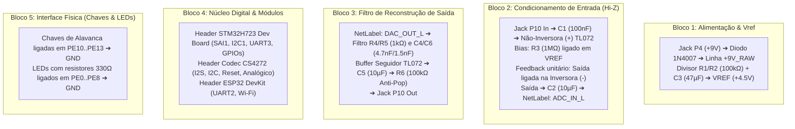

# Guia Prático para Criação do Esquemático no EasyEDA Web

Este guia orienta passo a passo a montagem do esquemático elétrico do protótipo da **Pedaleira Digital** no [EasyEDA Web](https://easyeda.com/editor), utilizando componentes com encapsulamento **Through-Hole (DIP/THT)** ideais para montagem em protoboard e placa perfurada/ilhada, com seus respectivos códigos oficiais de catálogo **LCSC**.

---

## 1. Acesso e Configuração Inicial no EasyEDA

1. Acesse o editor web gratuito: **[https://easyeda.com/editor](https://easyeda.com/editor)**.
2. Crie um novo projeto: **`File` $\to$ `New` $\to$ `Project...`** com o nome `Pedaleira-Digital`.
3. Um esquemático em branco será aberto. Pressione a tecla **`Space`** para rotacionar componentes e **`W`** para puxar fios (*wires*).
4. **Boas Práticas de Projeto**: Em vez de cruzar fios longos pela tela inteira, utilize **NetLabels** (atalho **`N`**). Pinos com o mesmo NetLabel conectam-se automaticamente de forma limpa.

---

## 2. Catálogo de Componentes Oficiais (Códigos LCSC)

Para adicionar qualquer componente no EasyEDA com o símbolo elétrico e o footprint de furos (Through-Hole) corretos:
1. Pressione **`Shift + B`** (ou clique na aba **`Library`** na barra lateral esquerda).
2. Cole o código **LCSC Part #** indicado na tabela abaixo no campo de busca e clique em **`Place`**:

| Categoria | Componente / Valor | Encapsulamento | Código LCSC (EasyEDA) | Função no Circuito |
| :--- | :--- | :---: | :---: | :--- |
| **CI Analógico** | **TL072CP** (Texas Instruments) | DIP-8 | **`C6955`** | Buffer de entrada Hi-Z e filtro ativo de saída |
| **Conector Áudio** | **Jack P10 Fêmea 6.35mm** | THT Horizontal | **`C2843477`** | Entrada de instrumento e saída de áudio |
| **Conector Alimentação**| **Jack DC P4 (2.1x5.5mm)** | THT (DC-005) | **`C136657`** | Conexão para fonte de pedal DC +9V |
| **Diodo Proteção** | **1N4007** | DO-41 (THT) | **`C2860`** | Proteção contra inversão de polaridade dos 9V |
| **Chaves Físicas** | **Chave Alavanca MTS-102** (SPDT) | Painel/THT | **`C318884`** | Comutação de Bypass/Ativação com retenção |
| **Headers STM32** | Barra Fêmea 1x20 (ou 2x20) 2.54mm | THT | **`C224345`** | Soquete de encaixe da Dev Board STM32 |
| **Headers ESP32** | Barra Fêmea 1x15 2.54mm (2 unidades) | THT | **`C224345`** | Soquete de encaixe da Dev Board ESP32 |
| **Headers Codec** | Barra Fêmea 1x10 2.54mm | THT | **`C224345`** | Conexão do módulo breakout CS4272 |
| **LEDs Difusos** | LED 5mm Vermelho | THT | **`C2286`** | Sinalização de Overdrive / Status |
| **LEDs Difusos** | LED 5mm Verde | THT | **`C2290`** | Sinalização de Equalizador Ativo |
| **Resistor** | **1 MΩ** 1/4W 1% filme metálico | THT Axial | **`C61685`** | Resistor de bias de alta impedância (Hi-Z) |
| **Resistor** | **100 kΩ** 1/4W 1% | THT Axial | **`C61678`** | Divisor do terra virtual (Vref) e anti-pop |
| **Resistor** | **1 kΩ** 1/4W 1% | THT Axial | **`C61671`** | Filtro de reconstrução de saída |
| **Resistor** | **330 Ω** 1/4W 1% | THT Axial | **`C61665`** | Limitador de corrente para os LEDs |
| **Resistor** | **4.7 kΩ** 1/4W 1% | THT Axial | **`C61674`** | Pull-up das linhas I2C (SCL/SDA) |
| **Capacitor** | **100 nF** (0.1µF) 50V cerâmico | THT Radial | **`C62649`** | Bloqueio DC de entrada e desacoplamento |
| **Capacitor** | **10 µF** 25V eletrolítico | THT Radial | **`C96985`** | Acoplamento AC de saída do buffer e filtro |
| **Capacitor** | **47 µF** 25V eletrolítico | THT Radial | **`C96991`** | Estabilização e filtragem do nó Vref (+4.5V) |
| **Capacitor** | **4.7 nF** (4700pF) 50V cerâmico | THT Radial | **`C62635`** | Capacitor 1 do filtro de reconstrução |
| **Capacitor** | **1.5 nF** (1500pF) 50V cerâmico | THT Radial | **`C62632`** | Capacitor 2 do filtro de reconstrução |

---

## 3. Estrutura do Esquemático em 5 Blocos Funcionais

Divida sua folha no EasyEDA em 5 áreas lógicas utilizando a ferramenta de texto (`T`) ou molduras retangulares:

---

## 4. Tabela de Conexões por NetLabels (Pino a Pino)

Ao colocar um pino ou conector, basta ligar um pedaço de fio e anexar um **NetLabel** (tecla **`N`**) com exatamente o mesmo nome. O EasyEDA cuidará da conexão lógica:

### A. Barramento de Áudio e Controle (STM32 $\leftrightarrow$ Codec CS4272)
| NetLabel | Pino STM32H723 | Pino Módulo CS4272 | Função Elétrica |
| :--- | :---: | :---: | :--- |
| `SAI1_MCLK` | `PE2` | `MCLK` | Master Clock do Codec ($12.288\text{ MHz}$) |
| `SAI1_LRCK` | `PE4` | `LRCK` / `FS` | Frame Sync / Left-Right Clock ($48\text{ kHz}$) |
| `SAI1_SCK` | `PE5` | `SCLK` / `BCLK` | Serial Bit Clock ($3.072\text{ MHz}$) |
| `SAI1_SDA` | `PE6` | `SDIN` | Dados de Áudio do STM32 para o DAC do Codec |
| `SAI1_SDB` | `PE3` | `SDOUT` | Dados de Áudio do ADC do Codec para o STM32 |
| `I2C1_SCL` | `PB6` | `SCL` | Linha de Clock de Controle (com pull-up 4.7kΩ para 3.3V) |
| `I2C1_SDA` | `PB7` | `SDA` | Linha de Dados de Controle (com pull-up 4.7kΩ para 3.3V) |
| `CODEC_RST` | `PD11` | `/RST` | Reset ativo em nível baixo do CS4272 |

### B. Ponte Serial Inter-MCU (STM32 $\leftrightarrow$ ESP32)
| NetLabel | Pino STM32H723 | Pino ESP32 DevKit | Função Elétrica |
| :--- | :---: | :---: | :--- |
| `UART_TX_STM` | `PD8` (USART3_TX) | `GPIO16` (RX2) | Envio de telemetria e estado para o ESP32 |
| `UART_RX_STM` | `PD9` (USART3_RX) | `GPIO17` (TX2) | Recepção de parâmetros do App/MQTT pelo STM32 |

### C. Chaves com Retenção Mecânica e LEDs de Status
| NetLabel | Pino STM32 | Componente Físico | Conexão Externa |
| :--- | :---: | :--- | :--- |
| `SW_OVERDRIVE` | `PE10` | Chave Alavanca SW1 | Um terminal no pino `PE10`, outro no `GND` |
| `SW_EQ` | `PE11` | Chave Alavanca SW2 | Um terminal no pino `PE11`, outro no `GND` |
| `SW_DELAY` | `PE12` | Chave Alavanca SW3 | Um terminal no pino `PE12`, outro no `GND` |
| `SW_MUTE` | `PE13` | Chave Alavanca SW4 | Um terminal no pino `PE13`, outro no `GND` |
| `LED_OD_DRV` | `PE0` | Ânodo do LED Vermelho (via R 330Ω) | Cátodo do LED ligado no `GND` |
| `LED_EQ_DRV` | `PE1` | Ânodo do LED Verde (via R 330Ω) | Cátodo do LED ligado no `GND` |
| `LED_DLY_DRV` | `PE7` | Ânodo do LED Amarelo (via R 330Ω) | Cátodo do LED ligado no `GND` |
| `LED_STATUS_DRV` | `PE8` | Ânodo do LED Azul (via R 330Ω) | Cátodo do LED ligado no `GND` |

---

## 5. Simulação Interativa no Navegador (Falstad)

Antes de soldar ou montar em bancada, você pode conferir o funcionamento elétrico do estágio analógico (guitarra $\to$ buffer Hi-Z TL072 $\to$ filtro de saída $\to$ osciloscópio) com apenas 1 clique no link abaixo:

🔗 **[Abrir Simulação do Buffer Hi-Z no Falstad Circuit Simulator](https://www.falstad.com/circuit/circuitjs.html?ctz=%24%201%200.000005%2010.200271171%2050%205%2050%0Av%2064%20240%2064%20160%200%201%201000%200.3%200%200%200.5%0Ac%20128%20160%20176%20160%200%200.0000001%200%0Ar%20176%20160%20176%20224%200%201000000%0AR%20272%2080%20272%2048%200%200%2040%209%200%200%200.5%0Ar%20272%2080%20272%20144%200%20100000%0Ar%20272%20144%20272%20208%200%20100000%0Ag%20272%20208%20272%20224%200%0Ac%20320%20144%20320%20208%200%200.000047%200%0Ag%20320%20208%20320%20224%200%0Aw%20272%20144%20320%20144%200%0Aw%20176%20224%20272%20224%200%0Aw%20272%20224%20272%20144%200%0Aa%20208%20176%20288%20176%200%209%20-9%201000000%204.5%204.5%20100000%0Aw%20176%20160%20208%20160%200%0Aw%20208%20192%20208%20224%200%0Aw%20208%20224%20288%20224%200%0Aw%20288%20224%20288%20176%200%0Ac%20288%20176%20352%20176%200%200.00001%200%0Ar%20352%20176%20352%20240%200%20100000%0Ag%20352%20240%20352%20256%200%0AO%20352%20176%20400%20176%200%0Aw%2064%20160%20128%20160%200%0Ag%2064%20240%2064%20256%200)**

Na simulação, você verá:
- A senoide limpa simulando o captador de guitarra na entrada ($300\text{ mV}_{\text{peak}}$ a $1\text{ kHz}$).
- A polarização estável de $V_{ref} = +4.5\text{V}$ com o divisor de $100\text{ k}\Omega$ e capacitor de desacoplamento.
- A saída isolada do buffer com nível estável pronto para o ADC do CS4272.
