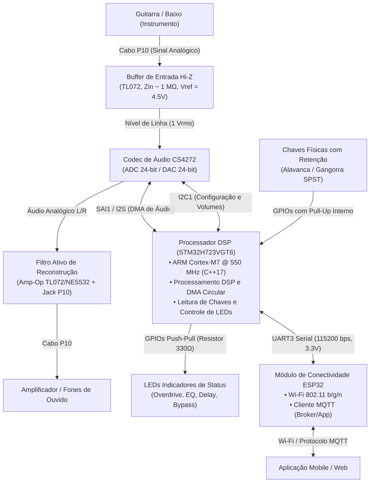
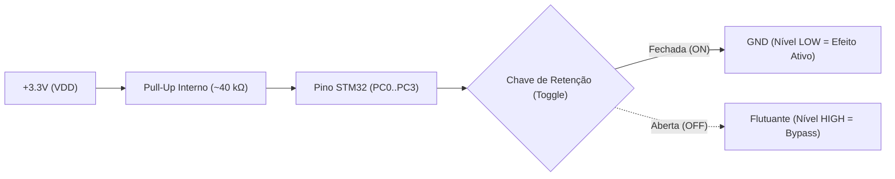
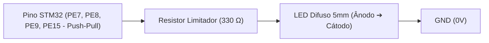
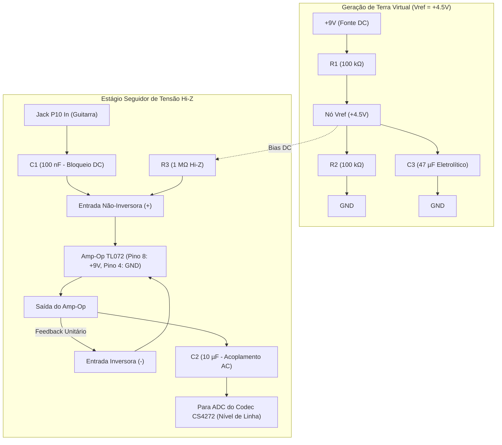
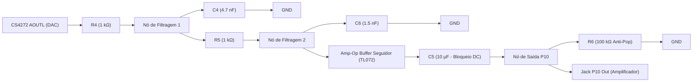

# Mapeamento de Pinout, Conexões e Lista de Materiais (BOM de Bancada)

Este documento estabelece o mapeamento físico completo de pinagem, diagramas de interconexão e a Lista de Materiais (*Bill of Materials* - BOM) com levantamento de custos para montagem e validação do protótipo de bancada da **Pedaleira Digital**, atendendo aos requisitos das Issues [#8](https://github.com/Rodriguesmath/Pedaleira-digital/issues/8) e [#10](https://github.com/Rodriguesmath/Pedaleira-digital/issues/10) e às diretrizes da disciplina de Prototipagem do IFPB.

---

## 1. Visão Geral da Arquitetura de Hardware

O hardware da pedaleira é composto por cinco blocos fundamentais interconectados:
1. **Condicionamento de Entrada (Buffer Hi-Z)**: Adapta a alta impedância de captadores magnéticos/piezoelétricos de instrumentos musicais (guitarra/baixo) para nível de linha balanceado/unipolar aceito pelo ADC.
2. **Codec de Áudio (Cirrus Logic CS4272)**: Conversão analógico-digital (ADC) de 24 bits e digital-analógica (DAC) de 24 bits com faixa dinâmica de até 114 dB e taxa de amostragem configurada para 48 kHz.
3. **Núcleo de Processamento DSP (STM32H723VGT6 - ARM Cortex-M7 @ 550 MHz)**: Recebe e envia streams de áudio digital via barramento de áudio síncrono (SAI/I2S com DMA duplo), executa os algoritmos de efeito e faz a leitura direta das chaves com retenção mecânica.
4. **Módulo de Conectividade e IoT (ESP32 DevKit V1)**: Gerencia Wi-Fi, conexão ao broker MQTT e ponte de comunicação serial UART assíncrona com o STM32.
5. **Estágio de Saída e Reconstrução**: Filtro passa-baixas anti-aliasing e buffer de saída desacoplado para ligação em fones, amplificadores ou mesas de som via jack P10.

### Diagrama em Blocos de Interconexão

---

## 2. Mapeamento de Pinout e Pinagem de Bancada

### 2.1. STM32H723VGT6 (WeAct Studio MiniSTM32H723)

O microcontrolador opera a 3.3V nos seus domínios de I/O. A pinagem foi rigorosamente mapeada e auditada contra o esquemático da placa **WeAct MiniSTM32H723 V1.2 (DS13313)** para **eliminar conflitos onboard** com a memória QSPI Flash (`PE2`, `PB6`, `PD11`) e o transistor do LED onboard VT2 (`PE3`):

| Pino (LQFP100) | Nome do Pino | Header WeAct | Periférico / Sinal | Função no Projeto | Modo elétrico | Conexão de Destino |
| :--- | :--- | :--- | :--- | :--- | :--- | :--- |
| **Pino 97** | `PE0` | Header P1.4 | `SAI4_MCLK_A` | Master Clock do Codec de Áudio | AF10 (Push-Pull, High Speed) | CS4272 - Pino `MCLK` |
| **Pino 2** | `PE4` | Header P2.5 | `SAI4_FS_A` | Frame Sync / Word Select (LRCK) | AF10 (Push-Pull, High Speed) | CS4272 - Pino `LRCK` |
| **Pino 3** | `PE5` | Header P2.6 | `SAI4_SCK_A` | Serial Bit Clock (BCLK) | AF10 (Push-Pull, High Speed) | CS4272 - Pino `SCLK` |
| **Pino 4** | `PE6` | Header P2.7 | `SAI4_SD_A` | Serial Audio Data Out (DAC Data)| AF10 (Push-Pull, High Speed) | CS4272 - Pino `SDIN` |
| **Pino 23** | `PA0` | Header P2.17| `SAI4_SD_B` | Serial Audio Data In (ADC Data) | AF10 (Input Float, High Speed) | CS4272 - Pino `SDOUT` |
| **Pino 95** | `PB8` | Header P1.6 | `I2C1_SCL` | I2C Clock de Controle do Codec | AF4 (Open-Drain, Pull-up 4.7kΩ onboard) | CS4272 - Pino `SCL/CCLK` |
| **Pino 96** | `PB9` | Header P1.5 | `I2C1_SDA` | I2C Data de Controle do Codec | AF4 (Open-Drain, Pull-up 4.7kΩ onboard) | CS4272 - Pino `SDA/CDIN` |
| **Pino 80** | `PD10` | Header P1.38| `GPIO_Output` | Reset de Hardware do Codec (`/RST`)| Output Push-Pull (Ativo em nível LOW) | CS4272 - Pino `RESET` |
| **Pino 55** | `PD8` | Header P1.40| `USART3_TX` | Linha de Transmissão UART para ESP32| AF7 (Push-Pull, 115200 baud) | ESP32 - Pino `GPIO16 (RX2)` |
| **Pino 56** | `PD9` | Header P1.39| `USART3_RX` | Linha de Recepção UART do ESP32 | AF7 (Input, 115200 baud) | ESP32 - Pino `GPIO17 (TX2)` |
| **Pino 15** | `PC0` | Header P2.11| `GPIO_Input` | Chave SW1: Overdrive On/Off | Input com Pull-Up interno | Chave Alavanca 1 -> GND |
| **Pino 16** | `PC1` | Header P2.12| `GPIO_Input` | Chave SW2: Equalizador 3-Band On/Off| Input com Pull-Up interno | Chave Alavanca 2 -> GND |
| **Pino 17** | `PC2` | Header P2.13| `GPIO_Input` | Chave SW3: Delay On/Off | Input com Pull-Up interno | Chave Alavanca 3 -> GND |
| **Pino 18** | `PC3` | Header P2.14| `GPIO_Input` | Chave SW4: Master Bypass / Mute | Input com Pull-Up interno | Chave Alavanca 4 -> GND |
| **Pino 37** | `PE7` | Header P2.30| `GPIO_Output` | LED1: Indicador Overdrive Ativo | Output Push-Pull | Ânodo LED1 (via Resistor 330Ω) |
| **Pino 38** | `PE8` | Header P2.31| `GPIO_Output` | LED2: Indicador Equalizador Ativo | Output Push-Pull | Ânodo LED2 (via Resistor 330Ω) |
| **Pino 39** | `PE9` | Header P2.32| `GPIO_Output` | LED3: Indicador Delay Ativo | Output Push-Pull | Ânodo LED3 (via Resistor 330Ω) |
| **Pino 45** | `PE15`| Header P2.38| `GPIO_Output` | LED4: Indicador de Status / Link | Output Push-Pull | Ânodo LED4 (via Resistor 330Ω) |
| **Pino 72** | `PA13`| Header P1.24| `SWDIO` | Linha de Dados de Depuração ST-LINK| Debug AF | ST-LINK V2 / V3 |
| **Pino 76** | `PA14`| Header P1.23| `SWCLK` | Linha de Clock de Depuração ST-LINK| Debug AF | ST-LINK V2 / V3 |
| **5V / 3V3 / GND** | Múltiplos | P1.1, P1.2, P2.2 | Alimentação e GND | Alimentado via porta USB da WeAct | Alimentação | Barramento USB / GND Comum |

---

### 2.2. Módulo / Breakout CS4272 (Cirrus Logic)

O CS4272 opera no modo de controle via software (I2C) para flexibilidade de volume analógico, filtros e taxa de amostragem:

| Pino CS4272 | Sinal do Módulo | Nível Lógico / Tensão | Conexão no Protótipo | Descrição Técnica |
| :--- | :--- | :--- | :--- | :--- |
| `MCLK` | Master Clock | 3.3V CMOS | STM32 `PE0` (`SAI4_MCLK_A`) | Clock mestre síncrono (ex: 12.288 MHz para 48 kHz Fs a 256x Fs) |
| `SCLK` | Serial Clock | 3.3V CMOS | STM32 `PE5` (`SAI4_SCK_A`) | Clock de bits (BCLK = 64 * Fs = 3.072 MHz) |
| `LRCK` | Frame Sync | 3.3V CMOS | STM32 `PE4` (`SAI4_FS_A`) | Seleção de canal esquerdo/direito (Fs = 48 kHz) |
| `SDIN` | Serial Data In | 3.3V CMOS | STM32 `PE6` (`SAI4_SD_A`) | Dados de áudio serial transmitidos do STM32 para o DAC |
| `SDOUT` | Serial Data Out | 3.3V CMOS | STM32 `PA0` (`SAI4_SD_B`) | Dados de áudio serial captados pelo ADC enviados ao STM32 |
| `SCL / CCLK` | I2C SCL | 3.3V (Pull-Up 4.7kΩ) | STM32 `PB8` (`I2C1_SCL`) | Clock da interface I2C de controle (pull-up soldado na WeAct) |
| `SDA / CDIN` | I2C SDA | 3.3V (Pull-Up 4.7kΩ) | STM32 `PB9` (`I2C1_SDA`) | Dados bidirecionais I2C (pull-up soldado na WeAct) |
| `AD0 / CS` | I2C Endereço | 0V (GND) | GND | Define o endereço I2C do chip como `0x20` (0010000b) |
| `RESET` | Reset Hardware | 3.3V (Ativo em LOW) | STM32 `PD10` | Pulso em nível LOW (> 100ns) para inicialização confiável |
| `VA` | Analog Power | +5.0V DC | Barramento USB (+5V_USB) | Alimentação dos circuitos analógicos (ADC/DAC) |
| `VD` | Digital Power | +3.3V DC | Barramento +3.3V | Alimentação do núcleo digital do codec |
| `VL` | Logic Power | +3.3V DC | Barramento +3.3V | Define o nível de tensão da interface I/O (compatível STM32) |
| `AGND / DGND` | Terra Analógico / Digital | 0V | Ponto Único de Terra (Star Ground) | Planos de terra desacoplados com capacitores cerâmicos de 100nF |
| `AINL+ / AINL-`| Entrada ADC Canal L | 1 Vrms polarizado em VQ | Buffer Analógico Hi-Z de Entrada | Entrada do sinal da guitarra após condicionamento |
| `AOUTL+ / AOUTL-`| Saída DAC Canal L | 1 Vrms | Filtro Ativo de Reconstrução | Saída processada encaminhada ao conector Jack P10 |

---

### 2.3. ESP32 DevKit V1 (30 ou 38 Pinos)

O ESP32 atua como o controlador de rede e telemetria:

| Pino ESP32 | Função de Hardware | Nível Lógico | Conexão no Protótipo | Descrição Técnica |
| :--- | :--- | :--- | :--- | :--- |
| `GPIO16 (RX2)` | UART2 RX | 3.3V | STM32 `PD8` (`USART3_TX`) | Recepção serial assíncrona de comandos e telemetria |
| `GPIO17 (TX2)` | UART2 TX | 3.3V | STM32 `PD9` (`USART3_RX`) | Transmissão serial assíncrona de configurações vindas do MQTT |
| `GPIO2` | Onboard LED | 3.3V | Interno da placa | Indicação de status da conexão Wi-Fi e Broker MQTT |
| `EN / RST` | Reset do ESP32 | 3.3V | Botão interno / Capacitor 10µF | Reinicialização manual do módulo |
| `VIN` | Entrada de Tensão | 5.0V DC | Barramento regulado +5V | Alimentação do regulador LDO interno do ESP32 |
| `GND` | Terra de Referência | 0V | Barramento GND comum | Referência elétrica comum entre STM32, ESP32 e analógico |

> [!NOTE]
> Utiliza-se a **UART2** do ESP32 (`GPIO16` e `GPIO17`) para comunicação inter-MCU. Isso mantém a **UART0** (`GPIO1` e `GPIO3`) dedicada exclusivamente ao cabo USB/Serial para compilação, gravação via PlatformIO/ESP-IDF e monitoramento de logs em tempo de execução sem interferência de pacotes.

---

### 2.4. Entradas Físicas (Chaves de Retenção) e LEDs Indicadores

As chaves mecânicas utilizam o recurso de **pull-up interno** do STM32 (`GPIO_PULLUP`), eliminando a necessidade de resistores discretos externos na bancada:

| ID Físico | Tipo de Chave | Pino STM32 | Estado em Aberto (HIGH) | Estado em Fechado (LOW) | Ação de Processamento DSP |
| :--- | :--- | :--- | :--- | :--- | :--- |
| **SW1** | Alavanca MTS-102 | `PC0` | Bypass do Efeito | Efeito Ativo | Habilita algoritmo de Distorção / Overdrive |
| **SW2** | Alavanca MTS-102 | `PC1` | Bypass do Efeito | Efeito Ativo | Habilita algoritmo de Equalização 3-Band |
| **SW3** | Alavanca MTS-102 | `PC2` | Bypass do Efeito | Efeito Ativo | Habilita algoritmo de Delay / Modulação |
| **SW4** | Alavanca MTS-102 | `PC3` | Pedaleira Operacional | Master Mute / Bypass | Ativa Bypass transparente global do sinal |

#### Conexão dos LEDs de Feedback

Cada LED é acionado diretamente por um pino de saída configurado como Push-Pull:

- Corrente por pino: $(3.3\text{V} - 2.0\text{V}) / 330\Omega \approx 3.9\text{ mA}$ (seguro para o STM32H7, cujo limite por I/O é 20 mA).
- **LED1 (Overdrive)**: Acionado por `PE7` (Header P2.30)
- **LED2 (Equalizador)**: Acionado por `PE8` (Header P2.31)
- **LED3 (Delay)**: Acionado por `PE9` (Header P2.32)
- **LED4 (Status / Link)**: Acionado por `PE15` (Header P2.38)

---

## 3. Circuito de Condicionamento Analógico (Bancada)

### 3.1. Estágio de Entrada: Buffer Hi-Z com Amp-Op TL072

Os captadores de guitarra passivos possuem alta impedância intrínseca (tipicamente de $6\text{ k}\Omega$ a $15\text{ k}\Omega$ com indutância de $2\text{ a }6\text{ H}$). Conectar esse sinal diretamente a uma entrada de baixa impedância atenua dramaticamente os harmônicos agudos (*efeito tone sucking*).

O circuito buffer seguidor de tensão (*voltage follower*) com o amp-op de entrada JFET **TL072** oferece impedância de entrada de $1\text{ M}\Omega$, linearidade em toda a faixa audível (20 Hz - 20 kHz) e baixo ruído térmico.

#### Esquemático do Buffer de Entrada (Alimentação Simples +9V com Terra Virtual)

**Parâmetros de Projeto**:
- $Z_{in} \approx R_3 = 1\text{ M}\Omega$.
- Frequência de corte passa-altas de entrada:
  $$f_c = \frac{1}{2 \pi \cdot R_3 \cdot C_1} = \frac{1}{2 \pi \cdot 10^6 \cdot 100 \cdot 10^{-9}} \approx 1.59\text{ Hz}$$
  (Permite passagem uniforme a partir de 20 Hz sem corte nos graves do contrabaixo).
- Adequação ao ADC CS4272: O CS4272 possui entrada diferencial ou unipolar centrada em $V_Q = 0.5 \cdot V_A = 2.5\text{V}$. O capacitor de acoplamento $C_2$ ($10\mu\text{F}$) desacopla o offset de $+4.5\text{V}$ do TL072 e injeta o sinal AC no circuito divisor/biasing do codec centrado em $2.5\text{V}$ com amplitude de pico a pico dentro de $2.8\text{ V}_{pp}$ ($1\text{ V}_{rms}$).

---

### 3.2. Estágio de Saída: Filtro de Reconstrução e Buffer Desacoplado

A conversão D/A do codec gera imagens espectrais de alta frequência (*aliases*) acima da banda de Nyquist ($f_s / 2 = 24\text{ kHz}$). Um filtro passa-baixas ativo ou passivo de 2ª ordem atenua resíduos de clock e ruído de chaveamento antes de enviar o sinal para o amplificador:

- Filtro passa-baixas Sallen-Key com frequência de corte em $f_c \approx 22\text{ kHz}$.
- Resistor de pull-down $R_6$ de $100\text{ k}\Omega$ elimina transientes e estalos (*pop noise*) ao plugar ou despolarizar o cabo P10.

---

### 3.3. Distribuição de Alimentação (Arquitetura Enxuta de Bancada)

Para minimizar componentes, aquecimento e ruídos de chaveamento em protótipo acadêmico (placa perfurada):
1. **Alimentação Digital & Codec via USB**:
   - A placa **WeAct STM32H723** e a placa **ESP32 DevKit** são alimentadas diretamente via suas portas USB.
   - O pino `5V` (VBUS USB) alimenta os pinos analógicos `VA` (+5V) do Codec CS4272.
   - Os reguladores LDO onboard de alta eficiência das próprias dev boards geram os barramentos de +3.3V para as linhas lógicas e o núcleo do microcontrolador.
2. **Alimentação Analógica Exclusiva (+9V DC)**:
   - Fonte DC de +9V (Jack P4/DC-005) com diodo **1N4007** em série (proteção contra inversão de polaridade) alimenta exclusivamente o amplificador operacional **TL072** (pino 8 = +9V, pino 4 = GND) e o divisor de terra virtual $V_{ref} = +4.5\text{V}$ ($R_1 / R_2 = 100\text{ k}\Omega$ e $C_3 = 47\mu\text{F}$).
   - Isso garante imunidade total do sinal de áudio analógico contra qualquer ruído de ripple ou chaveamento das portas USB dos computadores.
3. **Plano de Terra Unificado (GND Comum)**:
   - Os terras analógico (Jacks P10, TL072, AGND do Codec) e digital (DGND do Codec, WeAct STM32, ESP32) são interligados firmemente em um plano de terra comum na placa perfurada.

---

## 4. Lista de Materiais de Bancada (BOM - Bill of Materials)

A seleção dos componentes abaixo priorizou a facilidade de aquisição imediata no comércio eletrônico brasileiro (Mercado Livre, Baú da Eletrônica, Eletrogel, Shopee BR) com excelente relação custo-benefício e documentação técnica consolidada.

### Tabela Orçamentária Inicial (Valores Estimados em Reais - BRL)

| Item | Componente / Modelo | Função no Projeto | Qtd. | Custo Unitário (R$) | Subtotal (R$) | Fornecedor / Referência Sugerida |
| :---: | :--- | :--- | :---: | :---: | :---: | :--- |
| **1** | Placa STM32H723VGT6 Core Board (WeAct / Mini) | Processamento de áudio DSP em tempo real | 1 | R$ 145,00 | R$ 145,00 | AliExpress / Mercado Livre |
| **2** | Placa ESP32 DevKit V1 (30 pinos) | Conectividade Wi-Fi e ponte de mensagens MQTT | 1 | R$ 38,00 | R$ 38,00 | Baú da Eletrônica / Shopee |
| **3** | Módulo / Breakout Codec CS4272 | Conversão ADC/DAC de alta fidelidade (24-bit 114dB)| 1 | R$ 85,00 | R$ 85,00 | Mercado Livre / Cirrus Breakout |
| **4** | CI TL072IP (DIP-8) | Amplificador operacional duplo de entrada JFET | 2 | R$ 4,50 | R$ 9,00 | Lojas de componentes locais |
| **5** | Conector Jack P10 Fêmea (6.35mm) de Painel | Entrada de instrumento e saída de áudio | 2 | R$ 6,50 | R$ 13,00 | Eletrogel / Baú da Eletrônica |
| **6** | Chave Alavanca SPDT com Retenção Mecânica | Chaves de controle físico dos blocos de efeitos | 4 | R$ 5,00 | R$ 20,00 | Mercado Livre / Vonder |
| **7** | Conector Jack P4 Fêmea 2.1 x 5.5 mm | Conexão da fonte de alimentação de bancada/pedal | 1 | R$ 3,00 | R$ 3,00 | Loja de eletrônica local |
| **8** | LEDs difusos 5mm (Cores variadas) | Feedback visual dos efeitos ativos e link Wi-Fi | 5 | R$ 0,50 | R$ 2,50 | Kit componentes de bancada |
| **9** | Regulador de Tensão Linear AMS1117-3.3V (Módulo) | Fornece 3.3V estável para linhas digitais | 1 | R$ 4,00 | R$ 4,00 | Baú da Eletrônica |
| **10**| Regulador de Tensão Linear L7805CV (TO-220) | Fornece +5.0V com baixo ruído para circuito analógico| 1 | R$ 3,50 | R$ 3,50 | Loja de eletrônica local |
| **11**| Kit de Resistores 1/4W Metal Film (1M, 100k, 10k, 4.7k, 1k, 330Ω)| Polarização, divisor de tensão e limitadores de LED | 1 | R$ 12,00 | R$ 12,00 | Pacote variado 100 unidades |
| **12**| Kit de Capacitores (Eletrolíticos 47µF, 10µF + Cerâmicos 100nF, 4.7nF)| Desacoplamento de ruído e acoplamento AC de áudio | 1 | R$ 15,00 | R$ 15,00 | Pacote variado de bancada |
| **13**| Diodo 1N4007 | Proteção contra inversão de polaridade da fonte | 2 | R$ 0,50 | R$ 1,00 | Loja de componentes |
| **14**| Protoboard 830 Pontos com Barramentos Laterais | Montagem e prototipagem dos circuitos de bancada | 1 | R$ 26,00 | R$ 26,00 | Mercado Livre / Shopee |
| **15**| Kit de Cabos Jumpers (Macho-Macho e Macho-Fêmea)| Interconexão flexível entre placas e protoboard | 1 | R$ 16,00 | R$ 16,00 | Kit com 65 peças |
| **16**| Fonte de Alimentação 9V DC 1A Estabilizada | Alimentação primária de bancada do protótipo | 1 | R$ 28,00 | R$ 28,00 | Mercado Livre / Hayonik |
| **--** | **Custo Total Estimado de Bancada** | **--** | **--** | **--** | **R$ 422,00** | **Estimativa de Prototipagem M1** |

---

## 5. Justificativa Técnica da Seleção de Componentes

Atendendo à Seção 17 do roteiro de prototipagem do IFPB, destacam-se os critérios técnicos para a escolha dos elementos centrais:

1. **Microcontrolador DSP (STM32H723VGT6)**:
   - *Frequência de Operação e Arquitetura*: Núcleo ARM Cortex-M7 rodando a até 550 MHz, equipado com Unidade de Ponto Flutuante de Precisão Dupla (DP-FPU) e instruções SIMD/DSP nativas via biblioteca CMSIS-DSP.
   - *Taxa de Amostragem*: Capacidade de processar buffers circulares de áudio com latência inferior a $2\text{ ms}$ (buffer de 32 ou 64 amostras a 48 kHz).
   - *Periféricos*: Módulo SAI (*Serial Audio Interface*) dedicado e autônomo com suporte a múltiplos canais DMA contínuos sem carga na CPU.

2. **Codec de Áudio (Cirrus Logic CS4272)**:
   - *Resolução e Fidelidade*: Conversores delta-sigma de 24 bits e relação sinal-ruído (SNR) / faixa dinâmica de até 114 dB, garantindo fidelidade de nível profissional para áudio musical.
   - *Facilidade de Controle*: Comunicação de áudio via I2S síncrono e controle fino de ganhos/filtros via barramento I2C padrão de 2 fios.

3. **Amplificador Operacional (TL072)**:
   - *Impedância de Entrada*: Estágio de entrada baseado em transistores JFET com corrente de polarização na faixa de picoamperes, proporcionando impedância de entrada superior a $10^{12}\,\Omega$, essencial para captadores passivos de instrumentos de corda.
   - *Custo e Reposição*: Componente padronizado e com altíssima disponibilidade em qualquer distribuidor de eletrônica nacional a baixo custo.

4. **Conectividade IoT (ESP32 DevKit V1)**:
   - *Pilha de Protocolos*: Módulo Wi-Fi 802.11 b/g/n com suporte nativo a TCP/IP e biblioteca MQTT com baixo consumo de memória.
   - *Isolamento de Tarefas*: Libera integralmente a CPU do STM32 de gerenciar pilhas de rede sem fio, evitando perturbações de jitter ou interrupções concorrentes no pipeline crítico de processamento de áudio.

---

## 6. Procedimento de Montagem e Testes de Verificação de Bancada

Para mitigar riscos de queima de componentes ou curtos-circuitos durante a montagem física:
1. **Verificação de Tensões**: Antes de conectar o STM32, ESP32 e o CS4272 à protoboard, alimentar a fonte de 9V e verificar com multímetro as saídas dos reguladores (+5.0V e +3.3V) e a tensão de terra virtual (+4.5V).
2. **Teste de Passagem Analógica (Dry Run)**:
   - Injetar onda senoidal de $1\text{ kHz}$ e $500\text{ mV}_{pp}$ via gerador de funções na entrada do Jack P10.
   - Monitorar com osciloscópio a saída do buffer TL072 para verificar ganho unitário e ausência de distorção por saturação (*clipping*).
3. **Teste de Loopback de Áudio**:
   - Conectar o codec CS4272 ao STM32 via pinagem documentada na Seção 2.1 e 2.2.
   - Executar o firmware base de pass-through de áudio (ADC diretamente para DAC via buffer DMA circular).
   - Validar integridade espectral e latência do sinal de saída.
4. **Verificação de Chaves Físicas e Comunicação UART**:
   - Confirmar leitura de transições LOW/HIGH nos pinos `PE10-PE13` acionando os LEDs indicadores.
   - Monitorar no analisador lógico ou terminal serial os frames UART transmitidos para o ESP32 a 115200 baud.
