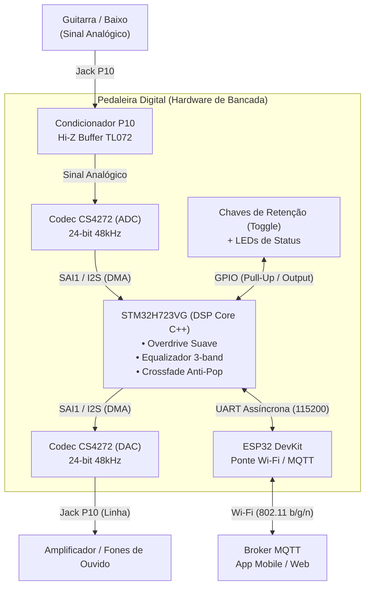

# Especificação de Requisitos do Sistema — Pedaleira Digital

-blue?style=flat-square)

Documentação formal de Engenharia de Requisitos para o projeto **Pedaleira Digital de Efeitos para Instrumentos Musicais**, desenvolvida segundo o roteiro metodológico da disciplina de **Técnicas de Prototipagem** do Instituto Federal de Educação, Ciência e Tecnologia da Paraíba (IFPB).

---

## 1. Identificação do Documento

| Campo | Descrição |
| :--- | :--- |
| **Projeto** | Pedaleira Digital de Efeitos para Instrumentos Musicais |
| **Sigla / Identificador** | `PED-DIGITAL` |
| **Instituição** | Instituto Federal da Paraíba (IFPB) |
| **Disciplina** | Técnicas de Prototipagem |
| **Versão** | 1.0.0 |
| **Data de Emissão** | Outubro de 2026 |
| **Classificação** | Documentação Técnica de Engenharia de Software e Hardware |

---

## 2. Visão Geral e Arquitetura de Referência

O sistema consiste em uma pedaleira de áudio digital baseada em processamento digital de sinais (DSP) em tempo real executado no microcontrolador de alta performance **STM32H723VG** (ARM Cortex-M7 com FPU de precisão dupla), integrada a um codec de áudio de alta fidelidade (**Cirrus Logic CS4272**) e a um módulo de conectividade **ESP32** para controle remoto e telemetria via protocolo **MQTT**.

---

## 3. Requisitos Funcionais (RF)

Os Requisitos Funcionais especificam o comportamento observável, as operações de entrada/saída, o processamento de sinal e as interfaces de interação do protótipo.

| Código | Nome do Requisito | Descrição Detalhada | Prioridade | Critério de Aceite / Verificação |
| :--- | :--- | :--- | :--- | :--- |
| **RF01** | **Captação e Pré-amplificação de Áudio** | O sistema deve captar o sinal elétrico analógico proveniente de instrumentos de corda (guitarra ou baixo) através de entrada física Jack P10 mono (6,35 mm), passando por estágio de buffer/condicionamento de alta impedância (Hi-Z $\ge 1\text{ M}\Omega$) e convertê-lo em sinal digital estéreo/mono balanceado via codec CS4272. | Essencial | Presença de sinal digital linear no barramento SAI sem ceifamento prematuro para amplitudes de entrada entre $100\text{ mV}_{\text{pp}}$ e $2\text{ V}_{\text{pp}}$. |
| **RF02** | **Processamento Digital de Efeitos Base (Overdrive e Equalizador)** | A MCU STM32H7 deve processar as amostras de áudio em tempo real aplicando uma cadeia sequencial configurável composta por: (1) Bloco de Overdrive com distorção harmônica não-linear suave (*soft-clipping* por aproximação tangencial hiperbólica ou polinomial); (2) Bloco de Equalização de 3 bandas (Graves: 100 Hz *shelving*, Médios: 1 kHz *peaking*, Agudos: 5 kHz *shelving*) utilizando filtros biquad IIR implementados com CMSIS-DSP; (3) Ganho master e chaveamento de bypass. | Essencial | Curva de resposta em frequência ajustável ($\pm 12\text{ dB}$ por banda) e espectro de distorção harmônica observável em osciloscópio/analisador FFT sem estouro de pilha ou falha de ponto flutuante. |
| **RF03** | **Leitura e Chaveamento Físico com Retenção Mecânica** | O sistema deve ler o estado de chaves mecânicas com retenção estática (alavanca/toggle ou gangorra de 2 posições) conectadas aos pinos de GPIO com resistores internos de pull-up ativados. O chaveamento deve ativar ou contornar (*bypass*) diretamente o bloco de efeito correspondente (Overdrive e Equalizador), atualizando LEDs indicadores de status associados. | Essencial | Mudança imediata de estado acústico (efeito ativo vs. bypass) sincronizada com o nível lógico fixo da chave (nível `LOW` = ligado; nível `HIGH` = bypass) e filtro de debounce temporal de 20 ms. |
| **RF04** | **Ponte Serial Inter-MCU de Controle** | A STM32H7 e o ESP32 devem se comunicar bidirecionalmente através de interface serial UART dedicada (115200 bps ou superior), utilizando protocolo leve de frames delimitados por checksum. O canal deve transmitir comandos de parametrização recebidos da nuvem para a STM32 e confirmar atualizações de parâmetros em tempo de execução. | Alta | Taxa de perda de frames de controle $< 0,1\%$ em ensaios contínuos de 10.000 pacotes; latência inter-mcu $< 15\text{ ms}$. |
| **RF05** | **Telemetria e Controle Remoto via MQTT** | O módulo ESP32 deve conectar-se a uma rede Wi-Fi local e a um broker MQTT, subscrevendo tópicos de configuração (`pedaleira/set/#`) e publicando o estado operacional da pedaleira (`pedaleira/state`, `pedaleira/telemetry`), incluindo: estado das chaves físicas, parâmetros ativos de equalização/ganho e status de conexão. | Alta | Sincronização do estado em painel MQTT/Dashboard em até 200 ms após alteração de estado sob rede sem perdas. |
| **RF06** | **Saída de Áudio Digital com Baixa Latência** | As amostras de áudio processadas devem ser transmitidas continuamente via DMA circular do barramento SAI/I2S para os canais de saída analógica estéreo (Line Out / Fone) do codec CS4272 com reconstrução de sinal analógico livre de interrupções (*dropouts*). | Essencial | Emissão contínua de áudio limpo medido na saída analógica P10/P2 com taxa de distorção harmônica total (THD) $< 0,05\%$ em bypass. |
| **RF07** | **Transição Suave de Bypass (Anti-Pop / Crossfade)** | O firmware de processamento de áudio da STM32H7 deve aplicar uma rampa suave de interpolação linear ou cossenoide (*crossfade* de 2 ms a 5 ms) entre o sinal processado e o sinal seco (*dry/bypass*) durante o chaveamento das chaves mecânicas ou comandos remotos, eliminando estalos (*clicks/pops*) causados por descontinuidade de fase ou offset DC. | Média | Ausência de pulsos transitórios audíveis no espectro temporal de saída (amplitude do transiente de chaveamento $< -60\text{ dBFS}$). |

---

## 4. Requisitos Não Funcionais (RNF)

Os Requisitos Não Funcionais estabelecem as restrições de desempenho, integridade arquitetural, tolerância a falhas e viabilidade construtiva no contexto acadêmico do IFPB.

| Código | Nome do Requisito | Descrição Detalhada | Métrica / Tolerância | Categoria |
| :--- | :--- | :--- | :--- | :--- |
| **RNF01** | **Latência Total de Processamento Audível** | O retardo temporal total de áudio (*round-trip latency*), medido da entrada física analógica P10 até a saída analógica P10, não deve ultrapassar 10 ms para garantir tocabilidade ao vivo sem percepção de atraso pelo instrumentista. | $\le 10,0\text{ ms}$ (Meta nominal: $4\text{ a }7\text{ ms}$ utilizando duplo buffer circular DMA de 32 a 64 amostras a 48 kHz). | Desempenho e Tempo Real |
| **RNF02** | **Fidelidade de Áudio e Taxa de Amostragem** | O fluxo de processamento e conversão de áudio digital deve operar a uma frequência de amostragem padronizada de $44,1\text{ kHz}$ ou $48,0\text{ kHz}$, com resolução de quantização de 24 bits no codec CS4272 e processamento aritmético interno em ponto flutuante de precisão simples (IEEE-754 `float32`) no núcleo Cortex-M7. | $f_s \in \{44.1, 48.0\}\text{ kHz}$, 24 bits, faixa dinâmica $> 95\text{ dB}$, resposta de frequência plana de $20\text{ Hz}$ a $20\text{ kHz}$ ($\pm 0,5\text{ dB}$). | Qualidade de Sinal |
| **RNF03** | **Desacoplamento e Tolerância a Quedas de Rede** | O processamento digital de áudio local na STM32H7 deve ser completamente desacoplado e autônomo em relação ao subsistema de rede do ESP32. Quedas de sinal Wi-Fi, indisponibilidade do broker MQTT ou reinicializações do ESP32 jamais devem interromper, congelar ou degradar a geração de áudio no instrumento. | 0 interrupções no fluxo de áudio causadas por eventos de conectividade ou falhas na pilha TCP/IP; tempo de recuperação do ESP32 transparente para o áudio. | Robustez e Confiabilidade |
| **RNF04** | **Supressão de Ruído Transitório e Chaveamento Anti-Pop** | A comutação de estado dos efeitos gerada tanto por ação física nas chaves de retenção mecânica quanto por comandos de rede deve ser acusticamente transparente, com transientes atenuados abaixo do limiar de percepção auditiva. | Nível de pico de transiente $< -60\text{ dBFS}$; tempo de rampa de ganho entre 2 ms e 10 ms. | Qualidade e Usabilidade |
| **RNF05** | **Viabilidade de Prototipagem e Custo Acadêmico** | O projeto deve ser viável para construção no laboratório do IFPB com orçamento limitado: proibida a exigência de manufatura de PCB industrial comercial; o circuito deve ser validado em protoboards e consolidado em placa de fenolite/fibra perfurada (ilhada), empregando placas de desenvolvimento de prateleira (STM32 Dev Board, ESP32 DevKit, breakout CS4272) e chaves alavanca comerciais de baixo custo. | Custo total de componentes de bancada $< \text{R\$} 450,00$; 100% dos componentes adquiríveis no mercado nacional/varejo eletrônico ágil. | Construtibilidade e Custo |
| **RNF06** | **Interação Física e Sincronismo Remoto** | O sistema deve aceitar leitura direta do estado físico por chaves com retenção estática (eliminando máquinas de estados complexas de clique único/duplo), e propagar alterações de parâmetros da aplicação remota com tempo de atualização imperceptível para ajustes musicais. | Tempo de propagação comando MQTT $\rightarrow$ aplicação no filtro DSP $\le 200\text{ ms}$; tempo de resposta da chave física $< 30\text{ ms}$ (incluindo debounce). | Usabilidade e Operação |

---

## 5. Matriz de Rastreabilidade de Requisitos

A matriz abaixo estabelece a amarração bidirecional entre os Requisitos Funcionais, Requisitos Não Funcionais, Subsistemas de Hardware/Firmware responsáveis e o respectivo Procedimento de Teste.

| ID Requisito | Subsistema Responsável | RNF Associado | Módulo de Firmware / Circuito | ID de Teste |
| :--- | :--- | :--- | :--- | :--- |
| **RF01** | Analógico / Codec | RNF01, RNF02, RNF05 | Buffer TL072 + Codec CS4272 + SAI1 DMA | `TEST-RF01` |
| **RF02** | Processamento DSP | RNF01, RNF02, RNF03 | `dsp_overdrive.c`, `dsp_eq.c`, CMSIS-DSP | `TEST-RF02` |
| **RF03** | Interface Física / GPIO | RNF04, RNF05, RNF06 | `switches.c` (GPIO interrupt / debounce) | `TEST-RF03` |
| **RF04** | Comunicação Inter-MCU | RNF03, RNF06 | `serial_protocol.c` (UART DMA / Ring Buffer) | `TEST-RF04` |
| **RF05** | Conectividade IoT | RNF03, RNF06 | Firmware ESP32 (`mqtt_client.c`, `wifi_mgr.c`) | `TEST-RF05` |
| **RF06** | Saída / DAC Codec | RNF01, RNF02 | CS4272 DAC + SAI1 TX DMA + Filtro de Reconstrução | `TEST-RF06` |
| **RF07** | Núcleo de Áudio DSP | RNF03, RNF04 | `dsp_crossfade.c` (Rampas de atenuação) | `TEST-RF07` |

---

## 6. Plano Inicial de Verificação e Critérios de Sucesso

Conforme exigido pelo Roteiro de Prototipagem do IFPB (Seção 25), cada requisito deve ser validado experimentalmente em bancada com critérios mensuráveis.

| Código Teste | Requisito Alvo | Procedimento Experimental de Validação | Resultado Esperado | Critério de Sucesso (Go / No-Go) |
| :--- | :--- | :--- | :--- | :--- |
| **TEST-RF01** | RF01 | Injetar sinal senoidal de $1\text{ kHz}$ e amplitude $500\text{ mV}_{\text{pp}}$ via gerador de funções na entrada P10. Monitorar o barramento digital SAI com analisador lógico/depurador. | Leitura digitalizada limpa e estável correspondente à amplitude calibrada. | Amostragem a 48 kHz sem distorção harmônica anômala ($< 0,1\%$ THD). |
| **TEST-RF02** | RF02 | Aplicar sinais de teste (senoide pura e ruído branco) e variar via firmware os ganhos de graves, médios, agudos e o fator de saturação do overdrive. | Modificação espectral compatível com as equações dos biquads IIR e geração de harmônicos ímpares/pares no overdrive. | Variação de ganho em $\pm 12\text{ dB}$ nas frequências centrais especificadas e execução do laço de processamento em $< 70\%$ do tempo disponível de bloco DMA. |
| **TEST-RF03** | RF03 | Acionar as chaves físicas de alavanca com retenção em ciclos rápidos e repetidos, registrando a resposta de chaveamento em canal de osciloscópio acoplado ao LED e ao áudio. | Ativação imediata do efeito sem perda de transição ou falsos disparos provocados por repique de contato (*chatter*). | 100% das transições detectadas corretamente com debounce estável de 20 ms; ausência de loops travados. |
| **TEST-RF04** | RF04 | Disparar rajada de 1.000 comandos de alteração de ganho via porta serial com taxa de 115200 bps. | Decodificação correta e recepção sem perdas ou buffer overrun na STM32H7. | Taxa de erro de checksum $= 0\%$; nenhum travamento na rotina de recepção UART. |
| **TEST-RF05** | RF05 | Conectar o ESP32 a um broker Mosquitto local. Simular comandos nos tópicos `pedaleira/set/eq` e induzir interrupção forçada do roteador Wi-Fi. | Publicação do estado das chaves físicas e recepção das configurações; manutenção ininterrupta da operação do áudio na STM32 durante a queda do Wi-Fi. | Tempo de sincronismo $< 200\text{ ms}$; zero impacto no áudio local durante a oscilação do rádio. |
| **TEST-RF06** | RF06 | Medir a saída analógica P10 com osciloscópio de bancada acoplado a fone de ouvido/monitor de áudio de referência. | Sinal contínuo, limpo e com resposta em frequência plana de 20 Hz a 20 kHz em modo bypass. | Nível de ruído de fundo inferior a $-80\text{ dBV}$; ausência perceptível de zumbidos (*hum*) de 60 Hz ou ruído digital de alta frequência. |
| **TEST-RF07** | RF07 | Comutar as chaves físicas e comandos remotos com sinal contínuo senoidal de $440\text{ Hz}$ na entrada. Capturar a forma de onda transitória no osciloscópio durante a comutação. | Transição gradual contínua entre os sinais seco e processado através da rampa de crossfade. | Ausência completa de degraus de tensão instantâneos; nível sonoro do clique de comutação $< -60\text{ dBFS}$. |
| **TEST-RNF01** | RNF01 | Injetar pulso transitório (impulso estreito) na entrada P10 e medir no osciloscópio a diferença temporal $\Delta t$ até o surgimento do impulso na saída analógica P10. | Atraso total de hardware e buffers digitais inferior a 10 ms. | $\Delta t \le 10,0\text{ ms}$ (Aprovado com folga se $\Delta t \le 7,0\text{ ms}$). |

---

## 7. Controle de Mudanças e Histórico de Revisões

| Revisão | Data | Autor | Descrição das Alterações |
| :--- | :--- | :--- | :--- |
| **0.1.0** | 15/09/2026 | Equipe Pedaleira Digital | Criação inicial das anotações conceituais de requisitos. |
| **1.0.0** | 22/10/2026 | Equipe de Engenharia / IFPB | Formalização completa dos Requisitos Funcionais (RF01-RF07) e Não Funcionais (RNF01-RNF06), Matriz de Rastreabilidade e Plano Experimental de Testes no padrão IFPB. |
