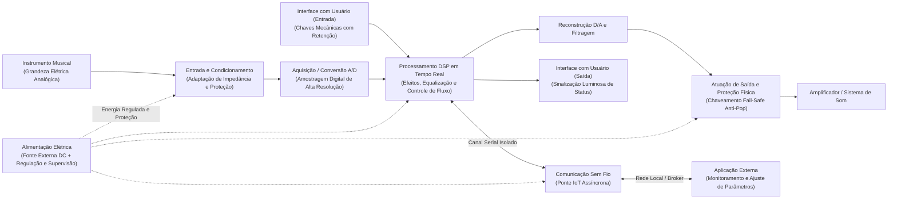
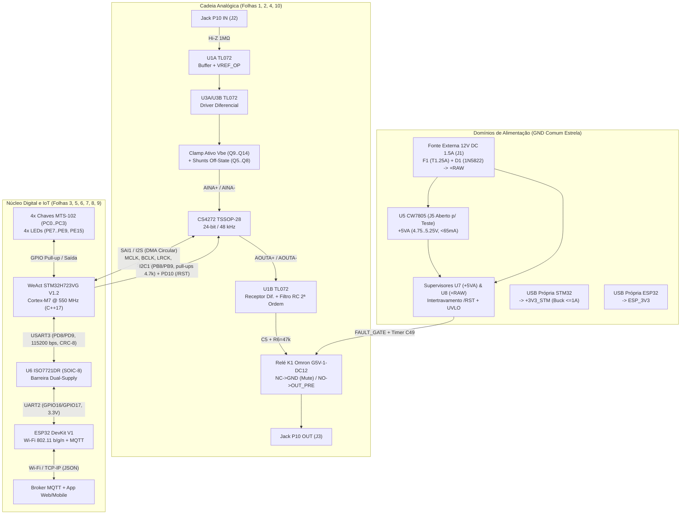
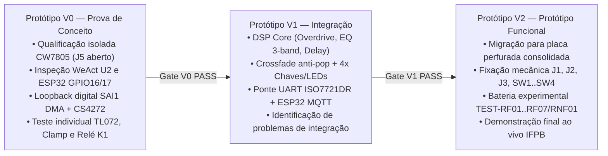

# Documento de Requisitos e Especificação Inicial do Projeto — Pedaleira Digital (`PED-DIGITAL`)

**Instituição:** Instituto Federal de Educação, Ciência e Tecnologia da Paraíba (IFPB)  
**Disciplina:** Técnicas de Prototipagem  
**Curso / Turma:** Engenharia Elétrica / Engenharia de Computação — Turma 2026.2  
**Projeto:** Pedaleira Digital de Efeitos para Instrumentos Musicais (`PED-DIGITAL`)  
**Equipe:** Arthur Ramalho, Isabelle Lavínia, João Paulo, Rodrigues Matheus  
**Data:** Novembro/2026  
**Versão:** 1.1.0 — Revisão Elétrica 4.10 (Checkpoint Gate B)

---

## 1. Apresentação e Objetivo do Documento

Este documento consolida a especificação técnica inicial, os requisitos funcionais e não funcionais, a arquitetura preliminar, o orçamento, o cronograma, o plano de verificação e a análise de riscos do projeto **Pedaleira Digital de Efeitos para Instrumentos Musicais (`PED-DIGITAL`)**, seguindo integralmente as seções **2 a 32** do *Roteiro para Documentação Inicial do Projeto* da disciplina de **Técnicas de Prototipagem (IFPB)**.

A presente versão (**v1.1.0**) incorpora a evolução de engenharia consolidada na **Revisão Elétrica 4.10 (Gate B)** — incluindo separação de domínios de alimentação, isolação de barramento UART, supervisão de subtensão, proteção ativa das entradas do ADC e circuito eletromecânico de *mute* físico *fail-safe* — mantendo rastreabilidade direta com o pacote de esquemáticos KiCad (10 folhas, 0 violações ERC) e com as 33 simulações SPICE validadas antes da etapa de testes físicos em bancada.

---

## 2. Identificação do Projeto

| Campo | Descrição |
| :--- | :--- |
| **Nome do Projeto** | Pedaleira Digital de Efeitos para Instrumentos Musicais |
| **Nome / Sigla da Solução** | `PED-DIGITAL` |
| **Integrantes da Equipe** | Arthur Ramalho, Isabelle Lavínia, João Paulo, Rodrigues Matheus |
| **Turma** | Técnicas de Prototipagem — 2026.2 |
| **Curso** | Engenharia Elétrica / Engenharia de Computação — IFPB |
| **Data** | Novembro de 2026 |
| **Versão da Documentação** | `1.1.0` (Alinhada à Revisão Elétrica `Rev 4.10 — Gate B`) |

---

## 3. Descrição da Ideia do Projeto

No cotidiano de estudo, ensaio e apresentação musical de guitarristas e baixistas, a construção de timbres depende de efeitos sonoros como distorção suave (*overdrive*), equalização tonal e ambiência. O método clássico baseado em pedais analógicos individuais exige a aquisição de múltiplas unidades dedicadas, cabos de interligação e fontes separadas, resultando em alto custo acumulado, rigidez de configuração e suscetibilidade a ruídos de terra e perdas capacitivas. Por outro lado, pedaleiras digitais comerciais de alto desempenho possuem custo elevado e arquitetura fechada, dificultando tanto a aquisição por estudantes e músicos iniciantes quanto o uso como plataforma didática de experimentação sonora.

Para enfrentar esse cenário, o projeto propõe o desenvolvimento de um protótipo funcional de pedaleira digital de áudio em tempo real voltado para instrumentos musicais de corda. A solução substitui cadeias rígidas de efeitos analógicos por um núcleo embarcado de processamento digital de sinais (DSP) de baixa latência, responsável por captar o sinal elétrico do instrumento, convertê-lo para o domínio digital em alta resolução (24 bits a 48 kHz), aplicar algoritmos matemáticos configuráveis de *Overdrive*, Equalização paramétrica de 3 bandas e *Delay*, e devolver o sinal tratado ao amplificador sem atrasos perceptíveis ao músico.

O público usuário da solução abrange músicos instrumentistas (guitarristas e baixistas) que necessitam de resposta imediata e timbres versáteis em ensaios e estudos, estudantes e pesquisadores de engenharia interessados em uma plataforma aberta de DSP em áudio, e operadores ou técnicos que desejam ajustar parâmetros sonoros remotamente sem interromper a execução musical.

Em operação geral, o instrumento musical conecta-se à pedaleira por um conector padrão P10 mono de entrada de alta impedância. O estágio analógico adapta o nível e a impedância do sinal antes da conversão analógico-digital. O áudio digitalizado é processado em blocos curtos (32 a 64 amostras) por algoritmos em ponto flutuante, retornando ao estágio de saída analógica com proteção física contra estalos de liga/desliga (*anti-pop*). Paralelamente, chaves mecânicas com retenção permitem acionar ou contornar (*bypass*) cada efeito diretamente no painel, enquanto uma ponte sem fio independente possibilita o ajuste fino de parâmetros e a visualização do estado do equipamento por meio de uma aplicação externa conectada via protocolo MQTT.

As principais funcionalidades previstas contemplam: processamento de áudio em tempo real com latência total inferior a 10 ms; efeitos de *Overdrive* por saturação suave e Equalizador de 3 bandas; acionamento físico determinístico por chaves com retenção mecânica e indicação luminosa por LEDs; transição suave por rampa de *crossfade* digital; proteção física de *mute* por relé na energização e queda de energia; e controle remoto assíncrono via rede Wi-Fi/MQTT. O diferencial central da proposta reside na arquitetura desacoplada de tempo real — que impede que oscilações de rede afetem o áudio — aliada às proteções elétricas analógicas projetadas e verificadas em simulação SPICE para montagem modular em bancada acadêmica sem dependência de fabricação industrial de PCBs.

---

## 4. Contexto e Justificativa

A motivação do projeto nasce da barreira econômica e técnica enfrentada por músicos amadores, estudantes de música e alunos de engenharia elétrica/computação no Brasil ao tentar montar ou estudar sistemas de processamento de áudio em tempo real. Em ambientes acadêmicos, estúdios caseiros e salas de ensaio, o problema manifesta-se continuamente sempre que é necessário combinar múltiplos timbres (distorção e ajuste espectral) com baixa latência e controle reproduzível.

No mercado nacional, pedais analógicos individuais de fabricantes consolidados variam tipicamente entre R$ 300,00 e R$ 1.200,00 por efeito, exigindo ainda cabos *patch*, fonte isolada e *pedalboard* para evitar laços de terra (*ground loops*) e zumbidos de 60 Hz. Soluções digitais comerciais multi-efeito (como linhas Boss GT/ME, Line 6 HX ou Neural Quad Cortex) resolvem a flexibilidade, porém custam frequentemente acima de R$ 2.500,00 a R$ 10.000,00, além de possuírem firmware proprietário fechado que impede inspeção, instrumentação laboratorial ou modificação de algoritmos DSP.

A consequência direta desse quadro é dupla: para o músico iniciante, a inviabilidade financeira ou a degradação de sinal em cadeias improvisadas; para o estudante de engenharia, a carência de uma plataforma didática completa que integre eletrônica analógica de baixo ruído, conversão A/D-D/A de 24 bits, aritmética DSP em ponto flutuante e telemetria IoT. A contribuição pretendida pelo protótipo `PED-DIGITAL` é demonstrar, com documentação aberta, modelos simulados em ngspice e ensaios instrumentados no IFPB, que placas de desenvolvimento de prateleira e circuitos discretos em placa perfurada alcançam desempenho acústico compatível com áudio profissional (latência $\le 10\text{ ms}$, faixa dinâmica $> 95\text{ dB}$) a uma fração do custo comercial.

---

## 5. Definição do Problema

| Dimensão | Descrição Estruturada |
| :--- | :--- |
| **Situação Atual** | Músicos recorrem a conjuntos caros, pesados e ruidosos de pedais analógicos discretos ou a pedaleiras digitais comerciais fechadas e de alto custo, enquanto estudantes carecem de sistemas abertos para experimentar algoritmos DSP reais. |
| **Problema Identificado** | Ausência de uma plataforma prototipada em bancada acadêmica, de baixo custo e arquitetura aberta, capaz de processar áudio de instrumentos musicais em tempo real com latência $\le 10\text{ ms}$, imunidade a estalos de chaveamento/energia e controle remoto desacoplado sem exigir PCB industrial multicamada. |
| **Consequências do Problema** | Alto custo de entrada para músicos, ocorrência de ruídos/transientes na cadeia sonora e desconexão prática entre o ensino de eletrônica analógica, DSP embarcado e conectividade IoT. |
| **Solução Proposta** | Protótipo modular de pedaleira digital em bancada (`PED-DIGITAL`), estruturado com núcleo DSP determinístico (`STM32H723VG`), codec de 24 bits (`CS4272`), ponte IoT isolada (`ESP32` + `ISO7721DR`), chaves mecânicas com retenção e proteção analógica fail-safe (`Rev 4.10`). |

### Pergunta de Projeto

> *"Como projetar, proteger eletricamente e validar experimentalmente um protótipo acadêmico de pedaleira digital de baixo custo em placa perfurada, utilizando placas de desenvolvimento comerciais e chaves mecânicas com retenção, capaz de garantir processamento DSP em tempo real com latência total inferior a 10 ms, ausência de estalos audíveis em energização/desligamento e controle remoto desacoplado via MQTT?"*

---

## 6. Público-Alvo

| Usuário ou Público | Necessidade Principal | Cenário de Uso Típico |
| :--- | :--- | :--- |
| **Músico Instrumentista (Guitarrista / Baixista)** | Obter timbres de overdrive e equalização com resposta instantânea ($\le 10\text{ ms}$), sem estalos ao ligar/desligar a fonte ou acionar efeitos. | Conecta guitarra à entrada P10 e saída ao amplificador; aciona as chaves de alavanca para ligar/desligar *Overdrive*, *EQ* ou *Master Mute* com retorno visual nos LEDs. |
| **Estudante / Pesquisador de Engenharia e DSP** | Dispor de hardware e firmware abertos e instrumentados (11 pontos de teste `TP1..TP11`) para implementar filtros e medir latência, THD e resposta em frequência. | Conecta depurador ST-LINK à placa STM32H723, injeta senoides em `J2` e analisa sinais nos nós `TP6..TP9` e barramento SAI em osciloscópio. |
| **Operador de Áudio / Ajustador Remoto** | Ajustar ganhos de drive e bandas de equalização em tempo real à distância, sem interromper a execução do instrumentista. | Envia comandos JSON via cliente/dashboard MQTT na rede Wi-Fi local; o ESP32 repassa os parâmetros por UART isolada à STM32, atualizando os filtros suavemente. |

---

## 7. Objetivo Geral

**Desenvolver**, integrar e validar experimentalmente um protótipo funcional de pedaleira digital de efeitos para instrumentos musicais (`PED-DIGITAL`), capaz de realizar aquisição, processamento DSP em tempo real (*Overdrive* e Equalizador de 3 bandas) e reconstrução de áudio com latência total inferior a $10\text{ ms}$, comutação livre de transientes audíveis e parametrização remota via MQTT, utilizando arquitetura desacoplada entre núcleo DSP (`STM32H723VG`), codec de 24 bits (`CS4272`), interface sem fio (`ESP32`) e estágio analógico protegido em montagem de bancada (`Rev 4.10`).

---

## 8. Objetivos Específicos

1. **Pesquisar soluções semelhantes** e levantar requisitos acústicos, elétricos e ergonômicos para instrumentos de corda (impedância Hi-Z $\ge 1\text{ M}\Omega$, latência $\le 10\text{ ms}$).
2. **Definir a arquitetura desacoplada** separando o plano de áudio de tempo real crítico do plano assíncrono de rede IoT e dos domínios de alimentação.
3. **Projetar e simular o condicionamento analógico** de entrada (buffer Hi-Z `TL072` e driver diferencial com clamp ativo compensado por $V_{be}$) e saída (receptor diferencial `U1B`, filtro passa-baixas RC e relé de *mute* físico fail-safe `K1`).
4. **Implementar a aquisição e emissão contínua de áudio** via interface `SAI1 / I2S` com `DMA` circular duplo (*ping-pong*) a 24 bits / 48 kHz no `STM32H723VG`.
5. **Desenvolver os algoritmos DSP em C++17** com uso de FPU e `CMSIS-DSP`: *Overdrive* (*soft-clipping*), Equalizador de 3 bandas (filtros biquad IIR), *Delay* e rampa de *crossfade anti-pop*.
6. **Implementar a interface física com retenção mecânica**, realizando leitura GPIO de chaves `MTS-102` com *debounce* temporal e acionamento de LEDs indicadores.
7. **Estruturar a comunicação inter-MCU e MQTT**, empregando isolador digital `ISO7721DR` em UART a 115.200 bps com quadro binário e CRC-8 CCITT entre `STM32` e `ESP32`.
8. **Consolidar a montagem física de bancada** em placa perfurada ilhada com pontos de teste (`TP1..TP11`) e conectores P10/DC devidamente fixados.
9. **Executar ensaios experimentais** em bancada (qualificação isolada da fonte `CW7805`, resposta em frequência, THD, ruído de fundo, estalos de comutação e latência ponta a ponta).

---

## 9. Requisitos Funcionais (RF)

| Código | Requisito Funcional | Descrição Detalhada | Prioridade | Critério de Aceite / Verificação |
| :--- | :--- | :--- | :---: | :--- |
| **RF01** | **Captação e Pré-amplificação de Áudio** | O sistema deve captar o sinal elétrico de guitarra/baixo via conector P10 mono (`J2`), passar por buffer de alta impedância (`U1A TL072`, bias $1\text{ M}\Omega$ `R3`), estágio diferencial (`U3A/U3B`) com proteção ativa (`Q9..Q14`) e digitalizar no codec `CS4272` (`AINA+/AINA-`). | Essencial | Sinal digital linear no barramento `SAI1` sem ceifamento prematuro para entradas entre $100\text{ mV}_{\text{pp}}$ e $2\text{ V}_{\text{pp}}$; proteção ativa em $[+0{,}298\text{ V}, +4{,}991\text{ V}]$ sem *back-pumping*. |
| **RF02** | **Processamento Digital de Efeitos Base** | A `STM32H723VG` deve processar blocos de áudio em tempo real aplicando: (1) *Overdrive* não-linear suave (*soft-clipping*); (2) Equalizador de 3 bandas (100 Hz *low-shelf*, 1 kHz *peaking*, 5 kHz *high-shelf*) via biquads IIR (`CMSIS-DSP`); (3) bloco auxiliar *Delay* e controle de ganho master/bypass. | Essencial | Variação de ganho de $\pm 12\text{ dB}$ por banda, geração controlada de harmônicos no overdrive e execução DSP em $< 70\%$ do tempo do bloco DMA. |
| **RF03** | **Leitura e Chaveamento Físico com Retenção** | O sistema deve ler 4 chaves de alavanca com retenção mecânica (`SW1` Overdrive, `SW2` Equalizador, `SW3` Delay, `SW4` Master Mute) via GPIO (`PC0..PC3`) com pull-up e *debounce* de 20 ms, acionando os LEDs correspondentes (`D2..D5` em `PE7..PE9, PE15`). | Essencial | Transição determinística entre efeito ativo e *bypass* sincronizada ao nível lógico da chave e atualização imediata do respectivo LED. |
| **RF04** | **Ponte Serial Inter-MCU de Controle** | `STM32H7` e `ESP32` devem comunicar-se bidirecionalmente via UART dedicada (`PD8/PD9` $\leftrightarrow$ `GPIO16/GPIO17`, 115.200 bps 8-N-1) através do isolador `U6 ISO7721DR`, usando quadro binário `[0xAA, 0x55, CMD, LEN, PAYLOAD, CRC8]`. | Alta | Taxa de erro de CRC/perda de frames $< 0{,}1\%$ em 1.000+ pacotes e latência inter-MCU $< 15\text{ ms}$, sem alimentação cruzada entre USBs. |
| **RF05** | **Telemetria e Controle Remoto via MQTT** | O `ESP32` deve conectar-se à rede Wi-Fi e ao broker MQTT, subscrevendo tópicos de comando (`pedaleira/v1/...` / `pedaleira/set/#`) e publicando o estado das chaves, parâmetros ativos e status de conexão (`pedaleira/state`). | Alta | Sincronização de parâmetros entre aplicação/broker e pedaleira em até 200 ms sob rede local estável. |
| **RF06** | **Saída de Áudio Digital com Baixa Latência** | As amostras processadas devem ser enviadas via `SAI1 TX DMA` ao DAC do `CS4272`, convertidas pelo receptor diferencial `U1B TL072`, filtradas por filtro RC de 2ª ordem (`R4/C4, R5/C6`) e entregues em `J3` (`OUT P10`) via relé `K1` sem *dropouts*. | Essencial | Áudio contínuo na saída `J3` com THD $< 0{,}05\%$ em *bypass* (simulado $0{,}000066\%$ no estágio analógico de saída) e resposta plana de 20 Hz a 20 kHz. |
| **RF07** | **Transição Suave Anti-Pop e Mute Fail-Safe** | O firmware DSP deve aplicar rampa de *crossfade* (2 a 5 ms) nas comutações de efeito, e o hardware deve manter a saída `JACK_OUT` fisicamente aterrada pelo contato `NC` do relé `K1` (`Omron G5V-1-DC12`) durante energização, subtensão (`+RAW < 9,25 V` ou `+5VA < 4,52 V`) ou desconexão abrupta. | Alta | Transiente de comutação DSP $< -60\text{ dBFS}$; pop de energização medido em SPICE $\le 1{,}23\text{ mV}$ ($< 5\text{ mV}$), isolação em mute de $-185{,}6\text{ dB}$ e desacoplamento `NC` em $8{,}26\text{ ms}$ na queda de energia. |

---

## 10. Requisitos Não Funcionais (RNF)

| Código | Requisito Não Funcional | Descrição Detalhada | Métrica / Tolerância | Categoria |
| :--- | :--- | :--- | :--- | :--- |
| **RNF01** | **Latência Total de Processamento** | O atraso ponta a ponta (*round-trip*) da entrada `J2` à saída `J3` deve permanecer abaixo do limiar perceptível em execução musical ao vivo. | $\le 10{,}0\text{ ms}$ (meta nominal $4\text{ a }7\text{ ms}$ com buffer DMA de 32–64 amostras a 48 kHz). | Desempenho / Tempo Real |
| **RNF02** | **Fidelidade de Áudio e Precisão** | Conversão a 48 kHz / 24 bits no `CS4272` e processamento interno IEEE-754 `float32` na FPU do Cortex-M7. | $f_s = 48{,}0\text{ kHz}$ (suporte a 44,1 kHz), 24 bits, faixa dinâmica $> 95\text{ dB}$, resposta $20\text{ Hz}–20\text{ kHz}$ ($\pm 0{,}5\text{ dB}$). | Qualidade de Sinal |
| **RNF03** | **Desacoplamento Áudio vs. Rede e Alimentação** | Falhas de Wi-Fi, reconexões MQTT ou desligamento do `ESP32` não podem travar o áudio nem causar *backpower* nos barramentos; perda de `+5VA` deve forçar `CODEC_RST` em nível baixo e shunts `AIN` em GND. | `0` interrupções de áudio por eventos TCP/IP; `CODEC_RST <= 0,03 V` e `|AIN| <= 1,1 mV` sem `+5VA`; `0 V` de backpower em `+3V3_STM`. | Robustez e Segurança Elétrica |
| **RNF04** | **Supressão de Transientes e Ruído** | Comutação de efeitos e partida/desligamento da fonte devem ocorrer sem estalos audíveis nem zumbidos de rede. | Pop físico de partida $< 5\text{ mV}$ (SPICE: $1{,}23\text{ mV}$); ruído de fundo $< -80\text{ dBV}$; transiente DSP $< -60\text{ dBFS}$. | Qualidade Acústica |
| **RNF05** | **Viabilidade Acadêmica e Custo** | Prototipagem sem PCB industrial multicamada, usando módulos comerciais, componentes THT (ou adaptadores DIP/SOIC para perfboard) disponíveis no varejo eletrônico. | Custo de aquisição incremental $< \text{R\$ } 200{,}00$ (considerando placas principais em posse da equipe) e custo global unitário estimado $\le \text{R\$ } 520{,}00$ na configuração completa Rev 4.10. | Construtibilidade e Custo |
| **RNF06** | **Ergonomia de Operação e Sincronismo** | Chaves com retenção mecânica dispensam máquinas de estado complexas e comandos MQTT devem refletir rapidamente nos parâmetros DSP. | Resposta física $< 30\text{ ms}$ (incl. debounce 20 ms); propagação MQTT $\rightarrow$ DSP $\le 200\text{ ms}$. | Usabilidade |

---

## 11. Escopo Positivo (O que SERÁ implementado)

- **Estágio de Entrada Analógica (`SS01`)**: Conector P10 mono (`J2`), acoplamento AC (`C1`), bias `1 MΩ` (`R3`), limitador de corrente (`R26`) e grampos iniciais `1N4148`, buffer Hi-Z (`U1A TL072`), driver diferencial (`U3A/U3B TL072`) e **clamp ativo compensado por $V_{be}$** (`Q9..Q14`, `R48..R53`, `C45..C48`) para proteção de `AINA+/AINA-`.
- **Conversão A/D e D/A (`SS02`)**: CI `CS4272` TSSOP-28 em adaptador passivo operando em 48 kHz / 24 bits via `SAI1` (modo *Slave*) com pull-ups externos I2C (`R11/R12 = 4,7 kΩ`), desacoplamento completo (`FILT+`, `VCOM`, `VA`, `VD`, `VL`) e contenção *off-state* nas entradas `AIN` (`Q5..Q8`).
- **Processamento DSP em Tempo Real (`SS03`)**: Placa `WeAct STM32H723VG V1.2` rodando firmware C++17 com DMA circular duplo (32–64 amostras), algoritmos de *Overdrive* (*soft-clipping*), Equalizador de 3 bandas (IIR biquad via CMSIS-DSP), *Delay* e rampa de *crossfade anti-pop*.
- **Estágio de Saída e Mute Físico Fail-Safe (`SS04`)**: Receptor diferencial `U1B`, filtro passa-baixas de reconstrução de 2ª ordem (`R4/C4, R5/C6`), capacitor de acoplamento `C5`, resistor de descarga `R6 = 47 kΩ`, relé SPDT `K1 Omron G5V-1-DC12` (`NC -> GND`), diodo *flyback* `D16`, supervisor UVLO `+RAW` (`U8 TL431ACZ`, `Q15`), porta AND discreta (`Q17..Q19`), descarga rápida (`Q16, Q22`), temporizador (~5,9 s com `C49/D17`) e gatilho Schmitt (`Q20, Q21`).
- **Interface Física de Painel (`SS05`)**: 4 chaves SPDT com retenção mecânica (`MTS-102`: `SW1..SW4`) e 4 LEDs indicadores (`D2..D5` com resistores de `330 Ω`).
- **Conectividade e Isolação Inter-MCU (`SS06`)**: Barramento UART a 115.200 bps com isolador digital dual-supply `U6 ISO7721DR` (SOIC-8 em adaptador DIP-8), `ESP32 DevKit V1` com cliente MQTT sobre Wi-Fi e painel/aplicação externa.
- **Alimentação Segmentada e Pontos de Teste (`SS07`)**: Fonte externa isolada `12 V DC / 1,5 A` via `J1`, fusível `F1 T1.25A`, diodo Schottky `D1 1N5822`, regulador `U5 CW7805` exclusivo para `+5VA` com seccionamento `J5` e borne de teste `J4`, USBs independentes para `STM32` e `ESP32`, supervisor `+5VA` (`U7 TL431ACZ`), intertravamento `/RST` (`Q1/Q2`) e 11 pontos de teste (`TP1..TP11`) em placa perfurada ilhada.

---

## 12. Escopo Negativo (O que NÃO será implementado)

- **Sem fabricação de PCB industrial multicamada**: O protótipo será validado em protoboard e consolidado em placa perfurada ilhada com módulos comerciais, sem contratação de fábrica de PCB de 4 camadas.
- **Sem *footswitches* industriais 3PDT ou *pushbuttons* momentâneos**: Serão utilizadas chaves de alavanca `MTS-102` com retenção mecânica para acionamento manual/de bancada, evitando desgaste mecânico e lógica complexa de clique curto/longo.
- **Sem efeitos baseados em memória SDRAM externa**: Efeitos como *Reverb* convolucional longo, *Pitch Shifter* polifônico ou *Looper* multipista ficam excluídos para manter o orçamento de memória dentro da SRAM interna da `STM32H723`.
- **Sem gabinete metálico industrial usinado/injetado**: Será utilizada estrutura acadêmica aberta ou gabinete impresso/acrílico de bancada para proteção dos conectores e placas.
- **Sem display gráfico local (OLED/TFT)**: Toda parametrização fina ocorre remotamente via MQTT, mantendo no painel apenas os 4 LEDs de estado.
- **Sem bateria interna recarregável (Li-Ion / BMS)**: A alimentação analógica provém exclusivamente de fonte externa regulada de `12 V DC` e as placas digitais recebem alimentação de suas portas USB próprias durante ensaios.
- **Sem uso de saída direta para fones de ouvido de baixa impedância**: O estágio de saída `J3` é dimensionado para carga de linha/amplificador ($\ge 10\text{ a }100\text{ k}\Omega$), conforme diretriz da auditoria de hardware.

---

## 13. Diagrama Conceitual

O diagrama conceitual a seguir representa os blocos funcionais do sistema sem dependência prévia de modelos específicos de circuitos integrados, destacando entradas, processamento, atuação/saída sonora, interface física, comunicação e alimentação (Seção 13 do Roteiro IFPB).



---

## 14. Arquitetura Preliminar

Convertendo o diagrama conceitual na arquitetura técnica da **Revisão 4.10 (Gate B)** com interfaces, barramentos e domínios elétricos explicitados:



---

## 15. Divisão em Subsistemas

| Subsistema | Função Principal | Principais Componentes / Módulos | Responsável Principal |
| :--- | :--- | :--- | :--- |
| **SS01 — Alimentação e Supervisão** | Retificação/proteção de entrada `12 V DC`, regulação `+5VA` (`CW7805`), USBs isoladas, referência `VREF_OP`, supervisores `U7/U8 TL431ACZ` e intertravamento `/RST`. | `J1`, `F1`, `D1`, `U5`, `J4`, `J5`, `U7`, `U8`, `Q1..Q4`, `C33/C37/C38/C44`. | Rodrigues Matheus |
| **SS02 — Condicionamento Analógico e Mute** | Buffer Hi-Z de guitarra, conversão single-ended para diferencial, clamp ativo compensado por $V_{be}$, shunts *off-state*, receptor diferencial, filtro RC e relé *fail-safe*. | `J2`, `J3`, `U1/U3 TL072`, `Q5..Q22`, `D6/D7/D13/D14/D16/D17`, `K1 Omron G5V-1-DC12`, `C49`. | Rodrigues Matheus / Arthur Ramalho |
| **SS03 — Conversão de Áudio (Codec)** | Amostragem e reconstrução estéreo/mono em 24 bits / 48 kHz com sincronismo escravo I2S e controle I2C. | `U2 CS4272` (TSSOP-28 em adaptador passivo), `C12..C15`, `C20`, `C23..C28`, `R11..R14`. | Arthur Ramalho |
| **SS04 — Processamento DSP (Firmware STM32)** | Captura e envio por `SAI1 DMA` circular, execução dos efeitos (*Overdrive*, *EQ 3-bandas*, *Delay*, *Crossfade anti-pop*) e driver do `CS4272`. | `WeAct STM32H723VG V1.2`, `DspEngine`, `DspOverdrive`, `DspEqualizer`, `DspDelay`, `DspCrossfade`, `Cs4272`, `CMSIS-DSP`. | João Paulo / Isabelle Lavínia |
| **SS05 — Interface Física de Bancada** | Leitura determinística de chaves de retenção com *debounce* e sinalização luminosa de estado. | `SW1..SW4` (`MTS-102` SPDT), `D2..D5` (LEDs 3/5 mm), `R_D2..R_D5` (`330 Ω`). | Arthur Ramalho |
| **SS06 — Comunicação e Conectividade IoT** | Isolação serial UART (`ISO7721DR`), protocolo binário CRC-8, cliente Wi-Fi/MQTT no `ESP32` e aplicação externa. | `U6 ISO7721DR`, `C42/C43`, `R29..R32`, `ESP32 DevKit V1`, `inter_mcu_proto`, `pedal_bridge`, `app/backend`, `app/frontend`. | Isabelle Lavínia / João Paulo |
| **SS07 — Estrutura Física e Instrumentação** | Consolidação mecânica em placa perfurada ilhada, chicotes curtos, blindagem P10, pontos de teste e modelo conceitual de gabinete 3D. | Placa perfurada ilhada, `TP1..TP11`, conectores P10/DC e modelo STL conceitual (`modelo_3d/`). | Toda a equipe |

---

## 16. Seleção dos Componentes (Resumo da BOM Rev 4.10)

A lista completa consolidada no esquemático KiCad da Revisão 4.10 (`BOM_rev4_10.csv`) totaliza **183 componentes** distribuídos em **10 folhas**, divididos entre **6 itens principais já disponíveis** na bancada da equipe e **177 referências** de semicondutores auxiliares, passivos e eletromecânicos com especificação fechada para aquisição/conferência:

| Grupo / Tipo | Referências Principais | Qtd. | Função no Protótipo | Encapsulamento | Situação (BOM Rev 4.10) |
| :--- | :--- | :---: | :--- | :--- | :--- |
| **Microcontrolador DSP** | `H_STM32` (`WeAct STM32H723 V1.2`) | 1 | Processamento DSP em tempo real (`Cortex-M7 @ 550 MHz`) | Placa 2x22 pinos | Já disponível |
| **Módulo Wi-Fi / MQTT** | `H_ESP32` (`ESP32 DevKit V1 WROOM`) | 1 | Conectividade Wi-Fi e cliente MQTT assíncrono | DevKit 30 pinos | Já disponível |
| **Codec de Áudio** | `U2` (`Cirrus Logic CS4272`) | 1 | Conversão ADC/DAC 24-bit / 48 kHz (114 dB DR) | TSSOP-28 + adaptador | Já disponível |
| **Amplificadores Operacionais** | `U1`, `U3` (`TL072`) | 2 | Buffer Hi-Z, receptor diferencial (`U1`) e drivers ADC (`U3`) | DIP-8 | Já disponível |
| **Regulador Analógico** | `U5` (`CW7805`) | 1 | Regulador linear `+5VA` exclusivo do codec (via `J5`) | TO-220 | Já disponível *(qualificar pinagem)* |
| **Isolador Serial Dual-Supply** | `U6` (`TI ISO7721DR`) | 1 | Barreira UART bidirecional entre `STM32` e `ESP32` | SOIC-8 + adaptador DIP-8 | Adquirir / conferir |
| **Referências Programáveis** | `U7`, `U8` (`TL431ACZ`) | 2 | Supervisão `+5VA` (`U7`) e UVLO `+RAW` (`U8`), `2,495 V ±1%` | TO-92-3 | Adquirir / conferir |
| **Relé de Mute Fail-Safe** | `K1` (`Omron G5V-1-DC12`) | 1 | Aterramento físico `NC -> GND` da saída em mute/queda | DIP-6 THT | Adquirir / conferir |
| **Transistores Discretos** | `Q1..Q22` (`2N3904`, `2N3906`, `2N7000`) | 22 | Intertravamento `/RST`, shunts `AIN`, clamp ativo $V_{be}$, lógica AND e driver de relé | TO-92-3 | Adquirir / conferir |
| **Diodos e Zener** | `D1` (`1N5822`), `D8` (`1N4007`), `D6/D7/D13..D16` (`1N4148`), `D17` (`BZX55C4V7`) | 9 | Proteção polaridade, descarga regulador, clamps iniciais, *flyback* e temporizador | DO-201AD / DO-41 / DO-35 | Adquirir / conferir |
| **Chaves e LEDs** | `SW1..SW4` (`MTS-102`), `D2..D5` (LEDs) | 8 | Controle físico com retenção (OD, EQ, Delay, Mute) + status | THT SPDT / LED 3–5 mm | Adquirir / conferir |
| **Conectores, Fusível e Jumper** | `J1` (12V DC), `J2/J3` (P10), `J4` (borne), `J5` (header 1x02), `F1` (`T1.25A`) | 6 | Entrada fonte 12V, áudio I/O, teste CW, seccionamento `VA` e proteção | THT | Adquirir / conferir |
| **Resistores de Precisão e Gerais** | `R1..R75`, `R_D2..R_D5` (`0,1%` e `1%`, `1/4 W`) | 73 | Ganhos diferenciais casados (`0,1%`), divisores, bias `1 MΩ`, limitadores | Axial DIN0207 | Adquirir / conferir |
| **Capacitores** | `C1..C49` (filme/C0G, X7R, eletrolíticos, bipolares `CB`) | 44 | Acoplamento AC, filtro RC, desacoplamento, `VCOM/FILT+`, temporizador `47 µF` | Radial THT | Adquirir / conferir |
| **Pontos de Teste** | `TP1..TP11` | 11 | Instrumentação em bancada (`+RAW`, `+5V`, `+3V3`, `VREF_OP`, `VCOM`, `AIN`, `DAC_BUF`, `GND`) | Pino THT isolado | Adquirir / conferir |

---

## 17. Justificativa da Escolha dos Componentes

Em conformidade com a Seção 17 do Roteiro IFPB, a seleção de cada componente principal fundamentou-se em critérios técnicos mensuráveis e compatibilidade elétrica:

1. **STM32H723VG (Placa WeAct V1.2)**: Escolhido pela arquitetura ARM Cortex-M7 a até 550 MHz com FPU de precisão dupla/simples nativa e instruções SIMD (`CMSIS-DSP`), permitindo calcular múltiplos filtros biquad IIR e funções não-lineares em blocos de 32–64 amostras a 48 kHz com folga superior a 70% de CPU. Dispõe de periférico `SAI1` nativo com suporte a áudio I2S 24 bits e `DMA` duplo, além de SRAM interna de 564 KB que dispensa memória externa.
2. **Cirrus Logic CS4272**: Selecionado pela faixa dinâmica de 114 dB (ADC e DAC), suporte nativo a amostragem de 48 kHz / 24 bits em modo *Slave* I2S, baixa distorção harmônica total (`THD+N` típica `-100 dB`) e entrada/saída diferenciais que ampliam a imunidade a ruído de modo comum em montagem de bancada.
3. **ESP32 DevKit V1 (`ESP32-WROOM-32`)**: Adotado por integrar rádio Wi-Fi 802.11 b/g/n e dois núcleos Xtensa LX6 com suporte oficial a FreeRTOS e biblioteca MQTT nativa (`ESP-IDF`), isolando completamente a pilha TCP/IP do núcleo de áudio.
4. **TL072 (U1 e U3)**: Amplificador operacional duplo com estágio de entrada JFET de altíssima impedância ($\sim 10^{12}\,\Omega$), garantindo casamento sem atenuação de agudos com captadores passivos de guitarra ($1\text{ M}\Omega$ via `R3`), baixo ruído e operação estável em fonte simples de `+12 V` (`+RAW`) com massa virtual `VREF_OP` (headroom verificado em SPICE $\ge 3{,}85\text{ V}$).
5. **ISO7721DR (U6)**: Introduzido na Rev 4.10 para substituir a conexão UART direta entre placas alimentadas por portas USB independentes. Por possuir alimentação dupla independente (`VCC1` em `+3V3_STM` e `VCC2` em `ESP_3V3`), elimina totalmente qualquer corrente de *backpower* quando apenas uma placa está energizada e garante estado padrão *HIGH* em repouso.
6. **TL431ACZ (U7 e U8)**: Referência shunt programável de precisão (`2,495 V ±1%`) escolhida em lugar de divisores resistivos puros ou comparadores alimentados por `STM32` por definir limiares térmicos estáveis para supervisão de `+5VA` (`4,602 V` / `4,516 V`) e UVLO de `+RAW` (`~9,25 V`) com histerese analógica independente de firmware.
7. **Omron G5V-1-DC12 (K1)**: Selecionado entre topologias concorrentes (MOSFET shunt, chaves CMOS CD4066/TS5A e JFET) por ser o único dispositivo que assegura **estado mudo físico com 0 V de alimentação** via mola mecânica no contato `NC -> GND`, apresentando isolação de $-185{,}6\text{ dB}$ em mute e $0{,}0000\%$ de distorção não-linear nos contatos banhados a ouro sobre prata quando ativo.
8. **CW7805 (U5)**: Mantido na Rev 4.10 por decisão de projeto para alimentar exclusivamente o trilho analógico `+5VA` do codec (`< 65 mA`), isolado por seccionamento físico `J5` até qualificação empírica completa de pinagem e estabilidade térmica na bancada (`A410-01`).

---

## 18. Consulta aos Datasheets

Os parâmetros abaixo foram extraídos diretamente da documentação oficial dos fabricantes e dos modelos elétricos auditados na Rev 4.10:

| Componente | Fabricante / Doc. Oficial | Tensão de Alimentação | Corrente / Consumo | Faixa de Operação / Precisão | Interface e Taxa Máx. | Pinagem Relevante no Projeto | Limitações / Cuidados Rev 4.10 |
| :--- | :--- | :--- | :--- | :--- | :--- | :--- | :--- |
| **STM32H723VG** | STMicroelectronics (`DS13313` Rev. 5) | `VDD = 1,62..3,6 V` (na placa WeAct: `3,3 V` via buck `U2`) | Run max @ 105 °C: `250 mA` (total domínio `+3V3_STM`: `329,4 mA` pior caso) | `-40..+85/+105 °C`; FPU 32/64 bits; clock até `550 MHz` | `SAI1` (I2S 24-bit/48 kHz), `I2C1` (100–400 kHz), `USART3` (115,2 kbps), `GPIO` | `PE0` (`MCLK`), `PE4/5/6` (`LRCK/BCLK/SDIN`), `PA0` (`SDOUT`), `PB8/9` (`I2C`), `PD10` (`/RST`), `PD8/9` (`UART`), `PC0..3` (`SW`), `PE7..9/15` (`LED`) | Confirmar CI buck `U2` físico da WeAct (`SY8088` 1 A mínimo); `PC2_C/PC3_C` exigem switch analógico fechado; `PE4..6` usam `AF8`. |
| **CS4272** | Cirrus Logic (`DS593F2`) | `VA = 4,75..5,25 V` (nom. `5,0 V`); `VD = 3,1..5,25 V`; `VL = 2,37..5,25 V` | `IA` máx `53 mA`; `ID+IL` máx `28 mA @ 3,3 V` | `-10..+70 °C` (comercial); `24 bits`, DR `114 dB`, THD+N `-100 dB` | `I2S/SAI` até `192 kHz` (uso em `48 kHz`), controle `I2C` (`0x10` com `AD0=GND`) | `3:MCLK`, `4:LRCK`, `5:SCLK`, `6:SDOUT`, `7:SDIN`, `9:VD`, `10:VL`, `11:SCL`, `12:SDA`, `14:/RST`, `15:VCOM`, `16/17:AINA-/+`, `20:VA`, `22:FILT+`, `24/25:AOUTA-/+` | **AMR estrito:** $V_{\text{IN}} \in [\text{AGND}-0{,}3\text{ V}, \text{VA}+0{,}3\text{ V}]$ (`DS593F2 p.9`). Exige clamp ativo `Q9..Q14` e `/RST <= 0,1 V` sempre que `+5VA` cair. |
| **ESP32 (`WROOM-32`)** | Espressif Systems (`ESP32-WROOM-32` Datasheet) | `3,0..3,6 V` (via regulador LDO on-board a partir da USB `5 V`) | Médio ~`80 mA`; picos TX Wi-Fi até `~240..500 mA` | `-40..+85 °C`; Dual-Core `240 MHz`; ADC 12-bit (não usado em áudio) | `Wi-Fi 802.11 b/g/n` (até 150 Mbps PHY), `UART2` (`115,2 kbps`) | `GPIO16` (`RX2`), `GPIO17` (`TX2`), `3V3` (lado 2 do `ISO7721`), `GND` comum | Inspecionar fisicamente módulo real (`A410-07`): modelos `WROVER` ocupam `GPIO16/17` com PSRAM. |
| **TL072** | Texas Instruments (`SLOS080W`) | `±3,5..±18 V` (uso em fonte simples `+RAW = 10,5..12,6 V` com `VREF_OP`) | Quiescente `1,4..2,5 mA` por canal (`~4 mA` por CI) | Entrada JFET $R_{\text{in}} \sim 10^{12}\,\Omega$; `GBW = 3 MHz`; `Slew Rate = 13 V/µs` | Analógico contínuo | `Pinos 1,2,3` (Canal A), `5,6,7` (Canal B), `8:VCC+ (+RAW)`, `4:VCC- (GND)` | Excursão de saída limitada a ~`1,5 V` dos trilhos; manter sinal abaixo de `1,4 Vpk` e carga $\ge 10\text{ k}\Omega$ (não ligar fones direto). |
| **TL431ACZ** | Texas Instruments / onsemi (`SLVS543` / `TL431A`) | Shunt `VKA = Vref..36 V` (uso em `+5VA` e `+RAW`) | Corrente mínima de regulação $I_{k,\min} \le 1{,}0\text{ mA}$; máx `100 mA` | $V_{\text{ref}} = 2{,}495\text{ V} \pm 1\%$ (grau A); $0..+70\,^\circ\text{C}$ | Analógico (referência shunt / comparador) | `1:REF`, `2:ANODE (GND)`, `3:CATHODE` (TO-92 inline; confirmar ordem física por lote) | Garantir $I_k \ge 1{,}0\text{ mA}$ quando disparado para evitar região de transição incerta (`R36/R57` dimensionados). |
| **ISO7721DR** | Texas Instruments (`SLLSEU5` — `ISO7721` *Default HIGH*) | Dual-supply independente `VCC1, VCC2 = 2,25..5,5 V` (`3,3 V` em ambos os lados) | `~1,5..2,2 mA` por canal @ 1 Mbps; orçamento de `4 mA`/lado @ 115,2 kbps | `-55..+125 °C`; propagação `~11 ns`; carga capacitiva projeto `<= 15 pF` | Digital bidirecional (1 canal TX + 1 canal RX), até `100 Mbps` | `1:VCC1`, `2:OUTA`, `3:INB`, `4:GND1`, `5:GND2`, `6:OUTB`, `7:INA`, `8:VCC2` (`SOIC-8 D`) | **Não** usar variante `F` (*Default LOW*) nem `DW-16`. `GND1/GND2` ligados ao `GND` comum (isolação de trilhos, não galvânica). Estado indefinido em brownout. |
| **G5V-1-DC12** | Omron Electronic Components (`G5V-1` Datasheet) | Bobina `12 V DC` nominal (`960 Ω`, faixa *must-operate* $\le 70\% = 8{,}4\text{ V}$, *must-release* $\ge 10\%$) | `12,5 mA @ 12 V` (`10,64 mA @ 10,5 V`, ~`150 mW`) | Contatos Au-clad Ag `1 A @ 30 V DC`; tempo de operação $\le 5\text{ ms}$, liberação $\le 5\text{ ms}$ | Eletromecânico SPDT Forma C | `2,9:Bobina`, `1:COM (JACK_OUT)`, `6:NC (GND)`, `5:NO (OUT_PRE)` | Exige diodo *flyback* (`D16 1N4148`); verificar tempo real de *operate/release/bounce* em osciloscópio na bancada. |

---

## 19. Tecnologias de Software

| Tecnologia / Ferramenta | Aplicação no Projeto | Justificativa Técnica |
| :--- | :--- | :--- |
| **C++17 (Bare-Metal)** | Firmware DSP e controle na `STM32H723VG` | Controle determinístico de memória sem alocação dinâmica (*heap*) no loop de áudio, tipagem forte e *overhead* zero com `-O3`. |
| **CMSIS-DSP & STM32Cube HAL** | Filtros biquad IIR, aritmética vetorial e drivers `SAI/DMA/I2C/UART` | Aproveita intrínsecas SIMD e FPU do Cortex-M7 e inicialização padronizada de periféricos (`STM32CubeIDE` / `STM32CubeMX`). |
| **C / C++ + FreeRTOS (`ESP-IDF` / PlatformIO)** | Firmware de conectividade no `ESP32 DevKit V1` | Execução concorrente segura das tarefas de Wi-Fi, cliente MQTT e leitura/escrita da ponte serial UART sem bloqueios. |
| **Protocolo Binário UART (CRC-8 CCITT) + MQTT (JSON)** | Comunicação `STM32 <-> ESP32` e `ESP32 <-> Broker <-> App` | Frame binário compacto `[0xAA, 0x55, CMD, LEN, PAYLOAD, CRC8]` evita *parsing* JSON na STM32; MQTT/JSON facilita integração com dashboard externo. |
| **KiCad 10 + Python (`ngspice` / automação)** | Desenho esquemático, auditoria ERC, geração de netlist e simulações SPICE | Fluxo aberto reprodutível (`build_rev4_10.py`, `simular_A.py`, `simular_B.py`, `auditar_cad_B.py`) garantindo paridade total entre modelo, esquemático e simulações. |
| **Git / GitHub + Padrão Assert Capacita v1.0** | Controle de versão, rastreabilidade de revisões e padronização de código C/C++ | Mantém histórico íntegro de revisões (`BASE_REV49_SHA256.txt`) e boas práticas de codificação embarcada adotadas no IFPB. |

---

## 20. Fluxo de Dados

O sistema opera com três fluxos coordenados e desacoplados:

1. **Fluxo de Sinal de Áudio (Tempo Real Crítico — Domínio Analógico & `STM32H7`)**:
   1. A vibração das cordas do instrumento gera um sinal elétrico alternado ($50\text{ a }500\text{ mV}_{\text{rms}}$) entregue em `J2` (Jack P10).
   2. O estágio `U1A` (`TL072`) realiza casamento de alta impedância ($1\text{ M}\Omega$) referenciado a `VREF_OP`; `U3A/U3B` convertem o sinal para par diferencial (`AINA+`/`AINA-`) protegido pelo clamp ativo `Q9..Q14`.
   3. O codec `CS4272` amostra o áudio a 24 bits / 48 kHz e transfere quadros continuamente por `SAI1 RX` via `DMA` circular para o *buffer ping-pong* da `STM32H723VG`.
   4. Na interrupção de meio-buffer/buffer completo (`Half/Full Transfer`), `DspEngine` converte amostras para `float32 [-1.0, +1.0]` e processa sequencialmente *Overdrive*, *Equalizador 3-bandas*, *Delay* e *Crossfade anti-pop*.
   5. As amostras processadas retornam pelo `SAI1 TX DMA` ao DAC do `CS4272`, sendo recombinadas por `U1B`, filtradas pelo filtro passa-baixas RC (`R4/C4, R5/C6`) e entregues em `J3` quando o relé `K1` está energizado (`NO`).

2. **Fluxo de Controle Local e Telemetria Remota (Assíncrono — `STM32` $\leftrightarrow$ `ESP32` $\leftrightarrow$ `MQTT`)**:
   - **Local $\rightarrow$ Remoto**: O usuário aciona uma chave `MTS-102` (`SW1..SW4`) $\rightarrow$ `STM32` lê GPIO com *debounce* de 20 ms $\rightarrow$ aciona rampa *crossfade* + LED (`D2..D5`) $\rightarrow$ envia frame UART binário com `CRC-8` via `U6 ISO7721DR` $\rightarrow$ `ESP32` publica JSON atualizado no tópico MQTT de estado.
   - **Remoto $\rightarrow$ Local**: O usuário altera ganho de EQ ou *drive* na aplicação $\rightarrow$ broker MQTT envia ao `ESP32` $\rightarrow$ `ESP32` valida e serializa comando binário via UART isolada $\rightarrow$ `STM32` valida `CRC-8` e atualiza os coeficientes do filtro no ciclo DSP sem interromper o DMA.

3. **Fluxo de Supervisão e Proteção Física (`Rev 4.10` Autônomo em Hardware)**:
   - Os comparadores `U7` (`+5VA >= 4,602 V`) e `U8` (`+RAW >= 9,25 V`) monitoram continuamente os trilhos independentemente de software. Caso `+5VA` falte ou caia abaixo de `4,516 V`, `Q1` força `CODEC_RST <= 0,03 V`, `Q5..Q8` aterram `AINA+/AINA-/ADC_BIAS` e `Q16/Q22` descarregam imediatamente o temporizador `C49`, abrindo a bobina de `K1` para aterrar a saída `J3` via contato `NC` antes da ocorrência de qualquer estalo audível.

---

## 21. Sistema de Alimentação

A **Revisão 4.10** substitui o conceito preliminar de 9 V por uma arquitetura rigorosamente segmentada em **três domínios independentes com terra comum em estrela (`GND`)**, eliminando caminhos de *backpower* e protegendo o áudio analógico:

- **Trilho Principal Analógico (`12 V DC` via `J1`)**: Fonte externa isolada e regulada de **12 V DC / 1,5 A** (centro positivo; faixa válida `11,4..12,6 V` — **não utilizar 9 V** nesta revisão). Protegida por fusível retardado `F1 (T1,25 A)` e diodo Schottky `D1 (1N5822)` contra inversão de polaridade, formando o barramento `+RAW` (`~11,5 V` nominais) que alimenta os op-amps `U1/U3 TL072` (com divisor `VREF_OP = +RAW/2` filtrado por `C38 = 470 µF`), o supervisor `U8` e a bobina do relé `K1` (`~17,6 mA` orçamento total no ramo de controle/mute de `+RAW`, com margem de `1,48 A`).
- **Trilho Analógico do Codec (`+5VA` via `U5 CW7805` e `J5`)**: O regulador `U5 CW7805` deriva `+5V_CW` exclusivamente para o pino `VA` do `CS4272` e polarizações associadas (`R21`, divisor `R27/R28`, supervisor `U7` e bias do clamp ativo), com **orçamento típico de `53,84 mA` e máximo de `62,74 mA` (`< 65 mA`)**. O jumper `J5` permanece **aberto por padrão** para qualificação prévia de `U5` usando carga artificial no borne `J4`.
- **Trilhos Digitais Independentes (`USB STM32` e `USB ESP32`)**: Durante a validação em bancada, `WeAct STM32H723` e `ESP32 DevKit V1` são alimentados exclusivamente por suas próprias portas USB (`5 V` externos dos headers desconectados/NC). Os pinos digitais `VD` e `VL` do codec `CS4272` recebem `+3V3_STM` proveniente do regulador buck interno `U2` da placa WeAct (`329,4 mA` no pior caso aritmético contra mínimo de `1000 mA` do `SY8088AAC` — margem bruta de `670,6 mA`).
- **Autonomia e Bateria**: Como o protótipo é alimentado por fonte regulada externa (`12 V DC`) e USBs de bancada sem bateria interna (Escopo Negativo §12), a equação de autonomia $T \approx C_{\text{bateria}} / I_{\text{médio}}$ não se aplica em operação nominal. Caso uma futura revisão V3 utilize *power bank* ou pacote Li-Ion `12 V / 2200 mAh` para o barramento analógico (`I_médio ≈ 85 mA`), a autonomia analógica estimada seria $T \approx 2200 / 85 \approx 25{,}8\text{ h}$.

### Matriz dos 8 Estados Estruturais de Alimentação (`MATRIZ_ALIMENTACAO.md` — Fase 4.10A)

Legenda: **S** = USB STM32 | **E** = USB ESP32 | **A** = Fonte externa 12 V (`J1`).

| Estado `S E A` | Trilhos Energizados | Estado UART (`RX STM` / `RX ESP` via `ISO7721DR`) | Comportamento de Proteção (`Folhas 9 e 10`) |
| :---: | :--- | :--- | :--- |
| **`0 0 0`** | Nenhum (apenas carga residual em capacitores) | Indeterminado, receptor OFF / Indeterminado, receptor OFF | `K1` em `NC -> GND` (mudo garantido); shunts `AIN` contidos se houver carga em `C44`. |
| **`0 0 1`** | `RAW`, `VA_CW_5V` (com `J5` fechado) | Indeterminado, receptor OFF / Indeterminado, receptor OFF | `CODEC_RST` em pull-down; `K1` aguarda `+5VA` e `CODEC_RST` (permanece mudo); `Q5..Q8` desarmam apenas com `VA_OK` válido. |
| **`0 1 0`** | `USB_ESP_5V`, `ESP_3V3` | Indeterminado, receptor OFF / `HIGH` após limiar PD e $t_{DO}$ | Sem `+5VA`: `Q1` mantém `CODEC_RST <= 0,03 V`; zero *backpower* para `+3V3_STM`; `K1` em `NC`. |
| **`0 1 1`** | `USB_ESP_5V`, `RAW`, `VA_CW_5V`, `ESP_3V3` | Indeterminado, receptor OFF / `HIGH` após limiar PD e $t_{DO}$ | Sem `+3V3_STM`: `PD10` inativo, `K1` permanece mudo; `U6` isola lado `ESP` do lado `STM` desligado. |
| **`1 0 0`** | `USB_STM_5V`, `STM_3V3`, `VD_VL_STM` | `HIGH` após limiar PD e $t_{DO}$ / Indeterminado, receptor OFF | Sem `+5VA`: intertravamento `Q1/Q2` força `CODEC_RST <= 0,03 V` mesmo com `PD10 HIGH`; `K1` em `NC`. |
| **`1 0 1`** | `USB_STM_5V`, `RAW`, `VA_CW_5V`, `STM_3V3`, `VD_VL_STM` | `HIGH` após limiar PD e $t_{DO}$ / Indeterminado, receptor OFF | Áudio local opera normalmente após ~5,9 s do temporizador `C49`; `ESP32` desligado não recebe corrente pela UART. |
| **`1 1 0`** | `USB_STM_5V`, `USB_ESP_5V`, `STM_3V3`, `ESP_3V3`, `VD_VL_STM` | Dados ativos / Dados ativos | Sem `12 V` (`+5VA` ausente): `Q1` trava `CODEC_RST <= 0,03 V`, `Q5..Q8` aterram `AIN` (`<= 1,1 mV`) e `K1` aterra saída. |
| **`1 1 1`** | Todos os trilhos nominais ativos | Dados ativos / Dados ativos | Regime pleno: após `VA_OK` + `RAW_OK` + `CODEC_RST HIGH` + ~5,9 s (`C49`), `K1` comuta para `NO` (`pop 1,23 mV`). |

---

## 22. Orçamento Inicial

Os valores unitários de referência baseiam-se em cotações médias do varejo eletrônico brasileiro (Mercado Livre, Baú da Eletrônica, Eletrogel e distribuidores nacionais de semicondutores) atualizadas para os itens da **BOM Rev 4.10**. Destaca-se claramente o custo de reposição integral de uma unidade vs. o custo incremental a adquirir considerando os 6 itens principais já em posse da equipe:

| Item | Descrição (Referência BOM Rev 4.10) | Qtd. | Valor Unit. Est. (R$) | Subtotal (R$) | Situação Atual | Fonte de Referência |
| :---: | :--- | :---: | :---: | :---: | :--- | :--- |
| **1** | Placa `WeAct STM32H723VG V1.2` | 1 | 145,00 | 145,00 | Já disponível | AliExpress / Mercado Livre |
| **2** | Módulo `ESP32 DevKit V1` (`WROOM-32`) | 1 | 38,00 | 38,00 | Já disponível | Baú da Eletrônica / Shopee BR |
| **3** | CI Codec `CS4272` + Adaptador Passivo TSSOP-28 | 1 | 85,00 | 85,00 | Já disponível | Distribuidor / Breakout |
| **4** | Amp-Op `TL072` (`DIP-8`, `U1` e `U3`) + Regulador `CW7805` (`U5`) | 3 | 4,50 | 13,50 | Já disponível | Comércio local / estoque |
| **5** | Fonte Externa Regulada `12 V DC / 1,5 A` (centro positivo) + Conector `J1` | 1 | 38,00 | 38,00 | Adquirir | Mercado Livre / Loja local |
| **6** | Isolador Digital `TI ISO7721DR` (`SOIC-8`) + Adaptador `SOIC8-DIP8` | 1 | 24,00 | 24,00 | Adquirir | Mouser / DigiKey / Distribuidor BR |
| **7** | Relé `Omron G5V-1-DC12` (`SPDT 12V`, `K1`) | 1 | 18,00 | 18,00 | Adquirir | Baú da Eletrônica / Eletrogate |
| **8** | Referências Shunt `TL431ACZ` (`TO-92`, `U7` e `U8`) | 2 | 2,50 | 5,00 | Adquirir | Baú da Eletrônica / Loja local |
| **9** | Lote Transistores `2N3904`, `2N3906`, `2N7000` (`Q1..Q22` + reserva) | 30 | 0,80 | 24,00 | Adquirir | Loja de componentes local |
| **10** | Diodos (`1N5822`, `1N4007`, `1N4148`, `BZX55C4V7`) + Fusível `T1.25A` c/ porta-fusível | 1 kit | 12,00 | 12,00 | Adquirir | Loja de componentes local |
| **11** | Conectores Jack P10 Mono (`J2, J3`) + Borne 2 vias (`J4`) + Header/Shunt (`J5`) | 1 kit | 18,00 | 18,00 | Adquirir | Eletrogel / Baú da Eletrônica |
| **12** | Chaves Alavanca `MTS-102` (`SW1..SW4`) + 4 LEDs 3/5 mm (`D2..D5`) | 4 conj. | 6,00 | 24,00 | Adquirir | Mercado Livre / Loja local |
| **13** | Lote Resistores `0,1%` e `1%` (`R1..R75`, 73 un. + sobras) e `11x TP` | 1 kit | 22,00 | 22,00 | Adquirir | Comércio eletrônico nacional |
| **14** | Lote Capacitores (Filme/C0G, X7R, Eletrolíticos e `4x` Bipolares `10 µF`, 44 un.) | 1 kit | 28,00 | 28,00 | Adquirir | Comércio eletrônico nacional |
| **15** | Placa Perfurada Ilhada + Protoboard/Jumpers de Ensaio | 1 kit | 24,00 | 24,00 | Adquirir | Mercado Livre / Baú |
| **--** | **Custo Total Unitário Estimado (Aquisição Completa do Zero)** | **--** | **--** | **R$ 518,50** | **Referência Rev 4.10** | *(Inclui proteções ativas e relé)* |
| **--** | **Custo Incremental Estimado para a Equipe (Descontados itens 1–4)** | **--** | **--** | **R$ 237,00** | **A adquirir** | *(Adequado ao orçamento acadêmico)* |

> *Nota sobre RNF05:* O teto original de R$ 450,00 (Rev 4.7/4.8) referia-se à versão preliminar sem isolador `ISO7721DR`, relé `G5V-1-DC12`, fonte `12 V` e resistores `0,1%` da Rev 4.10; considerando os itens já disponíveis com a equipe, o desembolso efetivo restante permanece abaixo de R$ 240,00.

---

## 23. Planejamento e Cronograma

| Período | Etapa (Roteiro §23) | Descrição das Atividades | Responsável Principal | Estado Atual (Nov/2026) |
| :--- | :--- | :--- | :--- | :---: |
| **Semanas 1–2** | **Pesquisa e Requisitos** | Levantamento do problema, definição de RF01–RF07, RNF01–RNF06, escopo positivo/negativo e matriz de rastreabilidade. | Toda a equipe | Concluído |
| **Semanas 2–3** | **Arquitetura** | Definição dos subsistemas, protocolo UART/MQTT, revisão elétrica 4.10 (10 folhas KiCad, 0 ERC) e validação SPICE (`33/33`). | Rodrigues Matheus / João Paulo | Concluído (`Gate B PASS`) |
| **Semanas 4–5** | **Componentes** | Fechamento da BOM Rev 4.10 (183 itens), conferência de estoque, aquisição de auxiliares/proteções e inspeção física (`A410-05/07`). | Arthur Ramalho / Rodrigues Matheus | Em andamento |
| **Semana 6** | **Testes Individuais** | Qualificação isolada do `CW7805` (`J5` aberto, `J4` carga `100 Ω`), teste de `K1` em osciloscópio, casamento $V_{be}$ e validação Hi-Z/V0. | Rodrigues Matheus / Arthur Ramalho | Próxima etapa |
| **Semanas 6–8** | **Firmware** | Refinamento e flash dos drivers `SAI1 DMA`, `Cs4272`, `DspOverdrive`, `DspEqualizer`, `DspDelay`, `DspCrossfade`, `switches` e UART CRC-8. | João Paulo / Isabelle Lavínia | Código base compilado |
| **Semanas 8–9** | **Software** | Desenvolvimento do cliente MQTT no `ESP32` (`pedal_bridge`) e painel/backend da aplicação externa de parametrização. | Isabelle Lavínia / João Paulo | Em desenvolvimento |
| **Semanas 9–10** | **Integração** | Consolidação física em placa perfurada ilhada, conexão `STM32 <-> ISO7721DR <-> ESP32 <-> CS4272`, chaves `MTS-102` e LEDs. | Toda a equipe | Planejado (`V1/V2`) |
| **Semana 11** | **Validação** | Execução formal de `TEST-RF01..RF07` e `TEST-RNF01` em bancada com gerador de funções, osciloscópio e analisador FFT. | Toda a equipe | Planejado |
| **Semana 12** | **Documentação** | Registro de medições reais, fotos de bancada, relatório final e apresentação do protótipo na disciplina. | Toda a equipe | Em consolidação |

---

## 24. Estratégia de Prototipagem

O desenvolvimento adota abordagem incremental em três ciclos (**V0, V1 e V2**), evitando a montagem integral sem validação prévia de cada domínio:



- **Protótipo V0 — Prova de Conceito**: Validar alimentação e proteções isoladamente antes de instalar o `CS4272` (`A410-01` com `J5` aberto e carga `100 Ω` em `J4`), confirmar barramento I2S/SAI1 em loopback e validar entrada Hi-Z, clamp ativo e atuação do relé `K1` em protoboard.
- **Protótipo V1 — Integração**: Integrar estágio analógico, codec e núcleo DSP com algoritmos completos (*Overdrive*, *EQ 3 bandas*, *Delay*, *Crossfade*), leitura das chaves `SW1..SW4` e comunicação bidirecional via `ISO7721DR` até o broker MQTT.
- **Protótipo V2 — Protótipo Funcional**: Consolidar fiação e componentes na placa perfurada ilhada sobre base física rígida, executar todos os ensaios quantitativos de latência, THD, ruído e queda de energia (`plug-pull`) e preparar a demonstração final.

---

## 25. Plano Inicial de Testes

O protótipo só será homologado após evidências experimentais em bancada para cada requisito funcional e de tempo real (Seção 25 do Roteiro IFPB):

| ID Teste | Requisito Alvo | Procedimento Experimental de Verificação | Resultado Esperado | Critério de Sucesso (Go / No-Go) |
| :--- | :---: | :--- | :--- | :--- |
| **TEST-RF01** | `RF01` | Injetar senoide de $1\text{ kHz}$ ($500\text{ mV}_{\text{pp}}$ e pico de sobrecarga) em `J2` via gerador de funções; monitorar `TP6..TP8` e palavras 24-bit no `SAI1`. | Sinal limpo nos buffers e limitação simétrica pelo clamp `Q9..Q14` em sobrecarga sem elevar `+5VA`. | Amostragem estável a 48 kHz; `THD < 0,1%` em faixa linear; `0 mA` de injeção em `+5VA`. |
| **TEST-RF02** | `RF02` | Aplicar senoide e ruído branco/varredura $20\text{ Hz}–20\text{ kHz}$, variando ganhos de graves (100 Hz), médios (1 kHz), agudos (5 kHz) e drive via firmware/MQTT. | Curvas de ganho compatíveis com biquads IIR e geração controlada de harmônicos ímpares/pares no *overdrive*. | Ajuste $\pm 12\text{ dB}$ por banda e tempo de execução DSP $< 70\%$ do período de bloco DMA (via contador DWT Cortex-M7). |
| **TEST-RF03** | `RF03` | Acionar repetidamente `SW1..SW4` (`MTS-102`), monitorando pinos GPIO, LEDs `D2..D5` e saída de áudio em osciloscópio. | Alternância imediata entre efeito ativo e *bypass* sincronizada aos LEDs sem repiques falsos. | 100% das comutações detectadas corretamente com *debounce* de 20 ms e zero travamentos. |
| **TEST-RF04** | `RF04` | Enviar rajada contínua de 1.000 quadros binários UART a 115.200 bps entre `ESP32` e `STM32` através de `U6 ISO7721DR`. | Decodificação determinística de comandos com verificação `CRC-8 CCITT` sem perda de sincronismo. | Taxa de erro/perda $< 0{,}1\%$ ($0\%$ de frames corrompidos aceitos) e zero alimentação cruzada com uma USB desligada. |
| **TEST-RF05** | `RF05` | Conectar `ESP32` ao broker Mosquitto local, enviar alterações nos tópicos MQTT e desligar o roteador Wi-Fi durante execução de áudio. | Sincronização de estado no dashboard e operação contínua e imperturbável do áudio na `STM32H7`. | Latência MQTT $\rightarrow$ aplicação $\le 200\text{ ms}$; `0` interrupções ou *glitches* de áudio na queda do Wi-Fi. |
| **TEST-RF06** | `RF06` | Medir saída `J3` em modo *bypass* com osciloscópio e analisador FFT sob carga de linha ($\ge 47\text{ k}\Omega$). | Reconstrução analógica contínua, resposta plana de 20 Hz a 20 kHz e ausência de zumbido de 60 Hz. | Ruído de fundo $< -80\text{ dBV}$ e `THD < 0,05%`. |
| **TEST-RF07** | `RF07` | Medir `J3` no osciloscópio durante: (a) chaveamento `SW1..SW4`, (b) energização de `12 V`, e (c) desconexão abrupta (*plug-pull*) da fonte `12 V`. | Rampa suave *crossfade* em comutação DSP e aterramento físico instantâneo via `K1 NC` em energia/queda. | Transiente DSP $< -60\text{ dBFS}$; pop físico de energização/desligamento $< 5\text{ mV}_{\text{pico}}$. |
| **TEST-RNF01** | `RNF01` | Aplicar pulso estreito em `J2` e medir com dois canais do osciloscópio o intervalo $\Delta t$ até a resposta correspondente em `J3`. | Atraso total somando ADC, DMA *ping-pong*, DSP e DAC dentro da especificação ao vivo. | $\Delta t \le 10{,}0\text{ ms}$ (meta nominal $4\text{ a }7\text{ ms}$). |

---

## 26. Riscos Técnicos

A tabela abaixo integra os riscos de projeto e segurança elétrica auditados em `MATRIZ_RISCOS.csv` (`A410-01` a `A410-08`) aos riscos operacionais de DSP e montagem de bancada:

| ID | Risco Técnico | Severidade / Prob. | Impacto | Estado na Rev 4.10 | Estratégia Preventiva e de Mitigação |
| :--- | :--- | :---: | :---: | :---: | :--- |
| **`A410-01`** | `CW7805` genérico sem pinagem/identidade física confirmada na amostra | Alta / Média | Crítico | **Pré-requisito de Bancada** | Restrito apenas a `+5VA` (`< 65 mA`); manter jumper `J5` aberto e codec `U2` ausente até validar terminais, carga artificial `100 Ω` em `J4` e temperatura. |
| **`A410-02`** | Alimentação cruzada via UART direta entre placas em USBs independentes | Alta / Média | Alto | **Mitigado no Projeto (Gate A)** | Substituída ligação direta por isolador `U6 ISO7721DR` dual-supply (`C42/C43`, `R29..R32`), validado nos 8 estados e 24 transições. |
| **`A410-03`** | Perda de `+5VA` com `PD10 HIGH` não forçar reset do codec / *backpower* em `+3V3` | Alta / Média | Crítico | **Mitigado no Projeto (Gate A)** | Supervisor `U7 TL431ACZ + Q3` + intertravamento `Q1/Q2` força `CODEC_RST <= 0,03 V` sempre que `+5VA < 4,52 V` (`16/16 SPICE PASS`). |
| **`A410-03B`** | Tensão residual em `AIN`/`ADC_BIAS` quando `+5VA` está ausente (`J5` aberto ou queda) | Alta / Média | Alto | **Mitigado no Projeto (Gate A)** | Shunts *off-state* `Q5..Q8 (2N7000)` acionados por `D15/R43/C44` contêm entradas em `<= 1,1 mV` sem carregar `VCOM`. |
| **`A410-04`** | Sobretensão nas entradas `AIN` com clamps `BAT85` causando *back-pumping* em `+5VA` | Alta / Média | Crítico | **Mitigado no Projeto (Gate B)** | `D9..D12` removidos; clamp ativo compensado por $V_{be}$ (`Q9..Q14`) limita `AIN` em `[+0,298, +4,991] V` com `0,0000 mA` em `+5VA`. Confirmar casamento térmico na bancada. |
| **`A410-05`** | Capacidade real do regulador buck `+3V3` na placa física `WeAct V1.2` | Média / Baixa | Médio | **Orçamento PASS / Bancada** | Pior caso `329,4 mA` vs buck mínimo `SY8088` (`1000 mA`); inspecionar marcação de `U2` e medir *droop* sob carga na bancada. |
| **`A410-06`** | Estalos violentos na saída (`JACK_OUT`) durante partida ou queda abrupta de energia | Alta / Alta | Alto | **Mitigado no Projeto (Gate B)** | Relé `K1 Omron G5V-1-DC12` (`NC -> GND`), UVLO `+RAW` (`U8`), descarga rápida (`Q16/Q22`) e timer `C49` (`17/17 SPICE PASS`); medir repique físico em bancada. |
| **`A410-07`** | Variante física do `ESP32` (`WROVER` com PSRAM ocupando `GPIO16/17`) | Média / Média | Médio | **Pré-requisito de Bancada** | Conferir visualmente e por continuidade que o módulo é `WROOM` com `GPIO16/17` livres antes de ligar `U6`. |
| **`A410-08`** | Ausência de footprints KiCad oficiais em parte dos componentes passivos/CIs | Média / Baixa | Baixo | **Parcial / Fase C** | `U6`, `K1`, `U7/U8`, `Q1..Q22` já têm footprints oficiais; completar restante na Fase 4.10C antes de eventual PCB. |
| **`R-DSP01`** | Latência total $> 10\text{ ms}$ ou *overrun* de bloco DMA em efeitos combinados | Média / Baixa | Alto | **Monitorado (Shift-Left)** | Buffers DMA compactos (32–64 amostras), compilação `-O3`, FPU habilitada e medição de ciclos via DWT. |
| **`R-MNT01`** | Mau contato mecânico ou ruído de 60 Hz em montagem de protoboard | Alta / Alta | Médio | **Mitigado na V2** | Migrar para placa perfurada ilhada soldada após V0, usar retorno em estrela para `GND` e cabos blindados nos conectores P10. |

---

## 27. Organização da Equipe

| Integrante | Responsabilidades Principais | Subsistemas Associados |
| :--- | :--- | :--- |
| **Rodrigues Matheus** | Projeto elétrico, esquemáticos KiCad (`Rev 4.10`), simulações SPICE, sistema de alimentação/proteções e integração física de bancada. | `SS01`, `SS02`, `SS07` |
| **Arthur Ramalho** | Montagem analógica/bancada, interface do codec `CS4272`, chaves físicas com retenção, LEDs e ensaios com osciloscópio/gerador. | `SS02`, `SS03`, `SS05`, `SS07` |
| **João Paulo** | Firmware DSP em C++17 na `STM32H723VG` (`SAI1 DMA`, *Overdrive*, *EQ 3-bandas*, *Delay*, *Crossfade*) e protocolo serial inter-MCU. | `SS04`, `SS06` |
| **Isabelle Lavínia** | Firmware IoT no `ESP32` (Wi-Fi/MQTT), cliente/aplicação de controle remoto, testes de integração e rastreabilidade documental. | `SS06`, `SS04` |

> *Diretriz de equipe (Roteiro IFPB §27):* Embora haja líderes por subsistema, todos os quatro integrantes dominam a arquitetura global, a matriz de alimentação e os protocolos de comunicação para suporte cruzado durante a bancada e apresentação.

---

## 28. Repositório do Projeto

- **Repositório Git:** `https://github.com/Rodriguesmath/Pedaleira-digital.git` (branch de auditoria elétrica: `codex/rev410-auditoria`)

### Estrutura Atual do Repositório

```text
Pedaleira-digital/
├── README.md                               # Apresentação, arquitetura, status e instruções
├── docs/
│   ├── requisitos.md                       # Especificação RF01–RF07 e RNF01–RNF06
│   ├── escopo.md                           # Escopo positivo/negativo e planejamento
│   ├── code/                               # Protocolo UART/MQTT e plano de testes DSP
│   ├── components/                         # Datasheets (ex.: CS4272_F2.pdf)
│   └── hardware/
│       ├── rev4_10/                        # Geradores CAD KiCad 10, scripts SPICE e auditores
│       └── rev4_9/                         # Base elétrica preservada
├── firmware/
│   ├── stm32/                              # Projeto STM32CubeIDE C++17 (DspEngine, Cs4272, Bsp)
│   └── esp32/                              # Projeto ESP-IDF / PlatformIO (inter_mcu_proto, pedal_bridge)
├── app/
│   ├── backend/                            # Serviço intermediário MQTT
│   └── frontend/                           # Interface gráfica de parametrização
├── output/
│   ├── REV410_ENTREGA/                     # Esquemático 10 folhas, BOM, ERC, SPICE e relatórios
│   └── ENTREGA_DISCIPLINA/                 # Pacote consolidado da disciplina (Req., 3D, Esq., Sim.)
└── tests/                                  # Suíte de testes automatizados
```

O arquivo `README.md` na raiz do repositório contempla todos os itens exigidos pelo roteiro: nome do projeto, integrantes, descrição, problema, arquitetura, hardware, software, status das *milestones* e links para a documentação técnica.

---

## 29. Registro do Desenvolvimento

Até o marco **Revisão 4.10 — Checkpoint Gate B (Novembro/2026)**, o histórico de evolução técnica e evidências verificáveis registra:

1. **Evolução das Revisões Elétricas (`Rev 4.7` $\rightarrow$ `Rev 4.10 Gate B`)**:
   - Correção do mapeamento físico do codec `CS4272` em adaptador passivo TSSOP-28 e criação dos circuitos auxiliares externos (`Rev 4.8`).
   - Revisão do condicionamento diferencial e referências `ADC_BIAS` (`Rev 4.9`, com `97/97` arquivos preservados em `BASE_REV49_SHA256.txt`).
   - **Fase 4.10A (`Gate A PASS`)**: Separação dos trilhos USB, isolamento UART com `ISO7721DR`, introdução do jumper `J5` em `+5VA`, supervisor `U7 TL431ACZ`, intertravamento `/RST` (`Q1/Q2`) e contenção *off-state* `AIN` (`Q5..Q8`).
   - **Fase 4.10B (`Gate B PASS`)**: Remoção dos diodos `BAT85` e implementação do **Clamp Ativo Compensado por $V_{be}$** (`Q9..Q14`, Folhas 2 e 10) + projeto completo de **Mute Físico Fail-Safe** com relé `Omron G5V-1-DC12`, UVLO `+RAW` (`U8`), lógica AND (`Q17..Q19`), *fast-dump* (`Q16/Q22`) e temporizador `C49/D17` (Folhas 4 e 10).
2. **Evidências Automatizadas de CAD e Simulação (100% PASS no Gate B)**:
   - **Esquemático KiCad 10**: 10 folhas A4 paisagem (`pedaleira_digital_rev4_10_esquematico.pdf`), **183 componentes**, **454 terminais conectados**, **96 redes**, **0 cruzamentos ilegais** e **0 violações ERC** (todas as severidades ativas, `ignored_checks = []`).
   - **Validação Elétrica e Interfaces**: `14/14` testes analíticos de alimentação (`validar_alimentacao.py`) e `12/12` testes independentes de interface UART (`test_interfaces_indep.py`).
   - **Simulações SPICE (`ngspice`)**: **`33/33` cenários aprovados** (`16/16` na Fase A + `17/17` na Fase B), comprovando `AIN` contido em `[+0,2979 V, +4,9910 V]` nos 4 cantos térmicos/tensão com `0,0000 mA` de *back-pumping* em `+5VA`, `THD = 0,000878% @ 0 dBFS`, unmute em `5,899 s` (`pop = 1,2321 mV < 5 mV`), isolação em mute `-185,61 dB` e fechamento `NC` em `8,26 ms` no desligamento abrupto.
   - **Auditoria Independente e Adversarial**: `13/13` testes em `auditar_cad_B.py` e parecer `ADVERSARIAL_GATE_B.md` aprovado sem ressalvas.
3. **Avanço de Firmware**: Módulos C++17 da STM32 (`DspEngine`, `DspOverdrive`, `DspEqualizer`, `DspDelay`, `DspCrossfade`, `DspSvf`, `Cs4272`, `InterMcuUart`) e ponte `ESP32` (`inter_mcu_proto`, `pedal_bridge`) estruturados e compilados localmente para testes unitários em host.

---

## 30. Próximos Passos

Com a conclusão documental e simulada do **Gate B**, as próximas etapas imediatas para transição à bancada física são:

1. **Conclusão da Fase 4.10C (quando autorizada)**: Atribuição dos footprints KiCad oficiais restantes na BOM (`A410-08`) e geração final do manifesto `MANIFESTO_SHA256.txt`.
2. **Aquisição e Conferência de Estoque**: Adquirir e conferir os componentes pendentes da `BOM_rev4_10.csv` (fonte `12 V DC / 1,5 A`, `ISO7721DR`, `2x TL431ACZ`, `Omron G5V-1-DC12`, transistores, resistores `0,1%/1%`, capacitores bipolares e placa perfurada).
3. **Execução dos Pré-Requisitos Físicos de Bancada (antes de energizar o codec)**:
   - `A410-01`: Identificar pinagem física `IN/GND/OUT/TAB` do exemplar `CW7805` com `J5` **aberto** e `U2` (`CS4272`) **ausente**, testando com carga artificial `100 Ω / 1 W` em `J4` e monitorando estabilidade térmica.
   - `A410-05_hw`: Inspecionar o CI buck `U2` montado na `WeAct STM32H723 V1.2` e medir *droop* sob carga de `3,3 V`.
   - `A410-07_hw`: Confirmar visualmente e por continuidade que o módulo `ESP32` possui `GPIO16/GPIO17` livres (variante `WROOM`).
   - Conferir compatibilidade de `GND` entre fontes USB, fonte `12 V` e instrumentos; casar $V_{be}$ ($\Delta V_{be} < 20\text{ mV}$) nos pares `Q9/Q11..Q14` e medir tempos reais de operação/repique do relé `K1` no osciloscópio.
4. **Execução do Protótipo V0 $\rightarrow$ V1 $\rightarrow$ V2**: Fechar `J5` após qualificação, instalar `CS4272`, validar loopback `SAI1 DMA` (`V0`), integrar algoritmos DSP e ponte `MQTT` (`V1`), consolidar em placa perfurada e executar a bateria experimental completa `TEST-RF01..RF07` e `TEST-RNF01` (`V2`).

---

## 31. Referências

- **IFPB.** *Técnicas de Prototipagem — Roteiro para Documentação Inicial do Projeto*. Instituto Federal de Educação, Ciência e Tecnologia da Paraíba (IFPB), 2026. Arquivo local: `docs/Técnicas_de_Prototipagem___Roteiro_do_Projeto_e_disciplina.pdf`.
- **STMICROELECTRONICS.** *STM32H723xE/G — Arm Cortex-M7 32-bit MCU+FPU, 550 MHz, 1 MB Flash, 564 KB RAM* (`DS13313` Rev. 5). Disponível em: `https://www.st.com/resource/en/datasheet/stm32h723vg.pdf`.
- **CIRRUS LOGIC.** *CS4272 — 24-Bit, 192 kHz Stereo Audio CODEC* (`DS593F2`). Disponível em: `https://statics.cirrus.com/pubs/proDatasheet/CS4272_F2.pdf` (cópia local em `docs/components/CS4272_F2.pdf`).
- **ESPRESSIF SYSTEMS.** *ESP32-WROOM-32 Datasheet*. Disponível em: `https://www.espressif.com/sites/default/files/documentation/esp32-wroom-32_datasheet_en.pdf`.
- **TEXAS INSTRUMENTS.** *TL072 Low-Noise JFET-Input Operational Amplifiers* (`SLOS080W`). Disponível em: `https://www.ti.com/lit/ds/symlink/tl072.pdf`.
- **TEXAS INSTRUMENTS.** *TL431 Precision Programmable Reference* (`SLVS543`). Disponível em: `https://www.ti.com/lit/ds/symlink/tl431.pdf`.
- **TEXAS INSTRUMENTS.** *ISO7721 Dual-Channel Digital Isolators* (`SLLSEU5` — variante `ISO7721DR` Default HIGH). Disponível em: `https://www.ti.com/lit/ds/symlink/iso7721.pdf`.
- **OMRON ELECTRONIC COMPONENTS.** *G5V-1 Ultra-Miniature SPDT Relay* (`G5V-1-DC12`). Disponível em: `https://omronfs.omron.com/en_US/ecb/products/pdf/en-g5v_1.pdf`.
- **WEACT STUDIO.** *MiniSTM32H723 V1.2 Hardware Schematic*. Disponível em: `https://github.com/WeActStudio/WeActStudio.MiniSTM32H723`.
- **REPOSITÓRIO PED-DIGITAL (Documentos Internos Rev 4.10):** `output/REV410_ENTREGA/RELATORIO_REV410.md`, `BOM_rev4_10.csv`, `MATRIZ_ALIMENTACAO.md`, `MATRIZ_RISCOS.csv`, `ANALISE_ADC.md`, `PROJETO_MUTE_FISICO.md`, `docs/code/protocolo_comunicacao.md`.

---

## 32. Checklist para Entrega

Verificação integral dos 23 critérios obrigatórios da Seção 32 do Roteiro IFPB:

- [x] **O nome do projeto foi definido?** Sim — *Pedaleira Digital de Efeitos para Instrumentos Musicais* (`PED-DIGITAL`), Seção 2.
- [x] **O problema está claramente explicado?** Sim — Seção 5 (quadro estruturado e Pergunta de Projeto).
- [x] **A justificativa está fundamentada?** Sim — Seção 4 (custos de mercado, limitações analógicas/comerciais e contribuição acadêmica).
- [x] **O público-alvo foi identificado?** Sim — Seção 6 (músicos instrumentistas, estudantes/pesquisadores de DSP e operadores remotos).
- [x] **O objetivo geral está definido?** Sim — Seção 7.
- [x] **Os objetivos específicos foram definidos?** Sim — Seção 8 (9 objetivos verificáveis).
- [x] **Os requisitos funcionais foram especificados?** Sim — Seção 9 (`RF01` a `RF07` com critérios de aceite).
- [x] **Os requisitos não funcionais foram especificados?** Sim — Seção 10 (`RNF01` a `RNF06` com métricas mensuráveis).
- [x] **O escopo positivo foi definido?** Sim — Seção 11.
- [x] **O escopo negativo foi definido?** Sim — Seção 12.
- [x] **Existe um diagrama conceitual?** Sim — Seção 13.
- [x] **Existe uma arquitetura preliminar?** Sim — Seção 14 (com interfaces `SAI1`, `I2C`, `UART`, `GPIO`, `Wi-Fi`, `MQTT` e domínios de energia).
- [x] **O projeto foi dividido em subsistemas?** Sim — Seção 15 (`SS01` a `SS07` com responsáveis).
- [x] **Os principais componentes foram selecionados?** Sim — Seção 16 (resumo da BOM Rev 4.10 com 183 componentes).
- [x] **A escolha dos componentes foi justificada?** Sim — Seção 17 (critérios técnicos objetivos).
- [x] **Os datasheets foram consultados?** Sim — Seção 18 (parâmetros oficiais de `STM32H723VG`, `CS4272`, `ESP32`, `TL072`, `TL431ACZ`, `ISO7721DR` e `Omron G5V-1-DC12`).
- [x] **Existe uma estimativa de custo?** Sim — Seção 22 (custo completo R$ 518,50 e incremental R$ 237,00).
- [x] **Existe um cronograma?** Sim — Seção 23 (9 etapas ao longo de 12 semanas).
- [x] **Existem responsáveis pelas atividades?** Sim — Seções 15, 23 e 27.
- [x] **Existe uma estratégia de prototipagem incremental?** Sim — Seção 24 (`V0`, `V1` e `V2`).
- [x] **Existe um plano inicial de testes?** Sim — Seção 25 (`TEST-RF01..RF07` e `TEST-RNF01`).
- [x] **Os principais riscos foram identificados?** Sim — Seção 26 (baseada na `MATRIZ_RISCOS.csv` + riscos DSP/montagem).
- [x] **O repositório Git foi criado?** Sim — Seção 28 (`https://github.com/Rodriguesmath/Pedaleira-digital.git`).
